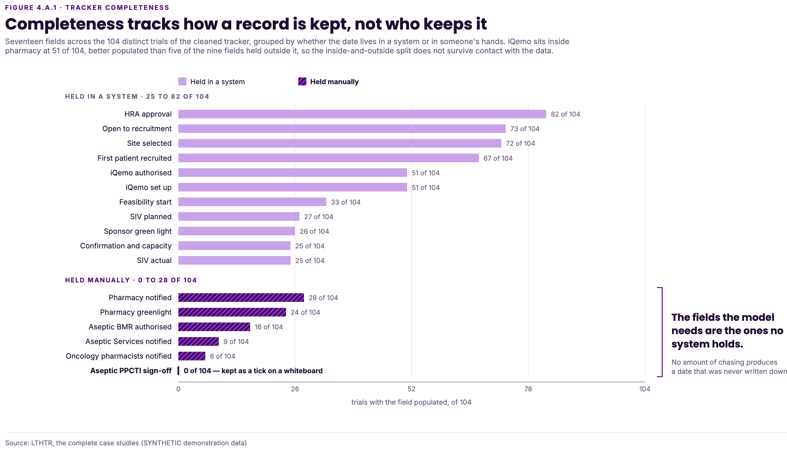
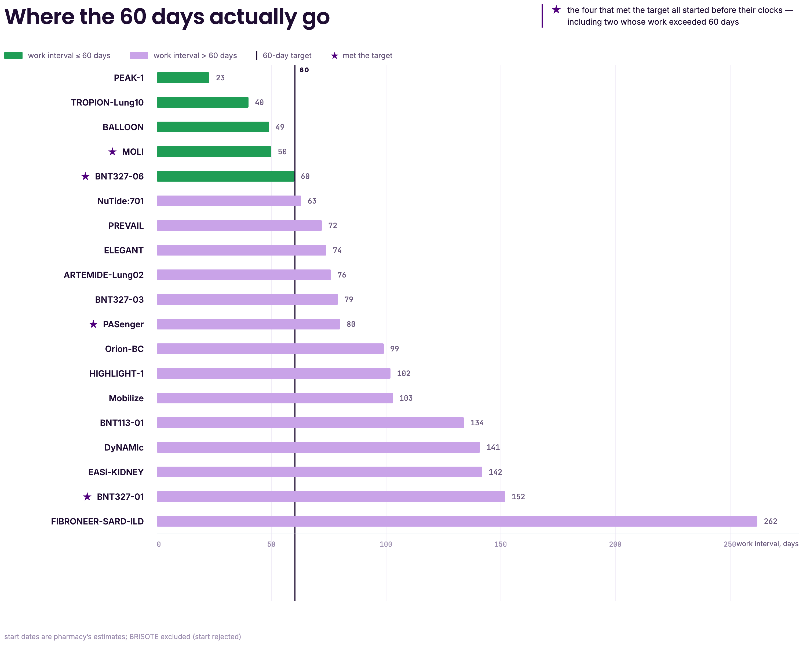
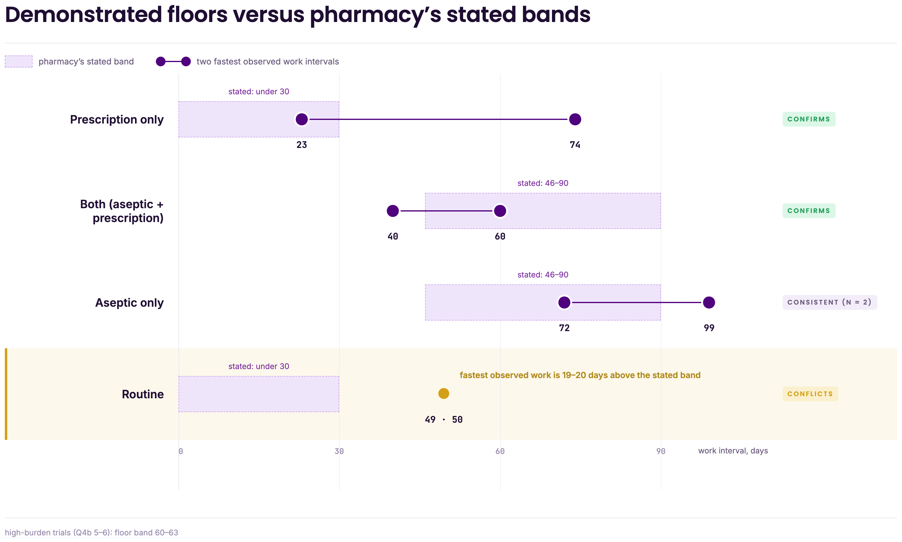

# 4. Methodology

> **Draft status.** Fifth draft, 2026-08-31. Four sections, with the preparation mechanism, the floor hierarchy and the burden provenance reconciled against the implementation. Counted body is §4.1 to §4.4; Appendices 4.A to 4.J and the provenance notes do not count.
## 4.1 Data and the methodology map

`[edit]` The analysis combines two operational systems the trust maintains with a case-study return collected for this study. The tracker establishes the historical problem and arrival pattern, while the case-study return supplies the study-level timing, pathway and burden inputs that neither operational system provides completely; Appendix 4.E records the evidential status of each.

**Table 4.1**

*The three sources and the role each plays*

| Status                   | Source                      | What it supplies                                                                                  | Role and limitation                                                                                                                        |
| ------------------------ | --------------------------- | ------------------------------------------------------------------------------------------------- | ------------------------------------------------------------------------------------------------------------------------------------------ |
| Operational system       | CTIMP 150-day tracker       | Problem scale, arrival rate, and the median 8-day hand-over of equation (4.1)                     | 104 trials, 23 with a measurable pharmacy duration                                                                                         |
| Operational system       | Prioritisation Tool records | Prospective view of studies before pharmacy set-up                                                | No recoverable history for trials already in set-up; its recorded burden field does not differentiate the studies and is not a model input |
| Collected for this study | The case-study return       | Every per-study parameter: clock anchors, pharmacy start, green light, pathway flags, burden rank | 20 finished CTIMPs, August 2026                                                                                                            |

`[edit]` The two operational systems do not join, and the case-study return's set-up starts are retrospective estimates rather than recorded events.

`[edit]` Two synthetic constructs supplement, but do not replace, the observed data: a synthetic standing queue, which tests the delivery reliability of a plan promising several on-time completions (§5.3; Appendix 4.G), and generated portfolios, which test whether the selection rule’s advantage survives variation in arrival timing, pathway mix and duration (§5.1; Appendix 5.A). Neither represents LTHTR's future portfolio, and the generated cases do not test preparation or hand-over interventions.

**Figure 4.1**

*From operational records to research-question evidence*

![Flowchart in five bands. The three sources of section 4.1 feed the five planning inputs constructed in section 4.2: available window, duration basis, waiting time and lateness weight, the run inputs of approval wait, commitment limit and cycle length, and the planning lead. A pale dashed strip beneath holds four items recorded but not used as active inputs: the value score, the inactive duration credit, the observed segments, and the committee route. The inputs enter a binary integer programme with two lexicographic objectives, on-time count then weighted lateness, which feeds the five reported analyses of section 4.3, four tagged with the question they answer. A dashed strip at the foot carries the verification evidence of section 4.4 and Appendix 4.C.](figures/fig4_1_methodology_map.png)

## 4.2 Constructing the planning inputs

Four quantities decide a plan. Appendix 4.J tabulates every parameter, its source, and the two quantities deliberately excluded.

### 4.2.1 Days available, which is not days remaining

A trial’s available time is the period from the point at which pharmacy can begin work to its due date:

$$\alpha_i = due_i - \max(\text{today}, \; \text{queue entry}_i) \tag{4.1}$$
The calculation subtracts hand-over delay that is still ahead of the trial, but not delay already served. This distinguishes the nominal 60-day deadline from the time pharmacy can actually use; Figure 4.2 illustrates the distinction.

**Figure 4.2**

*Hand-over consumes target days; preparation costs the target nothing*

*Note.* A schematic of the model's structure, not a measurement. Measured distributions are in Appendix 4.D.
### 4.2.2 Set-up duration, treated as uncertain

The duration basis differs by analysis. Current-performance regimes use elapsed case-study durations, whereas the demonstrated planning floors are derived from recorded work intervals. All duration measures end at pharmacy green light, but their start events differ; Appendix 4.H defines each interval and Appendix 4.B considers the resulting overlap with approval delay. Across the 19 usable work intervals, the median was 79 days, with a range of 23 to 262 days; five fitted within the 60-day target.

**Table 4.2**

*The five duration regimes*

| Regime                                      | What it represents                                                                                                                        | Where used                 |
| ------------------------------------------- | ----------------------------------------------------------------------------------------------------------------------------------------- | -------------------------- |
| 0.8 times the case-study medians            | Current performance 20% faster                                                                                                            | Appendix 5.A               |
| 1.0 times the case-study medians            | Current performance                                                                                                                       | Appendix 5.A               |
| 1.2 times the case-study medians            | Current performance 20% slower                                                                                                            | Appendix 5.A               |
| The demonstrated work floors                | Routine 50; Prescription-only 30; Aseptic-only 72; Both 60 days. A 63-day overlay applies only to high-burden studies on the Both pathway | §§5.1 to 5.6, Appendix 5.A |
| The pooled first-quartile figure of 62 days | One achievable benchmark across pathways                                                                                                  | Appendix 5.A               |

`[edit]` High burden means a rank of 5 or 6 on the scale pharmacy returned; Appendix 4.H distinguishes the burden-band minima, the pathway floors and the 63-day overlay, and Appendix 4.F explains why that rank is the one used.

`[edit]` The floors are demonstrated-achievable standards rather than forecasts or raw minima; Appendix 4.H derives and audits them. Results computed on them describe an optimistic operating condition rather than an expected one.

### 4.2.3 Preparation and approval

Preparation does not shorten the total work a trial requires; it moves part of that work outside the target window. The case studies suggest that earlier starts change how much work falls within the target window rather than the observed work duration itself: work intervals did not differ detectably between early and late starters, whereas on-time outcomes did (Appendix 4.I).

The reported preparation analysis represents an earlier planning lead, which for committed trials increases the time available before the 60-day deadline. It is interpreted operationally as work that can begin before the target clock starts, rather than as evidence that underlying set-up duration is shorter. Writing $\ell_i$ for the lead assigned to a committed trial:

$$\alpha_i^{\text{lead}} = \alpha_i + \ell_i \tag{4.2}$$

`[edit]` The lead is granted only to committed trials and is zero in the base case; Appendix 4.J.3 gives the implementation.

The base analysis does not charge pre-window preparation against the cycle commitment limit. This isolates the time benefit of earlier preparation from its operational resource cost; Appendix 5.E tests the sensitivity of that simplification by reducing the concurrent capacity available to the plan.

`[edit]` The implementation retains a separate duration-credit capability, but it is inactive in every reported analysis and produces no Chapter 5 result; its specification and verification are retained in Appendix 4.J.4 and Appendix 4.C, Tests 24 to 35.

Final approval is a shared, load-dependent queue. The wait $g_n$ uses the Pollaczek-Khinchine formula for a single server, exact when its assumptions hold and needing only the mean and variability of approval time, not its shape, which this study cannot observe:

$$g_n = \frac{\rho}{1-\rho} \cdot \frac{1+\kappa^2}{2} \cdot s, \qquad \rho = \min\left(0.95,\; \frac{n\,s}{A}\right) \tag{4.4}$$

`[edit]` Approval time is unobserved and is therefore treated as a sensitivity parameter; Appendix 4.B records the queueing assumptions, the utilisation and variability values, and the overlap analysis.

## 4.3 Experimental design

Every run builds a plan by the process in Figure 4.3, differing only in what it varies before that process starts and records after it ends. The model maximises on-time completions first and then minimises weighted lateness among tied plans. `[edit]` For §5.6, the model also reports the least-late plan at each achievable on-time count to display the trade-off; these are count-constrained comparisons, not alternative lexicographic optima. Appendix 4.J provides the formulation and solver settings.

**Figure 4.3**

*Solution construction process*

![Flowchart of one planning solve. A parallelogram, Assemble queue at planning date, leads to a process box, Apply eligibility gate. A decision diamond, Any eligible trial? leads on No to a terminator, Return empty plan with reasons. On Yes it leads to a process box, Set the available window including any planning lead, the duration basis and the approval wait, then to Solve P1, maximise on-time count. That value is fixed, then Solve P2, minimise weighted lateness within the fixed P1 value. A decision diamond, Optimality proven? returns on No to a terminator, Raise, no plan returned, and on Yes to Return committed plan, deferred trials and per-row status. A dashed return arrow from the returned plan back to the assemble box is labelled next planning month.](figures/fig4_3_solution_construction.png)

*Note.* The dashed return arrow applies to the historical replay only: each month is solved independently and no slot is held open for a later one.

**Table 4.3**

*Analysis-to-question map*

| Analysis | Data basis | What varies | What it measures | Question |
| --- | --- | --- | --- | --- |
| Historical planning replay | Observed queues | 25 monthly decision points, 2024 to 2026 | On-time trials, committed set | SQ1 |
| Commitment-limit sweep `[edit]` | Observed queues | Commitments per cycle, 1 to 6 | Whether raising the commitment limit changes on-time completion or weighted lateness | SQ2 |
| Lever sensitivity | Observed queues | Preparation, hand-over, queue entry, approval, target window | Which change raises the ceiling | RQ, SQ2 |
| Plan-delivery simulation | Observed and synthetic queues | 10,000 duration draws on one plan | Reliability of a promised outcome | RQ |
| Comparator robustness sweep | Generated portfolios | 9,000 portfolios, 90 scenario cells | Strict wins over arrival order, and their cost | SQ3 |
| Targeted-preparation comparison `[edit]` | Observed queues | Lead to high-burden committed trials only, against all committed trials | On-time coverage and the early-notification days required | Appendix 5.B |
| Preparation-capacity test | Observed queues | Preparation lead against reduced capacity | Whether the preparation finding survives | Appendix 5.E |

Nineteen case studies enter the replay, being those with both clock anchors; BALLOON has no site-selected date and BRISOTE no recorded start. Appendix 4.J holds the run settings, of which one hands-on day per approval is the only input in Chapter 5 not measured.

`[edit]` Two simulations are reported separately. The plan-delivery simulation tests the reliability of a selected plan under duration uncertainty, whereas the robustness sweep tests whether the selection rule outperforms arrival order across generated portfolios. Appendix 4.J specifies their distributions, settings and reporting rules.

### 4.3.1 The comparator and the robustness sweep

`[edit]` **The comparator is arrival order** (§3.1): it commits the longest-waiting eligible trials up to the same commitment limit as the model. Both plans run through Figure 4.3 under identical windows, duration assumptions and approval waits, so any difference arises from the selected set alone. Because practice may informally expedite some studies, the comparator result is an upper bound on the model's advantage over routine practice.

`[edit]` The sweep generates portfolios that vary arrival timing, pathway composition and duration regime, and reports the count in which the model places strictly more trials inside the window, with ties and the weighted-lateness difference beside it. Appendix 4.J.6.1 specifies the design and states why ties are read at cell level rather than pooled. **Table 5.A.2 summarises the sweep by duration regime and is the principal test of SQ3**; Appendix 5.A holds the grid.

## 4.4 Credibility, assumptions and boundaries

`[edit]` **Verification, reproducibility and face validity.** Automated tests verify input construction, optimisation logic, simulation behaviour and agreement between enumerated and solver solutions, with the full inventory in Appendix 4.C. All simulation runs use fixed seeds and save dated outputs, so Chapter 5 figures can be regenerated exactly. R&I and pharmacy reviewed the process representation and input definitions, which constitutes face validity from process owners rather than independent validation.

**A known overlap, bounded rather than removed.** `[edit]` Each planning duration ends at the pharmacy green light, which is the approving signature, so it already includes part of the wait that equation (4.4) adds separately. That component is dated in no system and cannot be separated, so the overlap is retained as a bounded conservative approximation rather than an empirically identified separation of work and approval delay; Appendix 4.B gives the assumption audit and the sensitivity result.

**What the evidence cannot establish.** Three limits bound every result. Set-up start dates are estimates, so the durations of §4.2.2 carry recall error the data cannot quantify. Hands-on approval time is unmeasured, so the checks above verify the implementation and not the formulation behind equation (4.4); testing that needs a separate model of the approval-signature queue, recorded as future work in Chapter 6. And the generated data of §4.3 answer questions the observed queues cannot, but do not evidence the trust's own portfolio. All three are handled by stated assumption, sensitivity analysis and simulation rather than presented as observed fact.

---
## Appendix 4.A: The tracker, its structure and its cleaning

Source, unmodified: `CTIMP Trials 150 Day Metric Tracker- 2026-07-30 SE.xlsx`. Outputs: a cleaned table holding one row per trial, a model-ready extract of the fields the model uses, and the log this appendix summarises. The source file was not edited at any point, so every output is a derivative and a corrected tracker can be processed by re-running the script.

**What the tracker is.** The CTIMP 150-day metric tracker is maintained in Research and Innovation and reported against the national targets. Its Report sheet holds one row per trial across 23 columns, of which the pharmacy block runs from the day the Research Setup and Governance meeting notifies pharmacy to the day pharmacy issues its greenlight. A second sheet, Raw data, holds 2,666 rows covering the whole portfolio including declined and closed studies, and is used only to estimate the arrival rate, since studies that never reached set-up carry no pharmacy milestones.

**How the pharmacy dates get into it.** By hand, from emails, local folders and the trust's quality system, with the aseptic figures arriving separately from the Pharmacy Quality Lead. None of it is a system export, so a blank records a retrieval failure rather than an event that did not happen. Two consequences. The aseptic sign-off is a tick on a whiteboard, so there is no date to retrieve. And trials before 2023 carry only HRA approval, site selected and the open-to-recruitment date, the pharmacy fields not being collected then; since those two are the clock anchors, an old trial's deadline is computable while its duration is not.

**What the tracker does not hold.** Across the 104 distinct trials the cleaned file holds 28 pharmacy notification dates and 24 pharmacy green lights, no PPCTI sign-off dates at all, and 9 trials with no complexity tier. Figure 4.A.1 sets every field against the rest. The gap is structural rather than random, but it does not fall where the obvious reading suggests. It tracks whether a record is held in a system, not which team owns the field. iQemo is pharmacy's own and is a digital system, and its dates are present for 51 of the 104 trials, better populated than 5 of the 9 fields arriving from outside pharmacy. The aseptic PPCTI sign-off, kept as a tick on a whiteboard, is empty for all 104. What cannot be retrieved is what was never written into a system, which is why chasing pharmacy would not have produced these dates and why the case studies were requested instead.

**Figure 4.A.1**

*Field completeness across the cleaned tracker, grouped by how each record is kept*

*Note.* Computed on the 104 distinct trials of the cleaned file. A blank is a date that could not be retrieved, not a step that did not happen.

**One field reported and then set aside.** Confirmation and capacity to the *sponsor's* green light has a median of exactly one day across the 23 trials holding both dates. That is not a measure of governance speed. The trust's own account is that the sponsor's green light is an announcement made once everything else is complete, so the one day measures the announcement, not the process behind it. It is a different event from the pharmacy green light of §4.2, which ends set-up; the two are months apart and only the second bounds segment C. It is recorded here so that no reader treats it as evidence that governance is fast.

**The 4 faults and their treatment.**

| Fault | Extent | Treatment |
|---|---|---|
| Trials stored as two half-filled rows | 14 pairs | Merged on a normalised title, each field taking the single non-empty value available |
| "As above" in place of a date | 18 cells | Replaced with the value in the row above, which is what the phrase refers to |
| Dates held as `dd/mm/yyyy` text | 19 cells | Parsed to real dates |
| "Pending" in a date column | 4 cells | Left blank, since it is not a date |

The two positional and text faults were the more damaging of the four relative to their size. All 18 "as above" cells and 8 of the 19 text dates sat in the pharmacy columns, so nearly the whole of both notification columns was invisible to any calculation that read them as dates.

**How the split rows were merged.** Rows were grouped on the trial title reduced to lower case with punctuation and bracketed protocol codes removed. Within a group each field took the single non-empty value available, and the longer title was kept because it carries the protocol code. Eleven of the 14 pairs merged with no conflict at all. Most apparent conflicts elsewhere were an "as above" against a real date, or a text date against the same date stored properly, and both dissolve once the other 2 faults are corrected.

**The three unresolved trials.** Where the two rows of a pair disagreed on a real value, the field was left blank and logged. AMPLITUDE differs by 2 to 3 years on 4 fields, with both sets internally consistent, which suggests two different studies sharing a short title rather than one split record. TAK-079-3001 differs on 3 fields, one of which looks like a transposed day and month while the others do not. Orion-BC differs by one day on a feasibility start date and affects no model quantity. Only the second costs anything: its blanked pharmacy green light removes the trial from the sample of measurable pharmacy durations.

**What the clean-up changed.**

| Quantity | Before | After |
|---|---|---|
| Distinct trials | 118 | 104 |
| Pharmacy set-up sample | 24 | 23 |
| Set-up median | 96 days | 95 days |
| Set-up mean | 105.7 days | 105.9 days |
| Within 60 days | 2 of 24 | 2 of 23 |
| Work in progress, mean | 3.41 | 3.51 |
| Arrival rate | 0.97 per month | 1.00 per month |
| Trials carrying a complexity tier | 90.7 per cent | 91.3 per cent |

**An internal consistency check.** An arrival rate of 1.00 trials per month against a 95-day median sojourn implies 3.48 trials in progress by Little's Law, against 3.51 observed, a gap of 0.9 per cent. It is the only check available on the cleaned tracker that does not depend on the fields the trust cannot supply.

**What was left alone, and why.** 4 items were not repaired because repair would mean invention rather than correction: the PPCTI column, empty for all 104 trials because the step is recorded as a tick on a whiteboard; 9 trials with no complexity tier, which cannot be inferred; the sparse pharmacy dates, since cleaning cannot create a record that was never made; and the three conflicts above. The start of the 60-day clock is also untouched, being a definition rather than a data fault.

---

## Appendix 4.B: Assumptions behind the approval wait

Equation (4.4) is the Pollaczek-Khinchine formula for an M/G/1 queue. The formula gives the exact long-run mean waiting time when its assumptions hold. Low utilisation reduces the size of the predicted wait. The table below sets out each assumption, what it means, and how it applies to this service.

| Assumption                      | What it requires                                                                                                                               | Evidence for this service                                                                                                                                                                                                                            | Status                                       |
| ------------------------------- | ---------------------------------------------------------------------------------------------------------------------------------------------- | ---------------------------------------------------------------------------------------------------------------------------------------------------------------------------------------------------------------------------------------------------- | -------------------------------------------- |
| Poisson arrivals                | Work reaches the Work reaches the approver independently and is dispersed over time rather than arriving in batches spread out, not in bunches | A trial's clock starts at HRA approval or site selection, both set by the sponsor and the regulator rather than by the trust. Trials therefore arrive at their own pace. The fixed committees do not batch the signature, for the reason given below | Met, subject to the batching rationale below |
| General service time            | Only the mean and the coefficient of variation are needed                                                                                      | Pharmacy has been asked to provide direct information on approval time. The formula itself does not require approval times to follow a normal, lognormal, or other specified distribution.                                                           | Met                                          |
| Single server                   | One approver, with work queueing behind whatever they are already doing                                                                        | The trust describes one approving person for pharmacy set-up. Pharmacy adds (August 2026 return) that the sign-off can be delegated to the operational manager when most processes are already approved                                              | Approximation, conservative: a second signer can only shorten the wait |
| Work-conserving, non-preemptive | The approver is never idle with work waiting, and never abandons a part-finished approval                                                      | This is consistent with the described process. It also means that the mean wait does not depend on the order in which trials are approved.                                                                                                           | Met                                          |
| Unbounded queue                 | The approver does not remain idle while approval work is waiting and does not abandon a partly completed approval                              | Trials wait for the signature. None are abandoned for want of one                                                                                                                                                                                    | Met                                          |
| Independent service times       | The duration of one approval does not depend on the duration of other approvals or on the number waiting                                       | Not observable in the available records.                                                                                                                                                                                                             | Assumed, recorded as a limitation |
| Steady state, $\rho < 1$        | On average, the approver can complete work faster than new approval requests arrive.                                                           | The commitment cycle resets monthly, so the service may not fully settle into a long-run average.                                                                                                                                                    | Assumed, recorded as a limitation |

The coefficient of variation, $\kappa$, is not identified by the available records. Equation (4.4) requires the variability of pharmacy sign-off time, but no direct observations of sign-off are available. The reported model runs therefore use $\kappa$ =1.55, the coefficient of variation calculated from 51 iQemo template-build records as the most complete pharmacy-related field in the tracker. This is a temporary substitution, not a validated estimate of approval-time variability.

The iQemo measure records the time from template set-up to authorisation. Its median is 16 days, and much of that interval is likely to be time spent waiting for the template to be processed. The required approval-time measure, by contrast, concerns the duration of the signing activity itself. The proxy therefore measures a combined waiting-and-signing interval rather than signing time alone.

The direction of the error cannot be established. The observed interval combines waiting and signing time, and adding waiting can change both the mean and the variance. Consequently, the coefficient of variation of the combined interval may be lower than, similar to, or higher than the coefficient of variation of signing alone.

This depends on the relative variability of waiting and signing time, and on whether they move together. Neither is identified in the records. Independence cannot be tested and should not be assumed.

The central problem is identification. The 16-day iQemo interval combines waiting and signing, but the available data do not separate those components. Its coefficient of variation therefore does not identify the coefficient of variation of signing time. The true signing-time $\kappa$ could be lower than, close to, or higher than 1.55. The proxy consequently places little constraint on  $\kappa$.

The value is retained solely to allow Equation (4.4) to be evaluated while direct pharmacy sign-off data are unavailable. It is not treated as an estimate of signing-time variability, and no substantive conclusion in this thesis depends on $\kappa$ =1.55 being accurate.

The observed proxy may not vary in the same way as sign-off time, and direct sign-off observations would be needed to test whether the two are comparable. Pharmacy was therefore asked for its quickest, usual and longest hands-on sign-off times. Those responses defined plausible bounds rather than an exact estimate, and the gate waiting time was tested across them; Appendix 5.C reports the result.

The three responses gave a minimum-to-maximum range, but Equation (4.4) requires the coefficient of variation $\kappa$, which depends on both the mean and the standard deviation. A range measures the distance between the extremes rather than the typical spread around the mean, so it had to be converted into an approximate standard deviation before $\kappa$ could be estimated.

Hartley’s $d_2$ provides a standard way to convert the range of a normal sample into an estimated standard deviation, and dividing by four is a practical approximation when the range represents roughly 25 observations. Approval times are unlikely to be normally distributed, so this was a convenience assumption rather than a claim about their true distribution. It was used because the available evidence consisted only of three broad bands returned by the trust.

Chapter 5 uses $\kappa = 1.55$, because the pharmacy response was not available when the model runs were produced. Direct observations of hands-on approval activity remain unavailable, so the reported approval wait is a provisional approximation rather than an empirically identified parameter. The approval-wait sensitivity and the gate-overlap check were nevertheless completed, as §4.4 reports: removing the approval wait changed neither the on-time ceiling nor the committed set in any tested replay, and changed the comparator result only in magnitude, from a $36\%$ to a $38\%$ strict-win rate. That bounds the approximation; it does not calibrate it, and direct observations of approval activity would still be required to do so.

The conversion has three limitations. If approval times are right-skewed, a normal-based conversion may mislead; the number of observations behind the recalled quickest and longest times is unknown; and in a skewed distribution the range may not be symmetric around the mean. A fitted lognormal or gamma distribution would be preferable, but would require actual sign-off observations rather than three recalled bands.

A separate unresolved input is $A$, approver availability per cycle. It is held fixed because the trust has not supplied the required information, and the assumption is documented in §4.2.3. 

DEAS and GMO committees release studies in batches, which might be conflicted with the model’s arrival assumption. However, approval occurs after a long and variable set-up period. That period disperses studies from each committee batch across later months, so much of the original batch pattern is lost before studies reach the approval gate.

This reasoning depends on approval occurring near the end of set-up. It also does not mean that the 95-day duration and the $\kappa$ estimate should be treated as parameters from the same distribution: they are drawn from different samples and should remain separate.

**The overlap between the wait and the duration, checked 31 August 2026.** Every duration the model plans on ends at the pharmacy green light, which is the approving signature, so any wait for that signature sits inside the observed interval on the work basis as well as the sojourn basis, and equation (4.4) adds it again. The size at the loads this service runs:

| Committed | $g_n$ | % of the 30-day prescription-only floor | % of the 60-day Both floor |
| --- | --- | --- | --- |
| 2 | 0.46 d | 1.5% | 0.8% |
| 3 | 0.79 d | 2.6% | 1.3% |
| 6 | 2.96 d | 9.9% | 4.9% |

Removing the wait entirely changes no on-time ceiling and no committed set across the 25 decision points at every commitment limit from one to six, on the demonstrated floors and on the current-performance medians alike. The comparator finding of §5.1 is unchanged in kind, wins occurring in the floors regime only and nowhere else, while its rate moves from 36% to 38%. Weighted-lateness magnitudes do move, by up to 23 days in one cell, because the term is additive and common to every plan of a given size: it shifts the level without reordering the plans, which is why no selection changes.

The overlap cannot be removed empirically, because the embedded waiting is dated in no system and its approval component cannot be separated from waiting for aseptic review, sponsor documentation or committee clearance. It is therefore retained rather than corrected. Retaining it is the conservative choice, since removing it increases the model's measured advantage. Full output: `Experiments/eda_output/real_run/GATE_OVERLAP_2026-08-31.md`.

`[edit]` **The values behind equation (4.4).** Utilisation $\rho$ is about 0.32 at realistic limits, and at $\kappa = 1.55$ the variability term raises the wait by 70%. Tabulating the formula for each committed count before the model runs admits a non-linear wait into an otherwise linear model. Approver availability $A$ is the one parameter the trust has not supplied; it moves where the capacity ceiling falls but not whether one exists, so §4.3 treats the ceiling as a pattern rather than a number.

---

## Appendix 4.C: What the 73 automated tests check

§4.4 reports 73 tests. This appendix says what each one checks, so the count can be verified and any single check found. Every test runs whenever the code changes, and a failing test stops the change rather than reporting the problem afterwards.

### C.1 The selection model, tests 1 to 35

*The model of Chapter 3, and the two refinements of §4.3.*

**Three tests cover a capability the model does not use.** The implementation retains the value level and its eligibility floor behind a switch that is off in every run reported here, because removing working code is a larger change than leaving it inert. Tests 9, 16 and 17 cover retained value and eligibility capabilities that are disabled in every reported analysis. They are included for implementation completeness; no Chapter 5 result depends on them.

| | The test checks that |
|---|---|
| 1 | The demonstration instance loads with 16 trials covering all four pathways |
| 2 | The demonstration durations are short enough to show the on-time mechanism, which the measured durations are not |
| 3 | The solver finds the same plan as checking every possible plan one at a time |
| 4 | The solver agrees with the simpler ranking rule wherever that rule is known to be correct |
| 5 | No plan commits more trials than the limit allows |
| 6 | The model commits fewer trials than the limit when an extra trial would cost a rescue |
| 7 | Ranking on lateness alone rescues no trial, which is why on-time is ranked first |
| 8 | Putting on-time first never improves lateness; it can only cost lateness |
| 9 | A study scoring below the value floor is closed rather than left in the queue |
| 10 | An empty queue returns a plan rather than an error |
| 11 | The capacity check made before solving agrees with what the solver returns |
| 12 | A trial that cannot be planned is returned marked as blocked, not quietly dropped |
| 13 | Solving through the planner interface gives the same plan as using the model directly |

*Inactive value and eligibility capability*

|     | The test checks that                                                                          |
| --- | --------------------------------------------------------------------------------------------- |
| 14  | The withdrawn setting has been removed from the model, not merely set to zero                 |
| 15  | A request still using it is refused rather than silently given an unchanged plan              |
| 16  | Switching the value objective on never costs an on-time trial                                 |
| 17  | Portfolio value rises with the commitment limit, which is why trading a trial away never pays |

*Segment B, the days lost before a trial reaches pharmacy*

| | The test checks that |
|---|---|
| 18 | A trial already in pharmacy's queue does not lose the same days twice |
| 19 | A trial not yet handed over loses the days before hand-over |
| 20 | A trial R&I still holds is planned on the median hand-over and marked as assumed |
| 21 | A trial with no usable dates is blocked rather than given an invented window |
| 22 | Subtracting the hand-over can cost a trial its rescue, which is the point of the correction |
| 23 | An assumed hand-over is always reported as assumed, never as a recorded date |

*Inactive duration-credit capability*

Tests 24–35 cover a separate duration-credit capability. Its cap is zero in every reported analysis, so these tests do not describe the planning-lead mechanism used in Chapter 5.

| | The test checks that |
|---|---|
| 24 | With no credit set, every plan matches the plan produced before the credit existed |
| 25 | With both conditions met, the credit shortens the set-up |
| 26 | Complexity alone earns nothing without the sponsor green light |
| 27 | The green light alone earns nothing without complexity |
| 28 | A Phase 1 study earns the credit without needing aseptic work |
| 29 | Every input to the credit comes from the data request; none is invented |
| 30 | The planner can add a study the rule would miss |
| 31 | The planner can withhold the credit from a study the rule would give it to |
| 32 | The planner cannot waive the sponsor green light |
| 33 | The credit never shortens a study below one day |
| 34 | A negative credit is refused |
| 35 | The credit can turn a missed deadline into a rescue |

### C.2 The robustness experiment, tests 36 to 40

*Tests 36 and 37 are the two hand-worked checks of §4.4.*

| | The test checks that |
|---|---|
| 36 | The four-trial instance of Appendix 3.A gives the same answer worked by hand and computed by the model |
| 37 | The lateness calculation matches Equation (3.5) worked by hand |
| 38 | A scenario regenerates exactly from its seed |
| 39 | The comparator commits the longest-waiting trials, as §4.3.1 describes |
| 40 | Checking every plan one at a time and solving directly return the same plan |

### C.3 The plan-level uncertainty run, tests 41 to 52

*Tests 41 to 43 fix the run's agreement with the plan it qualifies.*

| | The test checks that |
|---|---|
| 41 | With no variation in duration, the run returns the planning model's on-time count exactly |
| 42 | With variation, the promised count is not always achieved, which is the point of the run |
| 43 | Only the set-up spread widens the drawn durations; the approval-time figure cannot |
| 44 | The reported distribution adds to one and never exceeds the number of trials committed |
| 45 | The pessimistic figure never reads higher than the average |
| 46 | The trial most likely to miss its deadline is reported first |
| 47 | A trial the plan cannot rescue is never shown as rescued |
| 48 | A larger plan carries a longer approval wait |
| 49 | A run repeats exactly from the same seed |
| 50 | A different seed gives a different result |
| 51 | An empty plan is refused |
| 52 | A run must have at least one repetition |

### C.4 Planning lead active in preparation analyses, tests 53 to 60

*Added with the signed lead of §4.2.3. Preparation relieves the clock and must never alter the work.*

| # | What it fixes |
| --- | --- |
| 53 | A planned lead extends the available window by exactly the lead |
| 54 | A zero lead leaves the window at the target |
| 55 | A negative lead, a planned late hand-over, shrinks the window by that much |
| 56 | A lead longer than the time to the clock start is clipped at the planning date, so a plan cannot bank days already passed |
| 57 | The lead never changes the tier duration |
| 58 | The lead never changes the effective duration, so capacity is untouched |
| 59 | A recorded queue-entry date always overrides a planned lead |
| 60 | A planned lead is flagged as assumed, and an observed lead is derived from the dates |

### C.5 The case-study ordering checks, tests 61 to 73

*The rules that stop an impossible date ordering entering the derivation, and the segment split itself.*

| # | What it fixes |
| --- | --- |
| 61 to 63 | A missing anchor, a green light before the set-up start, or a notification after the set-up start each stop the run |
| 64 to 66 | A set-up start before the clock start is **recorded, not refused**, returned in row order, and absent when the dates are ordinary |
| 67 to 70 | Segment A floors at zero while keeping its signed value; segment B carries its sign; segment C is absent rather than zero while a study is unreleased |
| 71 to 73 | The three segments reproduce the study's own clock interval, and the split is identical whichever module computes it |

*Note.* Test 64 exists because the rule it relaxes was previously a hard failure. Rejecting a negative segment B would have discarded the four studies that met the target, which is the finding of §5.2.

---

## Appendix 4.D: Segment statistics for the case studies

§4.2 defines the three segments and keeps only what the model consumes; this appendix holds the descriptive statistics behind that section's summary claims. Every count describes the 20 case studies and is produced by the same script as the body figures, so it regenerates whenever the pipeline is rerun.

**Table 4.D.1**

*Occurrence and duration of each segment across the case studies*

| Segment        | Studies where it occurs | Median days (range) |
| -------------- | ----------------------- | ------------------- |
| A, preparation | 5 of 19                 | 46 (4 to 141)       |
| B, hand-over   | 18 of 19                | 14 (−118 to 210)    |
| C, set-up      | 19 of 20                | 79 (23 to 262)      |

*Note.* The counts are not a partition; the segments are per-study attributes. Denominators differ because one study carries no clock anchor and one carries no usable set-up start. A study with no segment A was told after its clock had started, so no preparation window existed, which is a finding rather than a gap.

**Segment A exists on 5 studies of 19.** On the other 14 pharmacy was told on or after the clock-start day, so there was nothing to prepare within. Where the window does exist it is large, a median of 46 days and up to 141, with no case between 1 and 3 days. The window is therefore substantial or absent. `[edit]` This pattern motivates the planning-lead representation in §4.2.3: the preparation analyses test the effect of assigning an earlier planning lead to trials selected for commitment. The segment statistics are descriptive evidence; they do not themselves reduce the planning duration or determine a
preparation lead for every trial.

**Segment B is bimodal and a single median describes it poorly.** Fourteen studies have a positive hand-over, median 35 days and up to 210, consuming target days before pharmacy begins. Four are negative, at −4, −11, −33 and −118 days, meaning set-up began before the clock started. The pooled median of 14 days sits between two populations that mean opposite things, so the model carries the signed value per study rather than a central estimate, and §4.2.1's `handover_days` retains the tracker's 8-day figure for studies with no date at all. `[edit]`

**Segment C has a median of 79 days**, longer than the whole 60-day target before any hand-over is counted. Combined with a positive segment B on 14 of 19 studies, this is why no case study finished inside the target from a standing start, and it is the result Chapter 5 opens with.

---

## Appendix 4.E: Questionnaire-derived operational inputs

A structured written request was used to obtain information unavailable from the trust's operational systems. It was sent after the meetings of 5 and 6 August 2026 and returned between 17 and 20 August, in three parts: Part 1 to both teams for the per-study fields of §4.2, Part 2 to Research and Innovation on scoring and committees, and Part 3 to Pharmacy Clinical Trials, the only part supplying a stated duration. The completed returns are retained in the project archive and are not reproduced here, because they contain operationally sensitive study and service information. Only responses used as model inputs or assumptions are summarised below.

**Table 4.E.1**

*Questionnaire-derived inputs and their evidential status*

| Input | Model use | Evidential status |
| --- | --- | --- |
| Pharmacy set-up start | Duration and reconstructed window | Retrospective estimate |
| Pharmacy green light | Completion endpoint | Recorded milestone |
| Pathway requirements | Duration basis | Study-specific reported attribute |
| Pharmacy burden rank | High-burden classification and the overlay | Elicited ordinal judgement |
| Preparation lead | Sensitivity input | Scenario assumption |
| Hands-on approval time | Queue sensitivity | Elicited range, not an observed time series |
| Delegation of approval | Queue-model caveat | Process-owner account |

**Table 4.E.2**

*Set-up duration by pathway as stated by pharmacy, Part 3 question 1*

| Pathway | Stated band |
| --- | --- |
| Routine: no electronic prescription, no aseptics | Under 30 days |
| Electronic prescription only | Under 30 days |
| Aseptics only | 46 to 90 days |
| Both electronic prescription and aseptics | 46 to 90 days |

*Note.* The two aseptic rows were answered by marking two adjacent bands; the union is recorded here.

The stated bands are used only as a service account against which observed work floors are audited, in Figure 4.H.2; they are not substituted for the duration inputs used in the model. Two further Part 3 answers enter the thesis: the sustainable set-up rate on core hours is two studies a month, unchanged by the additional funded hours; and the pharmacy green light can be delegated to the Operational Manager once the lead is content that most processes are approved, which is why §4.2.3 and Appendix 4.B treat the single-approver assumption as a conservative approximation rather than a fact.

**Limits.** Part 3 carries one respondent. Its answers are recalled judgements rather than measurements, and bands rather than point values. They are used as a statement of what the service believes its standard times to be, which is the only role Chapter 5 gives them.

---

## Appendix 4.F: The pharmacy burden rank and the Prioritisation Tool

**What the tool measures.** The Prioritisation Tool, version 1.6, scores a study on eleven measures. Measure 4b, Operational Burden — Pharmacy and aseptics, is the pharmacy one. It carries five options running from −5.5 to 0, subtracting points because the tool prices set-up difficulty against a study's value. It is the finest-grained of the eleven measures and the only one that draws on pharmacy clinical trials, technical services, quality assurance, clinical and supply, and ePMA together.

**Why the tool's own scores could not be used.** Every study scored on the tool to date carries 4b = 0, its lowest-burden option, which reads as dispensary-led set-up of a low-complexity investigational medicinal product. Zero on every study is not a finding about the portfolio. The scoring group has no pharmacy member, so where pharmacy is not involved someone records that in free text, and where it is involved nobody in the room can judge the burden. Measure 4b is uncollected rather than flat. None of the scored studies appears in the tracker either (§4.1), so no tool score sits beside a set-up outcome.

**What is used instead.** The August 2026 return asked pharmacy to rank the case studies on pharmacy burden directly. The respondent used five distinct values, 2 to 6, on a rising scale where 6 is the most demanding. This dissertation carries that answer unchanged, as `q4b_burden_rank`. High burden means a rank of 5 or 6 throughout.

**The raw pharmacy burden rank is retained as an ordinal classification.** `[edit]` It is used for grouping, to identify high-burden studies, to interpret observed work-floor evidence, and to apply the conditional 63-day adjustment where a study is both high burden and on the Both pathway. It does not enter a Prioritisation Tool total, a value objective or an eligibility criterion, and it is never combined with the value score $v_i$. Keeping the raw response also keeps it auditable, because a reader who later obtains the five option values can map it, and nothing computed here would have to change.

**A derived scale is used for reporting portfolio composition, and for nothing else.** `[edit]` Comparing the burden of two committed portfolios by counting trials assumes every trial costs the service the same, which the work-floor evidence contradicts. For that comparison alone, a derived routine-trial-equivalent planning scale maps the burden bands to relative weights of 1.00, 1.74 and 2.61, from the ratios of the fastest observed work intervals of 23, 40 and 60 days reported in Table 4.H.3. This transformation is used in Figure 5.8 only. It is not a direct measure of staff time or hands-on workload, and no burden-resource budget is active in any reported optimisation run.

**Table 4.F.2** `[edit]`

*The derived routine-trial-equivalent planning scale*

| Pharmacy burden rank | Derived weight | Basis |
| --- | --- | --- |
| 2, routine | $1.00$ | Reference: the 23-day fastest observed work interval |
| 3 to 4, moderate | $1.74$ | $40 / 23$, from the 40-day fastest observed interval |
| 5 to 6, high | $2.61$ | $60 / 23$, from the 60-day fastest observed interval |

*Note.* The weights are derived from fastest observed work intervals in a 19-case set, and the band medians themselves are indistinguishable (Appendix 4.I). They provide a planning scale for comparing the burden composition of alternative committed portfolios, and are not measured staff-time ratios: a weight of 2.61 does not assert that a high-burden study consumes 2.61 times the staff hours of a routine one. Chapter 6 records direct measurement of pathway-specific work as the prerequisite for modelling resource use in staff time rather than in commitment counts.

---

## Appendix 4.G: Construction of the synthetic standing queue

Section 5.3 requires a queue capable of supporting a non-zero planned on-time outcome. The observed case-study queues cannot provide such a plan without first assuming preparation. A synthetic standing queue of sixteen studies was therefore constructed for the plan-delivery reliability simulation. It is not used in the observed-queue lever sensitivities of §§5.4–5.6 or in the generated-portfolio comparator robustness analysis.

**Table 4.G.1**

*What each parameter of the synthetic queue is taken from*

| Parameter     | Value                                                                                           | Taken from                                                                                                                                       |
| ------------- | ----------------------------------------------------------------------------------------------- | ------------------------------------------------------------------------------------------------------------------------------------------------ |
| Size          | 16 studies                                                                                      | Large enough to fill three commitment slots several times over, small enough for exhaustive enumeration                                          |
| Pathway mix   | 7 Both, 4 Routine, 3 Prescription only, 2 Aseptic only                                          | The case studies' own mix, and the trust's figure of roughly 60% needing aseptic work                                                            |
| Durations     | The Appendix 4.H work floors by pathway, with Q4b 5 to 6 studies on the Both pathway at 63 days | Appendix 4.D and the burden band of §4.2                                                                                                         |
| Burden rank   | Assigned by pathway from the observed distribution, not drawn at random                         | The case studies. A uniform draw on seven studies missed the top rank entirely on the first seed, which would have left the burden overlay inert |
| Clock anchors | Spread 15 July to 30 August 2026                                                                | A standing queue of unplanned studies is recent arrivals; older anchors would already have entered an earlier planning cycle                     |
| Notification  | 0 to 21 days after each study's own anchor, so no preparation window exists by default          | The case studies, where 13 of 19 were told after the clock had started                                                                           |
| Preparation   | None, except three studies whose site confirmation is still ahead                               | Matches the observed rate of accidental preparation                                                                                              |

The generator is seeded, so the queue regenerates identically. Its pathway mix and burden distribution are based on the case studies, but it is a scenario construct rather than a measurement or forecast of LTHTR's future portfolio. It is used only in the §5.3 plan-delivery reliability analysis.

---

## Appendix 4.H: The measured work floors and what consumes the window

This appendix distinguishes three related quantities. First, the burden-band minima of 23, 40 and 60 days are descriptive evidence about the slack observed within each burden group. Second, observed pathway-level work intervals are calibration evidence. Third, the pathway floors in Table 4.2 are the active duration inputs used in the reported planning analyses. The 63-day value is a conditional overlay that applies only where a trial is both high burden and on the Both pathway. These quantities are related but are not interchangeable.

`[edit]` Each floor is anchored on the two fastest work intervals its pathway has recorded, taking the second where a single minimum would rest on one noisy case, except prescription-only, which is set at pharmacy's stated band because its fastest case confirms it. The durations the model plans with are medians and floors of the case studies' own recorded work, not estimates. This appendix derives them and audits them against the bands pharmacy stated in the questionnaire. The four trials that met the target are a finding rather than a parameter and are reported in §5.2.

No case study met the 60-day target from a standing start. The four that achieved it did so only by starting early. Table 4.H.1 reports the three measures defined in §4.2.

**Table 4.H.1**

*Set-up performance of the case studies*

| Measure                                          | n   | Median (days) | Range     | Within 60 days |
| ------------------------------------------------ | --- | ------------- | --------- | -------------- |
| Clock interval (clock start to green light)      | 19  | 126           | 34 to 345 | 4              |
| Pharmacy-held interval (notified to green light) | 20  | 102           | 61 to 283 | 0              |
| Work interval (set-up start to green light)      | 19  | 79            | 23 to 262 | 5              |

The work itself is not the main cause of delay. Figure 4.H.1 shows that five of the 19 recorded work intervals fit within 60 days.

Delays occur before and around the work, in activities not captured by the tracker. Table 4.H.2 lists these factors from the pharmacy team’s meeting records. As none is dated in any system, recorded duration reflects both congestion and work.

The chapter therefore separates the two: the median shows current performance, while the fastest cases show what the service can achieve.

**Table 4.H.2**

*Recorded reasons the window is consumed outside the work (pharmacy team meeting record, 30 June 2026)*

| Mechanism | Recorded example | Dated in any system |
| --- | --- | --- |
| Sponsor-documentation dependency blocks sign-off | An identity card waiting on vial photographs | No |
| Clarification loops on contradictory, jargon-heavy sponsor documents | "all these emails have to happen to check our understanding" | No |
| Contradictions inside the pharmacy manual itself | Thaw time stated differently in two places | No |

**Figure 4.H.1**

*Recorded work intervals against the target*

The floors also test the durations stated by the trust. Figure 4.H.2 compares the two fastest recorded work intervals for each pathway with the duration band pharmacy gave in the August 2026 questionnaire (Appendix 4.E).

Three of the four pathways match their stated duration band. Routine does not. Pharmacy estimated that a study with no aseptic work or prescription build would take under 30 days, despite having roughly 52 days within the 60-day target. However, the two fastest routine cases, BALLOON and MOLI, took 49 and 50 days. As these were independent trials with almost identical durations, the gap is unlikely to reflect an isolated record.

Three explanations are possible, but this dataset cannot distinguish between them.

First, the recorded start date may be earlier than the actual start of work. Every set-up start date is an estimate based on recall (§4.2), so an early estimate would lengthen the recorded interval.

Second, the interval may include waiting time rather than work. A routine study may wait behind aseptic studies already assigned to the same staff, and the dataset does not distinguish between days worked and days open.

Third, the stated band may refer to hands-on effort rather than elapsed time. The questionnaire did not ask respondents to separate these measures.

The first two would mean routine work is faster than 49 days; the third would mean the band and the measurement are not comparable quantities. Separating them needs a further investigation for the trust.

The confirmed floors do not increase with pathway complexity. On the observed two-fastest-case measure, the combined aseptic-and-prescription pathway has a value of 40 days, below the Routine pathway. This is descriptive calibration evidence rather than the active planning
input. The model uses a 60-day Both-pathway planning floor, selected to avoid relying on a single unusually fast case. The floor rises instead with the burden a study carries, on the ranking defined in Appendix 4.F. Table 4.H.3 groups the 19 recorded work intervals by burden band.

**Table 4.H.3**

*Recorded work intervals by pharmacy burden band*

| Burden band | n | Fastest observed work | First quartile |
| --- | --- | --- | --- |
| 2, routine | 6 | 23 days | 42 days |
| 3 to 4, moderate | 7 | 40 days | 72 days |
| 5 to 6, high | 6 | 60 days | 62 days |

Burden separates the floors, not the distributions. The fastest case increases with each burden band, from 23 to 40 to 60 days, while the quartiles show no clear order and the medians are indistinguishable (Appendix 4.I).

The observed high-burden minimum reaches the 60-day target, indicating little observed slack from a standing start. This supports the planning concern but does not establish a universal duration rule for every high-burden trial. Its fastest recorded set-up already uses the full 60-day window, so it cannot meet the target from a standing start.

**Figure 4.H.2**

*Demonstrated floors against pharmacy's stated bands*

## Appendix 4.I: Statistical tests behind the work floors

Every test below is computed on the case studies by `Experiments/analyse_preparation_and_burden.py`. Non-parametric tests are used throughout because the samples are small and the durations are right-skewed.

**Table 4.I.1**

*Does preparation change the work, or only the clock?*

| Comparison                                  | Groups       | Result                                            | Reading                                                                                                                                          |
| ------------------------------------------- | ------------ | ------------------------------------------------- | ------------------------------------------------------------------------------------------------------------------------------------------------ |
| Work interval, early against late starters  | 4 against 14 | median 70 against 89 days, Mann-Whitney p = 0.721 | No detectable difference in recorded work interval was observed between early and late starters.                                                 |
| Met the target, early against late starters | 4 against 14 | 4 of 4 against 0 of 14, Fisher p = 0.0003         | Early starters were more likely to meet the target, indicating that earlier work changes how much of the process falls inside the target window. |

**Table 4.I.2**

*Does any recorded characteristic predict an early start?*

| Characteristic | Early | Late | Fisher p |
| --- | --- | --- | --- |
| Aseptic | 3 of 4 | 8 of 14 | 1.000 |
| Oncology | 3 of 4 | 11 of 14 | 1.000 |
| Phase 2 rather than 3 | 2 of 4 | 4 of 14 | 0.569 |
| Burden rank 4 or above | 2 of 4 | 7 of 14 | 1.000 |
| Chemotherapy ePMA | 3 of 4 | 10 of 14 | 1.000 |

No recorded characteristic showed evidence of predicting an early start in this small sample. The observed data therefore do not establish that earlier preparation is allocated systematically by study characteristics.

**Table 4.I.3**

*Does pharmacy burden predict duration?*

| Test                                                | Result                                             |
| --------------------------------------------------- | -------------------------------------------------- |
| Burden rank against set-up total, all studies       | Spearman rho = −0.065, p = 0.785                   |
| Excluding the single Tukey outlier                  | rho = +0.038, p = 0.878                            |
| Excluding the two longest                           | rho = −0.108, p = 0.669                            |
| Excluding the three longest                         | rho = −0.001, p = 0.996                            |
| Excluding two longest and two shortest              | rho = −0.222, p = 0.408                            |
| Burden 4 to 6 against 2 to 3                        | median 95 against 107 days, Mann-Whitney p = 0.447 |
| Within aseptic studies only                         | rho = +0.297, p = 0.374                            |
| Work interval, burden 2 to 4 against 5 to 6         | median 80 against 78 days, Mann-Whitney p = 0.831  |
| Work interval across the three bands of Table 4.H.3 | Kruskal-Wallis, 2 df, H = 1.171, p = 0.557         |

The correlation estimates vary in direction across exclusions and provide no stable evidence of an association at this sample size. The last two rows are the tests behind Table 5.3: the distributions do not separate by burden band, while the minima do, rising 23, 40, 60 days. A floor that moves without a distribution that moves is what a binding constraint looks like, and it is why burden is treated in this chapter as a duration fact rather than as a ranking of studies. Five exclusion rules are reported and no more: continuing until one crossed significance would be searching for a result rather than testing for one.

**Table 4.I.4**

*Do the pathways separate on duration?*

| Quantity | Test | Result |
| --- | --- | --- |
| Work interval by pathway | Kruskal-Wallis, 3 df | H = 0.118, p = 0.990 |
| Set-up total by pathway | Kruskal-Wallis, 3 df | H = 1.978, p = 0.577 |

No statistically detectable pathway difference was observed in this small sample. The pooled median is therefore retained for the current-performance duration regime, while pathway-specific demonstrated floors are reported separately as an achievable planning condition.

**On what these tests can and cannot show.** With 20 studies and 4 in the early group, they can rule out a large effect and not a modest one. The null results are reported as absence of evidence at this sample size, not as evidence of absence.

## Appendix 4.J: Model parameters, excluded quantities and run settings

This appendix holds the reference tables moved out of the body in the fourth draft. Nothing here is new; §§4.2 and 4.3 state the reasoning and this appendix carries the enumeration.

**Table 4.J.1**

*Model parameters and where each comes from*

| Parameter           | Meaning                        | Source                                                                                                                                                |
| ------------------- | ------------------------------ | ----------------------------------------------------------------------------------------------------------------------------------------------------- |
| $p_i$               | Set-up duration by pathway     | Duration basis selected for the analysis: case-study median regimes, demonstrated pathway floors, or pooled 62-day benchmark, as Table 4.2 specifies. |
| $\ell_i$            | Preparation lead, in days      | Equation (4.2). A scenario input, zero in the base case                                                                                               |
| $due_i$, $\delta_i$ | Due day and days remaining     | Equation (3.1) from site selected and HRA approval                                                                                                    |
| $\alpha_i$          | Days available to work         | Equation (4.1), which replaces $\delta_i$ in the on-time test                                                                                         |
| $a_i$, $w_i$        | Days waited and claim weight   | Queue entry to planning date, then equation (3.2)                                                                                                     |
| $g_n$               | Approval wait at $n$ committed | Equation (4.4), tabulated before the model runs                                                                                                       |
| $c$                 | Commitment limit               | Set by the service, varied in §4.3                                                                                                                    |
| $L$                 | Planning cycle                 | 30 days                                                                                                                                               |

### 4.J.1 Active planning inputs

**Set-up durations.** A finished case gives one observation, the days from the trial entering the pharmacy queue to pharmacy issuing its green light. Where a pathway holds fewer than 3 observations, its duration falls back to the pooled median and the fallback is reported with the figure.

**Waiting time.** Days waited run from queue entry, as §3.3 defines. The case studies provide both dates; where only notification is available, as in the tracker, it stands as a fallback proxy for queue entry.

**Available window and approval wait**. For each trial, the model evaluates the available pharmacy window $\alpha_i$, pathway duration $p_i$, and approval wait $g_n$ associated with commitment size $n$. The commitment limit $c$, planning-cycle length $L$, due date $\mathrm{due}_i$, nominal remaining days
$\delta_i$, and lateness weight $w_i$ are defined in §4.2 and used as specified in the reported analyses.

### 4.J.2 Recorded but excluded quantities

| Parameter | Meaning               | Source                                                            |
| --------- | --------------------- | ----------------------------------------------------------------- |
| $v_i$     | Value score           | The Prioritisation Tool as recorded, supplied rather than derived |
| $t$       | Eligibility threshold | Set by the service, varied in §4.3                                |

 **Value score and eligibility threshold.** The value score $vi$​ and any associated eligibility threshold are not active model parameters. The reported formulation contains two objectives only: on-time count and weighted lateness. Prioritisation Tool scores are retained as source information but are not derived or used in optimisation, because the available score coverage does not support reliable discrimination between trials and the tool cannot be reconstructed retrospectively for studies already in set-up. Value score and priority band are distinct quantities; the latter is a coarser descriptive classification. A value-based objective would be reconsidered only if score coverage became sufficient to support a defensible ranking, not through a change to the current formulation.

 **Committee route.** Committee requirements are recorded for contextual purposes but are not represented as optimisation constraints. The available evidence does not support a forward committee-calendar model: committee routes are incomplete, no forward calendar was available, and the observed clearances preceded pharmacy green light by 32 to 77 days. The reported model therefore does not use committee identity, meeting cadence or clearance date to select a portfolio.

 **Planner warning.** Where the planner identifies a relevant committee for a committed trial, the tool may return a display warning stating the relevant cadence and the potential cost of a missed meeting. The warning is advisory only: the solver does not read it and no Chapter 5 result depends on it. Committee-gate modelling remains future work, conditional on a forward calendar and evidence from cases that have passed through the relevant route.

### 4.J.3 Planning lead in implementation

The preparation analyses apply a planning lead $\ell_i$ to the available window rather than reducing the pathway duration. For a candidate plan with committed set $C$, each committed trial $i \in C$ is evaluated using $\alpha_i + \ell_i$; each trial outside the committed set is evaluated using $\alpha_i$. This applies preparation only to trials the service has chosen to take on, which is the counterfactual examined in the preparation analyses.

The lead is subject to two constraints. First, the planned work start is floored at the planning date, so earlier preparation cannot bank time that has already passed. Second, the lead does not alter the planning duration $p_i$ or the commitment limit $c$; it changes the available window only. Appendix 4.C, Tests 57 and 58, verify that the lead alters neither pathway duration nor effective duration.

`[edit]` The lead is capped by the planning date, so the model cannot credit preparation time that has already elapsed before the decision is made. In the base case $\ell_i = 0$; it is varied only in the preparation analyses of §4.3, and granted only to the trials a plan commits, since preparation is spent on studies the service is about to take on. **Every preparation result in Chapter 5 is produced by this mechanism.**

### 4.J.4 Inactive duration-credit capability

| Parameter    | Meaning                                     | Source                                                                           |
| ------------ | ------------------------------------------- | -------------------------------------------------------------------------------- |
| $p^{\ast}_i$ | Residual duration after the duration credit | Equation (4.3). Inactive in every reported run, so $p^{\ast}_i = p_i$ throughout |

The implementation retains a separate duration-credit capability, defined by Equation (4.3): `[edit]`

$$p^{\ast}_i = \max\bigl(1, \; p_i - k \cdot \mathbb{1}[\text{sponsor confirmed}_i \wedge \text{complex}_i]\bigr) \tag{4.3}$$

Here $p^{\ast}_i$ is the residual duration remaining after any pre-window preparation, not a revised estimate of total set-up work. Both conditions would be required, complexity meaning aseptic work or Phase 1, and the credit $k$ defaults to zero because early preparation is discretionary and unresourced. Its cap is zero in every reported analysis, so $p^{\ast}_i = p_i$ throughout. No Chapter 5 result uses the duration credit, and no reported run combines it with the planning lead of Section 4.J.3.

The equation is displayed here rather than in the body because §4.2.3 states only the active preparation mechanism, the planning lead of Equation (4.2). Retaining the number preserves the sequence used throughout the chapter and in Chapter 5.

### 4.J.5 Solution method and standard run settings

`[edit]` For the historical replay and lever-sensitivity analyses, the reported plan is the proven-optimal solution under the stated lexicographic objective. The trade-off analysis in §5.6 additionally enumerates the constrained optimum at each achievable on-time count, minimising weighted lateness subject to that fixed count. These are count-constrained optima used to display the trade-off, rather than alternative globally lexicographic-optimal plans.

Each reported planning run solves the binary selection model defined in Chapter 3 using the active input values listed in Section 4.J.1. The model selects a committed set $C$ from the studies available at the planning date, subject to the maximum commitment limit $c$ and the timing conditions imposed by each trial's available window, planning duration and approval wait.

The reported formulation has two lexicographically ordered objectives:

1. maximise the number of committed trials that can complete within their available window; and  
2. among plans with the same on-time count, minimise weighted lateness across the queue.

No value objective, value eligibility threshold, committee-gate constraint or burden-resource budget is active in any reported run. These quantities are either recorded for context, returned as planner warnings, or retained as inactive implementation capabilities, as Sections 4.J.2 and 4.J.4 describe.

For each trial $i$, the model evaluates whether the active planning duration $p_i$ and approval wait $g_n$ can fit inside the available window $\alpha_i$. Where the preparation analysis is active, the planning lead $\ell_i$ is added to the available window of committed trials only, as Section 4.J.3 specifies. The lead does not alter $p_i$, $g_n$, or the commitment limit $c$.

A trial $i \in C$ is classified as on time under a candidate committed set $C$ of size $n$ when its available window accommodates both the active planning duration and the approval wait at that commitment level:

$$\alpha_i + \ell_i \;\geq\; p_i + g_n$$

with $\ell_i = 0$ in every run except the preparation analyses. The on-time count of a plan is the number of committed trials meeting this condition, and weighted lateness is summed across the whole queue, so a deferred trial contributes lateness even though it is not committed.

### 4.J.6 Simulation and comparator reporting rules

`[edit]` The two simulations answer different questions on different data and are reported separately. The plan-delivery simulation asks how reliably a selected plan delivers what it promises, drawing each committed duration from a lognormal anchored on its planned median. It runs on the real February queue and on the synthetic standing queue, because the real queue promises too little to test a promise. The robustness sweep asks whether the rule beats arrival order once the portfolio changes, and generates portfolios to do it. The first is uncertainty about one plan; the second is robustness of a rule.

The two simulation exercises answer different questions and use different constructed data. The comparator robustness sweep tests whether the planning rule selects more trials that can finish on time than arrival order when portfolio conditions vary. The plan-delivery simulation tests whether a selected plan delivers its promised on-time outcome when individual set-up durations are uncertain. Neither exercise estimates the future LTHTR portfolio: each is a stated scenario analysis with a distinct purpose.

#### 4.J.6.1 Comparator robustness sweep

The comparator robustness sweep tests the selection rule against the service's current arrival-order practice. Pharmacy has no formal rule for allocating scarce set-up capacity and generally takes trials in the order in which they have waited. The comparator therefore commits the longest-waiting eligible trials first, up to the same commitment limit $c$ used by the model.

Both the model and the arrival-order comparator are evaluated using the same available windows, pathway-duration regime, approval wait and commitment limit. They differ only in the committed set. Any difference in on-time completion can therefore be attributed to the selection rule rather than to a difference in the constraints applied to the two plans.

The sweep generates portfolios that vary arrival timing, pathway composition and the duration regime. It tests whether the model's advantage over arrival order survives conditions other than the single historical combination observed in the case-study replay. Generated portfolios begin with studies already in the pharmacy queue. The sweep therefore does not test the effects of preparation lead, hand-over intervention or earlier notification.

**Table 4.J.2**

*Robustness-sweep scenario grid*

| Axis | Values | Rationale |
|---|---|---|
| Arrival timing | Generous, typical, or little time remaining | Spans the conditions observed in the tracker, including studies already close to or beyond their due date |
| Aseptic-work share | $0.4$, $0.6$, $0.8$ | Centres on the trust estimate that approximately $60\%$ of open trials involve aseptic work |
| Prescription-only share | $0.2$, $0.4$ | Tests uncertainty in prescription-build prevalence, for which the trust has no direct portfolio estimate |
| Duration regime | $0.8$, $1.0$, and $1.2$ times the case-study medians; demonstrated pathway floors; pooled 62-day benchmark | Tests whether selection performance survives durations faster or slower than current performance, as well as the demonstrated-achievable planning condition |

The grid contains $3 \times 3 \times 2 \times 5 = 90$ scenario cells. One hundred generated portfolios are evaluated in each cell, giving $9{,}000$ portfolios in total under a fixed seed. The prescription-only pathway uses a pooled duration estimate where pathway-specific evidence is insufficient; findings involving that pathway should therefore be read with additional caution.

For each portfolio, the primary outcome is a strict model win:

$$
N_{\mathrm{model}} > N_{\mathrm{arrival}},
$$

where $N_{\mathrm{model}}$ and $N_{\mathrm{arrival}}$ are the respective numbers of trials placed inside the available time window. The results also report ties and the difference in weighted lateness. Results are retained at scenario-cell level rather than pooled across all portfolios, so that the timing and duration conditions associated with each outcome remain visible.

**Reporting rules for ties and lateness.** At a given commitment limit the model maximises the number of trials completed on time, so it cannot place fewer trials inside the window than another feasible plan; reporting that it never performs worse would describe a property of the formulation, not an empirical finding. A tie therefore has two possible meanings: the two plans select the same number of trials that finish within the window, or no trial can finish within the window at any feasible plan size, so every plan has an on-time count of zero. The second does not show that the selection rule has no value, which is why results stay at scenario-cell level.

Weighted lateness may favour arrival order in some cells, and those cells are reported rather than omitted. The objectives are ordered rather than combined into one weighted score, so the model prefers a plan that rescues one additional trial even if it produces more weighted late days. Reporting only the on-time improvement would misrepresent that trade-off.

#### 4.J.6.2 Plan-delivery simulation

The plan-delivery simulation evaluates the reliability of one selected plan when realised set-up durations differ from the planning duration. It asks whether a plan that promises a stated number of on-time trials is likely to deliver that outcome under duration uncertainty.

The simulation is run on two queues:

1. the observed February queue, which evaluates a historical plan; and  
2. the synthetic standing queue specified in Appendix 4.G, which supplies a plan with a non-zero on-time promise.

The synthetic standing queue is used only for the plan-delivery reliability analysis in §5.3. It is not used in the observed-queue lever sensitivities of §§5.4–5.6 and it is not used in the generated-portfolio comparator robustness sweep.

For each committed trial $i \in C$ and simulation repetition $r$, the realised set-up duration is drawn from a lognormal distribution:

$$
D_{ir} \sim \operatorname{Lognormal}(\mu_i,\sigma_p^2),
$$

where

$$
\mu_i = \log(p_i)
$$

and

$$
\sigma_p^2 = \log(1+\mathrm{CV}_p^2).
$$

This parameterisation gives the simulated duration a median equal to the active planning duration $p_i$:

$$
\operatorname{median}(D_{ir}) = p_i,
$$

with mean:

$$
\mathbb{E}[D_{ir}] = p_i\sqrt{1+\mathrm{CV}_p^2}.
$$

The lognormal distribution is used because set-up durations are positive and plausibly right-skewed. Anchoring the draw on the median is important because the case-study duration regimes are represented by medians or demonstrated planning floors. Anchoring on the mean would systematically shift simulated durations away from the duration basis used to construct the plan.

The duration-credit capability of Equation (4.3) is inactive in every reported analysis. Its cap is zero, so:

$$
p_i^\ast = p_i.
$$

The simulation therefore draws around the active planning duration $p_i$, not around a duration reduced by a preparation credit.

A committed trial is on time in repetition $r$ if its drawn duration and the approval wait associated with the committed count both fit inside its available window:

$$
\mathbb{1}_{ir}
=
\mathbb{1}
\left[
\alpha_i \geq D_{ir} + g_n
\right].
$$

For a committed set $C$ containing $n$ trials, the simulated on-time count is:

$$
N_r
=
\sum_{i \in C}
\mathbb{1}_{ir}.
$$

Across $R$ repetitions, the distribution of $N_r$ estimates the probability of delivering each possible number of on-time completions. The proportion of repetitions in which trial $i$ is on time estimates its individual on-time probability under the selected plan.

**Table 4.J.3**

*Settings for the plan-delivery simulation*

| Setting | Value | Basis |
|---|---:|---|
| Repetitions, $R$ | $10{,}000$ | Provides a stable estimate of a probability near one half to approximately half a percentage point |
| Duration distribution | Lognormal | Positive, right-skewed duration draws |
| Draw anchor | $p_i$ | Active pathway planning duration; $p_i^\ast = p_i$ in all reported runs |
| Set-up coefficient of variation, $\mathrm{CV}_p$ | $0.467$ for case-study medians; $0.575$ for demonstrated floors | Measured on the same duration basis as the draws it spreads |
| Approval wait | $g_n$, fixed at committed count $n$ | Equation (4.4) |
| Seed | Fixed before each run | Allows all reported figures to be regenerated exactly |

The simulation varies set-up duration but holds the approval wait $g_n$ fixed at its expected value for the committed count. It therefore represents uncertainty in pharmacy set-up duration, not uncertainty in the approval-signature process. Since approval wait also varies in practice, the true distribution of plan outcomes may be wider than the distribution reported here.

**Reliability thresholds.** `[edit]` The preparation leads reported at 50, 75 and 90 per cent reliability in §5.5 are the corresponding quantiles of the lognormal duration distribution above, taken at the demonstrated-floor coefficient of variation, less the trial's available window. They are checked against a Monte Carlo draw from the same distribution. A reliability is therefore the proportion of repetitions in which the plan delivers the stated outcome, and the reported lead is the smallest that reaches that proportion.

#### 4.J.6.3 Interpretation of wins, ties and lateness

At a given commitment limit, the model maximises the on-time count before minimising weighted lateness. It cannot therefore select fewer on-time trials than another feasible plan evaluated under the same conditions. A strict comparator win occurs only where the model places more trials inside the available window than arrival order.

A tie has two possible meanings. First, the two approaches may select different portfolios that produce the same on-time count. Second, no feasible portfolio may be capable of placing any trial on time under the scenario conditions. The latter does not show that the selection rule has no value; it may instead indicate that the available windows are already too short for any feasible selection to succeed. Reporting results by scenario cell preserves this distinction.

Weighted lateness may favour arrival order in some scenario cells. This does not contradict a model win on on-time completion. The objectives are lexicographic rather than combined in a weighted score: the model accepts greater weighted lateness when doing so rescues one additional trial. The reported tables therefore show strict on-time wins, ties and weighted-lateness differences together, rather than presenting only the measure on which the model performs best.

For clarity, weighted-lateness difference is reported as:

$$
\Delta W
=
W_{\mathrm{model}}
-
W_{\mathrm{arrival}}.
$$

Thus, $\Delta W < 0$ means that the model has lower weighted lateness than arrival order, whereas $\Delta W > 0$ means that arrival order has lower weighted lateness. This convention makes visible the cost, where present, of prioritising an additional on-time completion.

### 4.J.7 Lever sensitivity design `[edit]`

Each lever is varied on its own with the others held at base, across all twenty-five decision points, and every plan up to the commitment limit is enumerated. Each lever is scored against its own baseline setting rather than a global one.

The lever sensitivity asks what would have to change for the service to place more trials inside the target window. It is the run behind Table 5.3, and this section states the settings it sweeps so that table can be reproduced.

**Table 4.J.4**

*The six levers, their tested settings and their baselines*

| Lever | Controlled by | Tested settings | Baseline |
| --- | --- | --- | --- |
| Preparation lead, committed trials only | R&I | $0$, $7$, $14$, $21$, $35$, $60$ days | $0$ days |
| Hand-over gap, clock to notification | R&I | Return $0$, $25$, $50$, $75$ or $100\%$ of each trial's own observed gap | $0\%$ returned |
| Pharmacy queue, notification to start | Pharmacy | Return $0$, $25$, $50$, $75$ or $100\%$ of each trial's own observed gap | $0\%$ returned |
| Slots opened per month | Pharmacy | $1$ to $6$ | $1$ |
| Hands-on days per approval | Approver | $1.0$, $0.5$, $2.0$, $3.0$ days | $1.0$ day |
| Target window | Governance | $60$, $55$, $65$, $70$ days | $60$ days |

**The two delay levers are proportional, not absolute.** Each trial carries its own hand-over gap and its own pharmacy-queue wait, and those differ by an order of magnitude across the case studies. A common day grid would therefore return more days to some trials than they ever lost, and would model an intervention no service could deliver. The sweep instead returns a fraction of each trial's own observed gap, so the intervention scales with the delay each study actually experienced. The day spans quoted in Chapter 5 for these two levers are the observed range across trials, not tested values.

**Each lever is scored against its own baseline, not a global one.** The lateness a lever saves is measured against that lever's first setting at the same decision point. A global baseline would misattribute unopened capacity: comparing a one-slot plan against a six-slot baseline reports the slots the run did not open as lateness the lever failed to save.

**Scope of each solve.** One lever is varied at a time with the others held at base. Every setting is solved at all twenty-five decision points under the strict anchor rule, on the demonstrated work floors with the high-burden overlay of §4.2.2, and every committed set up to the commitment limit is enumerated so the optimum at each on-time count is available. The queue at each date is the trials pharmacy had been notified of and had not yet green-lit.

**Outcome definitions.** Four quantities are reported per setting: the number of decision points reaching at least one on-time trial; the number reaching at least two; the best on-time count achieved at any date; and the lateness saved, defined as the **largest reduction in weighted lateness at any single decision point** against that lever's own baseline. The last is a peak, not a total across the twenty-five dates, and Chapter 5 labels it accordingly.

**What the sweep cannot show.** `[edit]` The levers are varied independently, so no combination is tested and no interaction between them is estimated. The preparation mechanism and its capacity qualification are defined in §4.2.3; Appendix 5.E tests the latter separately.

## Source and provenance notes (not part of the submitted text)

**[edit] §4.2.2's floor derivation moved to Appendix 4.H, 2026-09-02.** The sentence describing how each floor is anchored on the two fastest recorded work intervals, and the prescription-only exception, are derivation; Appendix 4.H states its own purpose as deriving and auditing them. The body keeps the floor values in Table 4.2, the statement that they are demonstrated-achievable standards rather than forecasts, and the interpretive consequence that results computed on them describe an optimistic operating condition. Forty-one words.

**[edit] §4.4's four labelled paragraphs merged, 2026-09-02.** Verification, Reproducibility and Face validity now run as one paragraph; each was two sentences under its own bold label. Alternatives considered was deleted rather than merged, because §2.4 argues the same point at length, that the records support a queueing formula and not a discrete-event simulation, and Chapter 4 was restating the conclusion without the evidence. Twenty words.

**[edit] Non-forecast boundary restored to §4.1, 2026-09-01.** User review. The compressed synthetic-constructs sentence kept both constructs and their separate questions, which was the point of the compression, but lost the statement that neither represents the trust's future portfolio. That boundary is what stops a reader treating the generated scenarios as a weak substitute for observed validation, so it is restored. Eight words.

**[edit] Two safeguards returned to the body after the relocation pass, 2026-09-01.** User review of the pass above. (1) §4.3 regains a one-sentence statement that the §5.6 frontier plans are count-constrained comparisons rather than alternative lexicographic optima. Without it a reader meeting Figures 5.6 to 5.8 can take every point on the frontier as a globally optimal plan under the same objective, which contradicts the strict priority the chapter has just claimed. The full explanation stays in Appendix 4.J.5. (2) The replacement written into §4.2.3 opened by restating that preparation adds time rather than shortening work, which the section's own first two paragraphs already say twice; that sentence is deleted and the replacement keeps only the committed-trials-only rule and the pointer to Appendix 4.J.3. The no-capacity-charge paragraph was checked and was already intact, so nothing was owed there. Net effect on the body: nine words.

**[edit] Relocation pass, 2026-09-01. Chapter 4 cut from 2,217 to 1,845 counted words** by moving implementation detail into appendices, which do not count towards the limit (`dissertation_guidance.md:44`). The governing rule, set by the user, is that calculation, parameter grids and worked derivation may move, but mechanism, rationale and interpretation stay in the body. Five moves. §4.3's optimality paragraph moved to Appendix 4.J.5, its lever-design paragraph to Appendix 4.J.7, and the two-simulations paragraph to Appendix 4.J.6, the body keeping a three-sentence statement that the two simulations answer different questions on different data, which is the distinction that stops a reader over-reading the synthetic evidence. §4.2.3's planning-lead detail moved to Appendix 4.J.3, the body keeping the mechanism, that preparation adds time before the deadline rather than shortening work, that it reaches committed trials only, and that the base analysis does not charge it against the commitment limit. The utilisation and variability values behind equation (4.4) moved to Appendix 4.B, the body keeping equation (4.4) itself and the statement that approval time is unobserved and treated as a sensitivity parameter. §4.1's synthetic-constructs paragraph was compressed. Nothing moved that Chapter 5 or Chapter 6 cites as a reason.

**[edit] Two body paragraphs cut against their own appendices, 2026-09-01.** Length pass agreed with the user; nothing was deleted that is not stated elsewhere. (1) §4.2.2's "Three quantities are easily confused" paragraph duplicated the opening of Appendix 4.H, which distinguishes the same three quantities in the same order. The appendix is outside the word count, so the body keeps only the definition Chapter 5 depends on, that high burden means a rank of 5 or 6, plus pointers to Appendices 4.H and 4.F. (2) §4.4's overlap paragraph kept its argument, that the overlap exists, cannot be separated and is retained as a bounded conservative approximation, and gave up the 2.96-day figure and the sensitivity result, both of which Appendix 4.B reports. 97 counted words.

**[edit] Table 4.3's commitment-limit row corrected, 2026-09-01.** It reported the sweep as measuring "Where on-time completion stops rising", which presupposes that on-time completion rises with the commitment limit. Chapter 5 and `Chapter6_Conclusion.md` Table 6.1 both record that raising it increases the on-time count at none of the 25 decision points, so the column named an outcome the experiment did not produce. It now reads "Whether raising the commitment limit changes on-time completion or weighted lateness", which admits the null result and still names the two quantities the sweep reports. **One of three bound edits**, made together with the SQ2 wording in `Chapter1_Introduction.md` Table 1.1 and `Chapter6_Conclusion.md` Table 6.1; the Chapter 1 note carries the full reasoning. The Overleaf mirror has not been updated.

**[edit] Length pass, 2026-09-01.** Body 2,829 to 2,625 words; running prose 1,954 to 1,763. Six edits, all marked with an inline `` `[edit]` `` tag. Four cuts remove duplication of Chapter 3 or of the chapter's own tables: the comparator rationale in §4.3.1, which §3.1 already establishes and whose scenario grid is Table 4.J.2; the prose either side of Table 4.1, which the table carries; the overlap paragraph in §4.4; and the inactive duration-credit block in §4.2.3. Two structural edits remove no counted words: the appendix guide is deleted, and the preparation caveat in Appendix 4.J.7 is trimmed.

**Three things were deliberately kept against the arithmetic.** The saving came to 209 prose words rather than the 333 estimated, because three clauses the plan had scheduled for removal were retained: the conservative-direction result in §4.4, that retaining the approval wait *lowers* the reported comparator win rate, which is what answers the charge that the specification favours the model; the Table 5.A.2 pointer in §4.3.1, which is the only body trace from SQ3 to its principal test; and the Appendix 4.E pointer in §4.1, which is the only route to the evidential status of each input. A shorter chapter that lost any of the three would be a worse chapter.

**Two cuts from the proposal were not made.** The duration-floor prose in §4.2.2 was left intact: it saves 27 words and is the sole justification for treating the demonstrated floors as an optimistic planning condition rather than a forecast, which every §5.1 to §5.6 result depends on. The two-simulation paragraph in §4.3 was deferred pending the word-count basis.

**Equation (4.3) moved to Appendix 4.J.4 and is displayed there.** Removing the block from §4.2.3 orphaned the equation number, which three appendix passages still cite. Displaying it in 4.J.4 keeps every reference live and preserves the numbering that Chapter 5 and this section use. The consequence is that the equation now appears after (4.4) in document order; renumbering instead would have cascaded into Chapter 5, which cites equation (4.4) for the queueing term.

**On the word count.** The 2,625 figure is a Markdown count of §4.1 to §4.4 and includes 430 words of table cells, 318 of figure alt text and 86 of captions. Alt text is accessibility metadata and will not appear as running text in the compiled PDF. Whether the assessors' count treats tables and captions the same way is not established here, and `overleaf/Chapters/Chapter4.tex` is too stale to settle it. Treat the decomposition as an editing aid, not as the submission figure.

**[edit] Completeness pass against Chapters 5 and 6, 2026-09-01.** Body 2,719 to 2,861 words. Eight edits, each marked in the text with an inline `` `[edit]` `` tag for review; the tags are review scaffolding and must be stripped before submission (`grep -n '\[edit\]'` across the three chapter files finds every one). Every claim was traced to the implementation before it was written, and three findings from an earlier audit were withdrawn as wrong.

**What was verified, and what the code said.** The lever sweep behind Table 5.3 was undocumented in Chapter 4, and in the seven-section draft before it, so this is not a casualty of the reduction. `run_sensitivity_real_2026_08_28.py:190-227` supplies the design now in Appendix 4.J.7. Two claims were refuted. The §5.6 trade-off plans are not sub-optimal: `make_ch5_real_figures_2026-08-28.py:186-190` takes the minimum-lateness plan among those with exactly $k$ on time, which is a count-constrained optimum, and §4.3 now says so. And Figure 5.8's burden axis is not an ordinal sum read cardinally: `optimiser/config.py:53-69` defines weights of 1.00, 1.74 and 2.61 as the ratios of the band floors 23, 40 and 60, and `make_ch5_real_figures:199,275` sums them. The proposal to rewrite Figure 5.8 as an ordinal score was therefore rejected, because it would have discarded a derivation the project already holds; Appendix 4.F documents the scale instead, with the staff-time interpretation explicitly disclaimed.

**Two mislabels found in Chapter 5 and corrected.** The hand-over and pharmacy-queue levers are swept as fractions of each trial's own observed gap, not as day grids, so Table 5.3's "0 to 112 days" and "0 to 23 days" were observed spans presented under a heading reading "Range tested". And `run_lever` returns `saved = max(...)`, a peak at one date, where the column heading read "Weighted late days removed"; §5.4's "removes the most weighted lateness, 498 days" therefore read as an aggregate. Both headings and the sentence are corrected. No number changed and no run was repeated.

**One text defect repaired.** The fifth-draft reduction left "The window is therefore substantial or absent, which is The window is therefore substantial or absent" in Appendix 4.D; the archive at `references/Chapter4_Methodology_archive.md:553` carries the intact sentence.

**References.** Five stale pointers in submitted text and two in provenance notes were repaired: §4.5 to §4.3 twice, §4.2 to Appendix 4.D for the 14-day hand-over, §4.1 to Appendix 4.A for the 3.51 work-in-progress figure and Little's Law, equation (4.3) to (4.4) for the queueing term, and Chapter 4's own "§4.3's `handover_days`" to §4.2.1. After the pass, every `§4.x` reference in Chapters 5 and 6 resolves to a section that exists; the §4.5 to §4.8 references remaining in this provenance section describe the superseded seven-section structure and are correct as history.

**Not done, and outstanding.** `Dissertation/overleaf/Chapters/Chapter4.tex` and `Chapter5.tex` were last written on 29 August and were already behind the 31 August and 1 September revisions before this pass. The LaTeX is a separate synchronisation task and nothing here made it worse.

**[edit] Figure 4.1 replaced by the designed board, 2026-09-01.** The hand-built card of 31 August was superseded by `Figure 4.1 Methodology Map.dc.html`, imported with DesignSync from the Claude Design project `1431efe6-b878-42ed-9d03-7558bd9c40fe` ("Static figure regeneration"). Mirrored at `Dissertation/figures/source/`, rendered by `render_standalone_boards.py`, output 4352 x 3757.

It was audited against all sixteen corrections before adoption, and carries every one: the corrected title, the case-study return at 20 finished CTIMPs with no value score, the 8-day hand-over fallback without the stale Table 4.6 pointer, the duration-basis wording, no `p*_i` in the active pipeline, the planning lead as its own input, P1 to P2 with no P3, the five renamed analyses, and the Appendix 4.C verification strip with 73 tests. Equation references match the 31 August renumbering: lead (4.2), credit (4.3), approval (4.4).

**Its arrow architecture is better than the hand-built version and is the reason it was adopted.** The five planning inputs join a horizontal bus at y=596 and enter the model on one line, rather than five arrows crossing each other; the same bus pattern distributes the model to the five analyses. Critically the rule holds: the Prioritisation Tool has no solid arrow, only a dashed line routed down the right margin into the excluded strip.

Two changes were made on import. The planning-lead symbol was `li`, a plain lowercase L that reads as a digit one beside `gn`; it is now the script `ℓ` the chapter uses for `$\ell_i$`. And `render_ch4_figures.py` no longer maps its `fig4_3` card to `fig4_1_methodology_map.png`: with the designed board registered in `render_standalone_boards.py`, two renderers would otherwise have written the same output file and whichever ran last would win. The retired card is left on the Chapter 4 board as history.

Checked after the pass: each of the six chapter figures exists, and each output filename has exactly one writer across the two renderers.

**[edit] Figure 4.3 imported and rendered, 2026-09-01.** The flowchart was designed in the Claude Design project `d841305b-abc3-40e7-bd8e-e27ce9fae8b2` and imported with DesignSync. The board is mirrored at `Dissertation/figures/source/Figure 4.3 Solution construction process.dc.html` and renders through `Experiments/render_standalone_boards.py`, which now carries it alongside the three Chapter 5 standalone boards. Output `fig4_3_solution_construction.png`, 1840 x 3302, about 292 dpi across a 160 mm column and higher at the widths this portrait figure will actually be placed at. Every image reference in the chapter body now resolves.

The design follows the brief: nine nodes, two muted terminators for the two ways to decline, a single dashed return arrow for the replay, and no accept-or-improve loop, since this is an exact solve rather than a heuristic search. Its remote design system is byte-identical to the copy already in `figures/source/_ds/`, same UUID `8167afc6-...`, so nothing new was vendored.

**One correction made on import.** The board's footer read "Source: LTHTR, the complete case studies (SYNTHETIC demonstration data)". Figure 4.3 contains no data of any kind; it is a schematic of the solve. Attributing synthetic case-study data to it would be a false provenance claim in the submitted text. The line now reads "Structure only, no measured quantities", matching Figure 4.1, and the DCLogic prop was renamed `showSyntheticFooter` to `showSourceNote` so the switch matches what it controls.

**The local mirror and the remote project now differ by that one line.** Re-exporting from Claude Design without pushing the fix back would reintroduce the false footer.

A second export fault was fixed in the renderer rather than the board. Boards centre their artboard on the canvas ground, `#EDEBF0`, which is editing surface rather than figure; exported it became a lilac band the white-space crop could not trim. `card_html` now neutralises it, in the same spirit as `render_ch4_figures` dropping each card's shadow and border. This affects the three Chapter 5 standalone boards too, which were re-rendered in the same pass.

**[edit] Figure 4.1 rebuilt against the current methodology, 2026-09-01.** The rendered map was still the pre-revision one. It showed a P3 portfolio-value objective, `p*_i` effective duration as an active derived parameter, the preparation credit $k$ as the live preparation mechanism, the value score feeding the solver, "12 finished + 8 waiting" case studies, a §4.7 that no longer exists, 52 automated tests, and a stale Table 4.6 reference. Every one of those contradicted the chapter as it now stands.

The card's SVG in `Dissertation/figures/source/Chapter 4 Figures.dc.html` was rewritten and re-rendered with `render_ch4_figures.py --only fig4_3`. Five bands: three sources; five planning inputs including the planning lead $\ell_i$; a pale dashed strip for what is recorded, descriptive or inactive; the two-objective programme; and five reported analyses over a verification strip citing Appendix 4.C and 73 tests. The chapter's alt text and figure note were rewritten to match.

The governing constraint is the arrow rule: the Prioritisation Tool has **no solid arrow anywhere**, only a dashed line down the right margin into the excluded strip beside the value score, and nothing points into a residual or effective duration. `plan/Chapter4_Figure_Brief.md` now records the full specification so the figure cannot drift back.

Three deviations from the review specification, all deliberate. **The spec called this Figure 4.3**; the methodology map became Figure 4.1 on 31 August and Figure 4.3 is now the unrendered solution-construction flowchart, so the corrections were applied to 4.1. **The segments-to-planning-lead dashed arrow was dropped**: it would have crossed three input boxes, and the strip item already reads "descriptive timing evidence behind the lead". **A pale note for the preparation-capacity test pointing to Appendix 5.E was added** beneath the analyses band, because the figure shows five analyses while Table 4.3 lists six rows, and the sixth is an appendix robustness check rather than a reported analysis.

Two rendering faults were fixed in passing. The first rebuild left the Prioritisation Tool fanning solid arrows into two planning inputs, the opposite of the rule; and an earlier attempt to rename the renderer's `CARDS` key collided with the existing `fig4_1` entry, which would have silently stopped `fig4_1_data_sources.png` rendering. The board card id stays `fig4_3` and only the output filename tracks the chapter's numbering.

**[edit] Methodology-map figure renamed, 2026-08-31 (fifth pass).** `fig4_3_methodology_map.png` became `fig4_1_methodology_map.png`. The old name was a leftover from the third draft, when the methodology map was Figure 4.3; it moved to Figure 4.1 on 31 August and the file did not follow. Two different figures therefore both began `fig4_3_`, the map and the unrendered solution-construction flowchart, which is an easy mis-wiring during the Overleaf rebuild.

Renamed with `git mv` and updated in four places: the body's image path, `Experiments/render_ch4_figures.py`, `plan/Chapter4_Figure_Brief.md` and `Dissertation/figures/source/README.md`. The renderer's `CARDS` dict maps **design-board card id to output filename**, so only the value changed; the key stays `fig4_3` because that is the card id in `Chapter 4 Figures.dc.html`. A first attempt renamed the key as well, which collided with the existing `fig4_1` entry and would have silently stopped `fig4_1_data_sources.png` rendering; the dict is now checked for duplicate keys.

Provenance entries dated before this one still name the old filename. They are left as written, being a record of what was true at the time.

`fig4_1_data_sources.png` remains on disk and in the renderer but is no longer referenced by the chapter body, having been replaced by Table 4.1 in the fourth draft. It is kept rather than deleted so the design board still renders in full.

**[edit] Consistency pass against the review checklist, 2026-08-31 (fourth pass).** Body 2,749 words. Most of the checklist was already satisfied in the file as found: Appendix 4.G's opening, its deleted value-score and trial-phase rows and its revised limitation sentence; Appendix 4.F's removal of the value-minus-burden logic; Appendix 4.D's planning-lead reinterpretation; Appendix 4.C's relabelled blocks and the inactive-capability notes before tests 9/16/17 and 24 to 35; and Appendix 4.J.1's broadened $p_i$ source wording. Those were verified rather than re-applied. Four items genuinely remained.

**1. Appendix 4.J.4 held comparator reporting material.** The subsection is titled "Inactive duration-credit capability" but carried three paragraphs on strict wins, tie interpretation and weighted lateness favouring arrival order. They were moved to §4.J.6.1, where the comparator is specified, and 4.J.4 reduced to the four-sentence statement that the credit exists, has a cap of zero, and is never combined with the planning lead.

**2. Appendix 4.J.5 ended mid-sentence** at "a candidate committed set $C$ of size". The on-time condition is now stated in full, $\alpha_i + \ell_i \geq p_i + g_n$, with the note that $\ell_i = 0$ outside the preparation analyses and that weighted lateness is summed across the whole queue rather than the committed set alone.

**3. Figure 4.3's alt text said "Set available window, effective duration and approval wait".** The lead changes the window, not the duration, so the step now reads "Set the available window including any planning lead, the duration basis and the approval wait". The two remaining uses of "effective duration" in the chapter are test 58 and Appendix 4.J.3, both of which describe what the lead does *not* change; test 58's wording matches `test_lead_never_changes_effective_duration` and was left verbatim.

**4. Appendix 4.B was still written prospectively** ("Pharmacy has therefore been asked", "the model will test"). Chapter 5 §5.4 and Appendix 5.C do report a sensitivity over the recalled 0.5-to-3.0-day range, so the Hartley $d_2$ paragraph was kept and put into the past tense rather than cut. The conclusion now separates what the gate-overlap check established from what it did not: it bounds the approximation, it does not calibrate it, and direct observations of approval activity would still be needed. A stale §4.3 pointer in the same appendix was repointed to §4.2.3.

**Global search.** Every hit for `portfolio value`, `value objective`, `eligibility threshold`, `resource cost`, `resource budget`, `capacity budget`, `preparation credit` and `duration credit` was inspected. All are correct: they either sit inside an explicitly labelled inactive block (test 17), or state that the quantity is *not* active (Appendices 4.F and 4.J.5, and the simulation note that the draw is not around a credit-reduced duration), or refer to a real-world operational cost rather than a model term (§4.2.3). One redundancy was removed from Appendix 4.F, which stated twice that the rank never enters a Prioritisation Tool total. `Sections 5.3 and 5.4` and `trial phase` return zero hits.

**Render checks.** Display-math delimiters balanced at 30 tokens, inline at 216; `$p^{\ast}_i = p_i$`, `$N_{\mathrm{model}} > N_{\mathrm{arrival}}$` and `$\Delta W$` all render; `§§5.4–5.6` appears twice and never as `5.45.6`.

**Not done.** `figures/fig4_3_solution_construction.png` remains unrendered; its alt text is the specification of record and has now changed, so the brief in `plan/Chapter4_Figure_Brief.md` node 4 must be re-read before drawing. The Overleaf mirror still carries the seven-section structure.

*Equation numbering note: entries below dated before 31 August 2026 use the pre-renumbering scheme, in which the duration credit was (4.2) and the approval wait (4.3). They are left as written, being a record of what was true at the time.*

**[edit] Preparation mechanism, floor hierarchy and burden provenance reconciled against the code, 2026-08-31 (third pass).** Body 2,470 to 2,845 words. Triggered by a review proposing that Equation (4.2) be retained with $p^{\ast}_i$ redefined as residual duration. Tracing the equation to the implementation first showed the premise did not hold, and turned up one issue that was a possible results defect rather than a writing one.

**1. Two preparation mechanisms exist, and the chapter documented the inactive one.** `optimiser/data.py:324-325` subtracts a credit from duration; its cap is zero (`config.py:200`) and no script in `Experiments/` ever sets it otherwise, so it is inert in every published run. Every preparation result in Chapter 5 comes instead from a window lead, `days_available + lead` (`data.py:286-296`, `run_sensitivity_real_2026-08-28.py:137-138`). §4.2.3 now leads with the lead, gives it Equation (4.2), states that Chapter 5's results are produced by it, and demotes the credit to an explicitly inactive capability at Equation (4.3). The symbol is $\ell_i$, not $k$, which the credit already uses. Appendix 4.J.1a carries the implementation.

Appendix 4.C tests 53 to 60 were **not** rewritten, against the review's suggestion. They describe the lead and match `optimiser/tests/test_prep_lead.py:79-84` exactly; rewriting them to describe residual duration would have made the appendix contradict the code. The contradiction was real but the body was the wrong half. Chapter 5 §5.4 already described preparation correctly as a lead granted only to committed trials, so Chapter 4 was the only chapter out of step.

**2. Equations renumbered:** window (4.1), lead (4.2), credit (4.3), approval wait (4.4), with Appendix 4.J's simulation equations moving to (4.5) and (4.6). Every reference in the submitted text was repointed and checked. Chapter 5's one mention of "equation (4.3)" sits at line 371, inside its provenance notes rather than its submitted text, so no other chapter needed editing. The Overleaf mirror uses named labels (`eq:credit`, `eq:pk`) and auto-numbers, so it is unaffected by the numbering itself, though it still needs the full structural rebuild.

**3. The gate double-count was verified before being written up, not asserted.** `optimiser/gate.py:14-23` records that the approval wait is added to a duration that already contains it. Because a conservative penalty can still flip a comparative decision, this was tested rather than disclosed on the strength of the docstring. `Experiments/run_gate_overlap_2026-08-31.py` re-bounds it against the durations now in use and reruns both the replay and the full SQ3 sweep with the wait removed. Result: 2.96 days at six committed, under 5% of every planning duration but the 30-day prescription-only floor; zero changes to the on-time ceiling and zero to the committed set across 300 cells on both duration bases; SQ3 unchanged in kind, wins in the floors regime only, rate moving 36% to 38%. Weighted-lateness levels do move, by up to 23 days in one cell, because the term is additive and common to every plan of a size, which is why no selection changes. The direction matters: removing the wait *increases* the model's advantage, so carrying it makes the reported 36% conservative.

Outcome A on conclusions with a C qualification on identifiability. No model correction and no Chapter 5 rerun. The overlap cannot be removed empirically, because the embedded waiting is dated in no system and its approval component cannot be separated from waiting for aseptic review, sponsor documentation or committee clearance (recompute report section 9). It is disclosed as a bounded conservative approximation in §4.4 and detailed in Appendix 4.B. Output: `Experiments/eda_output/real_run/GATE_OVERLAP_2026-08-31.md`, with both SQ3 CSVs beside it. The gate-on column reproduces the published 640/1,800, which confirms the harness is faithful.

**4. Three floor tables were being conflated; they are now labelled.** The burden-band minima of 23, 40 and 60 days (`analyse_burden_and_preparation_2026-08-28.py:66-70`) are descriptive evidence about slack. The pathway floors `Routine 50, Prescription-only 30, Aseptic-only 72, Both 60` (`config.py:102-103`) are the planning inputs and are now given as numbers in Table 4.2. The 63-day overlay (`HB_FLOOR_TOP`) applies only to high-burden studies **on the Both pathway** (`run_sensitivity_real_2026-08-28.py:114-116`), which the previous draft stated too broadly.

The apparent conflict between Appendix 4.H ("the combined pathway has the lowest floor, at 40 days") and `config.py` (`Both: 60`) is not a conflict: recompute section 12 quotes each floor as the **two fastest** cases, because a single minimum is one noisy draw, and the config takes the second. Neither number was changed. But the body could no longer call the planning basis "the fastest work recorded", since for three of four pathways it is the second-fastest, and prescription-only is set at pharmacy's stated band rather than at its 23-day floor. Table 4.2 and the paragraph beneath it now say so.

**5. Table 4.1 no longer credits the Prioritisation Tool with the burden measure**, which inverted its own Appendix 4.F: every study scored on the tool carries 4b = 0 and the scoring group has no pharmacy member, so 4b is uncollected rather than flat. The rank used is `q4b_burden_rank`, hand-returned on a 2 to 6 scale (`build_lthtr20_analysis_set.py:240`). The fourth column is now "Role and limitation".

**6. Appendix 4.E rewritten as questionnaire-derived operational inputs.** Removed: respondent tenure, return filenames carrying initials, and the account of recovering answers from document XML run properties, none of which is method. Added: an input register with an evidential-status column, so §4.4 and Chapter 6 need not restate status per input. Kept: the stated duration bands, now Table 4.E.2 because the register takes 4.E.1, which nothing outside this file referenced; the two-a-month rate and the delegation fact; and the limits paragraph.

**Cross-chapter scan, read-only, no edits made.** Chapter 3 does not present $p^{\ast}_i$ as the operative mechanism and needs nothing. Chapter 5 §5.4 already frames preparation as a lead. Chapter 6 §6.3 already states that the base model does not charge preparation against the commitment limit. One residual ambiguity, not an error: Chapter 5 line 243 says "the high-burden overlay at 63 days" without stating the Both-pathway restriction. Worth a four-word qualification, left for the user's decision.

**Word budget.** 2,845 against the 2,470 the chapter carried before this pass. The growth is the lead mechanism, the floor hierarchy and the verified gate disclosure, all of which the marking rubric rewards under criterion 3. The six chapter bodies now stand at roughly 14,100 against a guillotine of 8,800, and that gap has to be closed in Chapters 3 and 5, which carry more consolidatable prose than Chapter 4 does.

**Not done.** `figures/fig4_3_solution_construction.png` is still unrendered. The Overleaf mirror still carries the seven-section structure and needs full replacement.

**[edit] Measured evidence, synthetic labelling and floor terminology, 2026-08-31 (second pass).** Body 2,153 to 2,470 words. Three additions and one correction, all from review feedback.

1. **§4.2.2 now states what the twenty cases measured before it reaches any test.** Nineteen usable work intervals, median 79 days on a range of 23 to 262, five inside the target, and the burden-band floors of 23, 40 and 60 days. The Kruskal-Wallis statistic left the body for Appendix 4.I, which already carried it as Table 4.I.4. Reason: Chapter 5's duration, burden and preparation findings all rest on these figures, and a reader previously had to reach Appendix 4.H to see them.

2. **The two synthetic constructs are now distinguished in the body**, in §4.1 and again in §4.3. They answer different questions: the synthetic standing queue of Appendix 4.G supplies a caseload that can be varied, because none of the twenty finished cases is waiting; the generated portfolios test the rule across changing conditions. Chapter 5 already separates them (§5.3 against §5.1 and Appendix 5.A) but Chapter 4 had described only the second. `dissertation_guidance.md` §6 requires synthetic data to be labelled as such, so both are now named, sourced and bounded in the counted text.

3. **§4.1 no longer claims that no source was collected for this study**, which was false of the case-study return and inherited from the third draft. The opening now names two operational systems and one purpose-collected return, and Table 4.1's first column is `Status` rather than `Role`, ordered systems-first.

4. **Table 4.2 lists five regimes as five rows** and the floors are renamed from "demonstrated pathway floors" to "demonstrated work floors". The reviewer proposed renaming them to burden floors; that would be wrong. Appendix 4.G:`Durations` and Appendix 4.I Table 4.I.4 both record that the floors are set **per pathway**, because pathway is the flag available on day one, with a **63-day overlay** applied to burden band 5 to 6. Burden is what separates the floors (23/40/60, Table 4.H.3) but pathway is what assigns them, and Chapter 5 §5.4 applies both. The new wording states the mechanism instead of picking one half of it.

5. **The expectation statement of the first pass was cut.** It read as a prediction written after Table 5.A.2 was known. Replaced by a statement of what the sweep is built to locate, which makes the same point about duration regime being the primary axis without claiming a prior hypothesis.

Not done, and flagged to the user rather than actioned: moving Table 5.A.2 from Appendix 5.A into §5.1 (a Chapter 5 edit, outside the file scope set for this work), and consolidating Appendices 4.A to 4.I into three. The consolidation saves no words, since appendices are uncounted, and would require renumbering every cross-reference in Chapters 4 and 5 plus the Overleaf mirror seven days before submission.

**[edit] Chapter restructured to four sections, 2026-08-31.** Counted body cut from 6,456 to 2,152 words, a 67% reduction, with no fact, figure, equation or caveat dropped: everything removed from the body is in Appendix 4.J. Driver is the word limit. The six counted bodies totalled 17,751 words against a limit of 8,000 +10% with a guillotine at 8,800 (`dissertation_guidance.md` §2), so the previous Chapter 4 alone consumed 73% of the whole allowance.

Seven sections became four: §4.1 data and the methodology map, §4.2 constructing the planning inputs, §4.3 experimental design, §4.4 credibility, assumptions and boundaries. Old §4.4 (solution method), §4.5 (experimental design), §4.6 (comparison against current practice) and §4.7 (verification and validation) are now §4.3 and §4.4 in the body, with their enumeration in Appendix 4.J.

Six substantive decisions.

1. **The three sources are now named by role, not counted as peers.** Table 4.1 labels the case-study return *primary* (it supplies every per-study parameter), the tracker *context*, and the Prioritisation Tool *prospective*. The earlier draft presented all three as equivalent, which understated the case studies and overstated a source that enters no model quantity. The non-join and the Prioritisation Tool's lack of retrospective coverage are kept as a stated limitation.

2. **Figure 4.3, the solution construction process, is new and does not yet exist on disk.** The brief is in `plan/Chapter4_Figure_Brief.md`; the alt text in §4.3 is the specification. Modelled on Figure 11 of the Butterwick dissertation, which carries an entire methodology subsection in one flowchart. It lets §4.3 state the loop once rather than describing each run's mechanics.

3. **Figure 4.1 is now the methodology map** (`fig4_3_methodology_map.png`, formerly Figure 4.3). The former Figure 4.1, `fig4_1_data_sources.png`, is dropped from the body: Table 4.1 carries its content, and the file on disk is the stale matplotlib render flagged in the 2026-08-26 note. Figure 4.2 is unchanged.

4. **An expectation statement was added at the end of §4.3.1.** Criterion 1 of the rubric asks for hypotheses or propositions where relevant, and Chapter 5's finding that the rule wins only under the demonstrated floors reads as a tested prediction rather than an observation once the prediction is stated first.

5. **Ethics, reproducibility and rejected alternatives are now explicit in §4.4.** All three are named in rubric Criterion 3 and only the first was previously present, as a single line in §4.1.

6. **The duration regimes are stated in the body for the first time (Table 4.2).** Chapter 5's Appendix 5.A runs five regimes and Table 5.A.2 is the principal SQ3 result, but the old §4.5 scenario grid listed three duration values and no floors or pooled-62 row, so Table 5.A.2 had no methodological home. Regimes taken from `Chapter5_Results.md:215` and the Appendix 5.A provenance bullet (90 cells, 100 draws, seed 42, 9,000 total).

Not done. The Overleaf mirror is untouched and `Chapters/Chapter4.tex` still carries the seven-section structure; it needs a full replacement, not a patch. `figures/fig4_3_solution_construction.png` is unrendered. Chapters 1, 2, 3, 5 and 6 are still over budget and need the same treatment; on the split proposed alongside this pass (900/1,400/1,500/1,900/2,200/900) Chapter 4 at 2,152 is about 250 words above its share, and closing that gap would mean cutting rubric-earning content in §4.4, so it was left.

**[edit] The value objective removed from the submitted body, 2026-08-29.** Chapter 4 was still describing a three-level model after `Chapter3_Problem_Description.md:185` recorded the Prioritisation Tool being taken out on 28 August, leaving §3.5 with two goals and the flat statement "There is no third level". Chapters 1 and 2 were corrected the same day; this closes the last chapter still inconsistent with them.

Eight body locations changed, all before this section. §4.1 no longer says the Part 2 scores are "what allows the value objective to rank real timings"; the pairing is still described, because the request did ask for it, but it is stated to enter no model quantity. §4.2's data row keeps the 6-of-20 coverage figure, which is a true property of the return, and replaces its P3 justification. §4.3's value-score block is rewritten from a parameter derivation into a statement that no such parameter is derived, and its dangling forward reference to §4.4 ranking "the third level" is gone. §4.4 now says both levels rather than all three, reports the commitment-limit sweep as on-time against lateness rather than value against lateness, names the two goals in the never-infeasible paragraph, and drops the `closed` status for trials below a floor the model no longer has.

**Two figures were dropped rather than rewritten.** §4.3 carried the range $v_i$ = 13.5 to 36.5. It is not reinstated, because its only purpose was to argue that the score could rank trials at P3, and because the set it describes is unclear: `Chapter4_Methodology.md` reports 6 of 20 case studies scored while the note at the foot of this section discusses the trust's eight, and the demonstration set is a third population. Nothing in Chapter 5 depends on the range.

**Appendix 4.C keeps tests 9, 16 and 17, with a note rather than a deletion.** The implementation still carries the value level and eligibility floor behind `value_active`, default `False` in `Experiments/optimiser/config.py:202` and in both presets at lines 285 and 302, and `Experiments/optimiser/tests/test_selection.py` still contains `test_value_floor_closes_cases`, `test_value_never_buys_a_concession_from_on_time_or_lateness` and `test_more_slots_never_lower_portfolio_value`. Deleting the rows would have misdescribed a suite that does run them and would have changed the counts in every C-section heading. C.1 now states that three tests cover a retained capability the model does not use, which is what is true.

**The Overleaf mirror is now behind.** `overleaf/Chapters/Chapter4.tex:294` carries the `\ref{eq:value}` that prints `??`, and it is the mirror of the §4.3 paragraph rewritten here. Regenerate that chapter before the next build.

**[edit] §4.2's descriptive statistics moved to a new Appendix 4.D, and two structural figures added, 2026-08-26.** On the user's instruction, following the assessment in `plan/Chapter4_EDA_Assessment_and_Methodology_Map.md`, written against the Butterwick exemplar, whose body carries no EDA. Three changes.

1. **Table 4.3 reduced to definitions** (segment, boundary events, clock state). Its occurrence and median/range columns, the segment-B arithmetic sentence and the segment-A distribution paragraph moved to Appendix 4.D as Table 4.D.1, with the non-partition note restored from the 15 August "readable as a partition" decision. A short bridge keeps the two conclusions in the body: hand-over consumes target days, and the preparation window is all-or-nothing.
2. **Figure 4.2 is now a schematic of the model's structure**: two illustrative studies, one told before its clock and one after, with $\delta_i$ and $\alpha_i$ drawn as brackets. This follows `Experiments/eda_output/real_run/CH4_RECOMPUTE_2026-08-26.md` §2, which found segments A and B not computable on the real return and recommended the segment chart "be relabelled as an illustration of the model's structure". The data timeline became Figure 4.D.1 (`fig4_D1_segments.png`), and **its rows were regenerated from `MOCK_LTHTR_Return_2026-08.csv` because the rendered version was stale**: it showed segment A on 7 of 20 studies with values matching no current study, where the data gives 6 of 20 (median 26, range 14 to 37), and its sidebar's "6 of the 12 finished cross the target" is actually 7 of 12. The chapter text was already correct; only the figure lagged. Verified against the CSV in this pass: B median 10, range 4 to 50; C median 52, range 34 to 79; notification lags 2 on the day, 12 at 1 to 7 days after, none 1 to 13 days early — all match §4.2 and Appendix 4.D exactly.
3. **Figure 4.3, the methodology map, added to §4.5**: five bands, sources → quantities → parameters → model → runs, with §4.7 drawn as a dashed certification strip rather than a pipeline stage, and the $g_n$ box deliberately given no inbound source arrow because its inputs are not yet observable.

Authoring: the two new figures are cards in `Dissertation/figures/source/Chapter 4 Figures.dc.html`, rendered by `Experiments/render_ch4_figures.py`, which gained the new card mapping and an `--only` flag. One legend fix in passing: "B uncounted hand-over" became "B hand-over"; the 15 August segment rename had never reached the drawn figure.

Word count, honestly: body excluding image alt text moved from 5,827 to 5,873. The statistics move saved about 150 words, but the two new captions, notes and reference sentences cost about 200. Under the handbook rule that excludes captions and table furniture from the count, the change is a reduction.

Not done, deliberately. The Overleaf mirror is untouched and `Chapters/Chapter4.tex` still references `fig4_2_segments.png`, which no longer exists; the mirror pass must swap in `fig4_2_segment_schematic.png`, `fig4_3_methodology_map.png` and Appendix 4.D. The §4.7-before-§4.5 reorder recommended in the assessment is a separate decision and was not made. And `fig4_1_data_sources.png` on disk is currently the old matplotlib render ("Study-data return, Aug 2026, 16 studies"), overwritten on 26 August by the recompute pass with content the chapter superseded on 15 August; `python3 Experiments/render_ch4_figures.py --only fig4_1` restores the design version that matches §4.1, but that overwrite is another session's uncommitted work, so it is flagged here rather than done.

**[edit] De-duplication and conciseness pass, 2026-08-23.** Counted body cut from 6,339 to 5,852 words with no fact, figure or caveat dropped. Two kinds of cut. Cross-chapter: restatements of Chapter 3 now back-reference it instead — the P1/P2/P3 hierarchy and exchange-rate argument (§3.5, previously restated twice in §4.4), the single-approver sign-off and delegation sentences (§3.4, restated in §4.3; Appendix 4.B keeps the full assumption row), the queue-entry-versus-notification justification (§3.3, previously in §4.1 and §4.3), the committee re-description (§3.1/§3.2, previously reopened in §4.3), and the expedite-informally fact (§3.1, previously restated in §4.6). Within-chapter: the pooled-fallback rule now stated once in §4.2 and once as the §4.3 rule rather than three times; the preparation-credit block consolidated from four paragraphs to three, removing double statements of the duration-reduction rationale, the complexity definition and the zero default; §4.5's Reproducibility paragraph reduced because its seeding claim and reporting list duplicated the Monte Carlo paragraph and §4.6. Three defects fixed in passing: the broken sentence "The model is never return "infeasible", the missing full stop in "runsThis", and §4.3's stale promise that §4.4 explains the P3 placement (it no longer did; the sentence now points to Chapter 5, and the "on 3 August" project date came out of the submitted text). The six-day overtime prose sentence in §4.2 was cut because Table 4.2's row carries it. The Overleaf mirror has not been updated in this pass.

**[added] Committee gate excluded explicitly, 2026-08-22.** Two paragraphs close §4.3 and the Table 4.2 committee row now points to them. Written after tracing the committee question through `Sources/Interviews/2026-08-17_Jaya-meeting-transcript.docx` and `2026-08-19_JS-feedback_Part2_R_and_I.docx`. The transcript settles a confusion that ran through three drafts of this decision: there are two committees, not one. The Prioritisation Review Committee sits before pharmacy is notified and is non-blocking by design; IDEAS, GMO and S&Q are triggered at the same point as pharmacy and block the finish. Jaya's own sequence is that a study goes to pharmacy, then to IDEAS, then to GMO, and that IDEAS or GMO might not meet for another month. The four dated cases agree: three of the four committee clearances fall after pharmacy was told to start, which fits the parallel branch and not a serial one.

Two things were considered and rejected. A hard feasibility constraint of the form $\alpha_i \geq \max(p^{\ast}_i, \gamma_i) + g_n$ was drafted and dropped as untestable: it would bind only on GMO studies and the return contains none. Folding the committee wait into the hand-over term was also dropped, because clearance can fall before the clock starts, in which case it costs the target nothing. Both were rejected on the user's instruction that the logic is risky and complex relative to what the data can support.

One claim from the working draft is not in the chapter and should not be revived without better evidence. A table setting each dated study's committee clearance against its day of the 60 showed a perfect ordering on four cases, the two clearing early finishing on time and the two clearing late not. It rested on the serial reading the transcript does not support, and four cases carry no weight regardless. It is recorded here rather than used.

No verification claim was added to §4.7. The display-only guarantee wants a test asserting that the plan is identical across every value of the committee field, and that test is not written; the requirement is logged in `Experiments/ui_prototype/CONTRACT_CHANGES_TODO.md` instead. The chapter's count stays at 52 tests.

**[edit] §4.7 retitled and one validation paragraph added, 2026-08-22.** The section reported verification only and closed by conceding that its checks "verify the implementation, not the formulation". A 943-word validation subsection with two tables was drafted and rejected as disproportionate; the kept version is 66 words. Sources for the three activities named: `Sources/Interviews/2026-06-30_CT-Aseptic-meeting_mapping.md` for the observed meeting, `meetings/` for the June weekly series, and the four `2026-08-19` and `2026-08-20` feedback files. Two decisions worth keeping to. The sentence naming what validation changed, the oncology proxy and the notification split, was cut on the user's instruction; both corrections are already carried by §4.3 and §3.7, so the evidence is not lost, but §4.7 now asserts that validation happened without showing what it altered. And "observed" attaches to the 30 June meeting alone: a site visit was planned for w/c 2026-07-20 (`Daily/2026-06-22.md:31`) but no record confirms it took place, so no in-person attendance is claimed. The rejected long draft is not in the repository.

**[edit] Single-approver assumption softened from the August questionnaire returns, 2026-08-20.** Source: `Sources/Interviews/2026-08-20_questionnaire-returns-digest.md`, SE's Part 3 return. The pharmacy green light can be delegated to the Operational Manager when the Lead is content the majority of processes are approved. §4.3's approval-wait paragraph and Appendix 4.B's single-server row now state this and mark the assumption as a conservative approximation: a second signer can only shorten the wait, so equation (4.3) overstates $g_n$ and the capacity ceiling it locates is, if anything, pessimistic. No figure changes.

**[edit] Chapter rewritten against the revised model and the corrected mock, 2026-08-15.** Trigger: `412225b feat(optimiser): split the notified-to-start window at the clock start` and `31c0bb4 feat(optimiser): seed robustness regimes from the measured calibration`, both of which changed what the chapter had to describe. Four substantive changes.

1. **The analysis of the study-data return is new**, and now forms the second half of §4.2. It is restricted to the sixteen to twenty complete cases on the user's instruction that the model is based on those and not on the tracker. Every figure in it is produced by `Experiments/eda_mock_return.py`, written for this draft and re-runnable on the real return. The tracker's role narrows accordingly, to establishing the problem and supplying the arrival rate and the hand-over median.
2. **§4.3 gains equations (4.1) and (4.2)** and the paragraphs around them. The gate wait, previously (4.1), becomes (4.3) so that the three appear in the order they are read. This is where the chapter now diverges from Chapter 3, and the divergence is deliberate rather than an inconsistency to be reconciled: Chapter 3's $\delta_i$ defines the deadline correctly and is the wrong quantity to test rescueability against. Sources: `optimiser/data.py::_work_start` and `::_prep_credit`, `optimiser/model.py` where `days_available` and `effective_duration` enter the rescue matrix and the lateness constraint.
3. **§4.5 gains the preparation sensitivity** as a fourth experiment, and the paragraph on the robustness generator's zero segment B. The latter is a real limit found while writing: `robustness.SynthTrial` carries `days_to_due` only and its docstring states the trials are drawn already queued, so the sweep does not exercise equation (4.1).
4. **§4.7 rises from 18 tests to 31** and gains the paragraph on the thirteen new ones. The inertness test is named specifically because it is the check that lets Chapter 5 report plans computed with the credit switched off without qualification.

**[edit] Body trimmed and the statistics folded into the prose, same day.** The first pass of this rewrite ran to 6,835 words against 4,680 in the previous draft, and presented the return analysis as a standalone section with its own framing sentences. Both were corrected on the user's instruction, and the section numbers quoted below are those of that intermediate draft rather than the current one.

Two things changed in how the numbers are written, and they are worth keeping to on the next pass. Statistics now appear inside the sentence that introduces the data rather than being announced ("Of the eighteen studies, twelve are finished and six waiting", not "Shape. Eighteen studies..."). And the meta-commentary is gone: sentences of the form "this section describes X and stops there", "two things are worth naming before", "this is the right shape for the answer" carried no information and were the bulk of what the trim removed. No finding, figure or caveat was dropped to make the count.

**[edit] Descriptive counts moved into tables, same day.** On the user's instruction. Three paragraphs of §4.3 that read as a run of counts (status, clock anchor, value score, committee, six-day pattern) became Table 4.2, and the three hand-over states of §4.3 became Table 4.6. Every table in the chapter is now numbered, including the three that previously sat unlabelled in §4.1, §4.3 and §4.5, and each is referenced from the text before it appears. The body rose from 5,755 words to 5,878, because a table costs a caption, a header row and a note that the prose did not. If tables are excluded from the count under the handbook's rule, the change is a reduction rather than an increase.

**Numbering scheme, unresolved across chapters.** This chapter uses within-chapter numbering, Table 4.1 and Figure 4.1. Chapter 1's provenance note records "Table 1 is the first numbered table in the drafted chapters, so Chapter 3's tables should start at Table 2", which is continuous numbering across the dissertation. The two schemes conflict and only one can survive. Nothing here has been changed to resolve it, because the fix has to be made in all three chapters at once together with the list of tables. Flagged rather than acted on.

**[edit] §4.1 cut to a short statement of sources, and §4.2 merged with §4.3, 2026-08-15.** On the user's instruction that after Figure 4.1 a brief overview is enough and the same three sources should not be explained twice. Plan: `~/.claude/plans/for-4-1-after-we-abstract-mountain.md`.

§4.1 fell from 1,215 words to 637, of which the table and the figure block account for about 150, so the prose is roughly a third of what it was. Table 4.1 and Figure 4.1 already state what each source supplies and how the three join, so the three named sub-sections that restated them are gone. The body as a whole fell from 5,871 words to 5,238. The chapter now has seven sections rather than eight.

| Old          | New          |                                   |
| ------------ | ------------ | --------------------------------- |
| §4.1         | §4.1         | Data sources, shortened           |
| §4.2 + §4.3  | §4.2         | Preparing and describing the data |
| §4.4 to §4.8 | §4.3 to §4.7 | Unchanged in content              |

Material moved rather than deleted, and Appendix 4.A does not count towards the word limit, so the move is a real saving. The appendix gained the tracker's structural description (23 columns, the pharmacy block, the hand-gathering from EDGE and email), the completeness counts (28 notification dates, 24 greenlights, no PPCTI, nine trials with no tier), the one-day confirmation-to-green-light paragraph that Chapter 3 asked this chapter to record, and the completeness chart, now Figure 4.A.1.

Three facts that were each stated in three or four places are now stated once: that the tracker's pharmacy fields are sparse (Appendix 4.A), that the prioritisation records do not join (Table 4.1's limit column, with the consequence in §4.3's value-score paragraph), and that the parameters therefore come from the return (§4.1, once, in bold).

**[edit] Moved to twenty complete case studies, and renamed, 2026-08-15.** User decision, superseding the sixteen-study framing and the "study-data return" label. Two changes in one pass.

The source is now called **the complete 20 case studies**, short form **the case studies**, in Table 4.1 and throughout. "Study-data return" and the bare "the return" are gone from the submitted text. The request-versus-source split introduced earlier the same day is preserved: the request still asks, the case studies still supply. One "sixteen" survives in §4.7 and is correct, because the verification cross-check runs on the separate 16-trial demonstration instance in `loaders.py`, which is a different object from the case studies.

The sample moved from sixteen to twenty, split twelve finished and eight waiting. The split is not cosmetic and §4.2 now states the reason: twelve finished across four pathways still leaves one pathway below the three-case minimum, and an even ten-ten split would leave all four below it, collapsing every pathway median onto the pooled figure. The chapter's earlier criticism of the request's sample size therefore becomes a design decision the pipeline run informed, which is a stronger position than criticising a request already sent.

`Experiments/make_mock_lthtr_return.py` was changed from 18 rows to 20 and regenerated, then `eda_mock_return.py` and `run_mock_pipeline.py` rerun. Numbers that moved, all now taken from the regenerated `EDA_RETURN.md`: segment B median 10 days to **9**, leaving **51** days rather than 50; aseptic 8 of 18 to **10 of 20**; site-selected anchor 12 to **14**; unscored 10 to **12**; aseptic-only pathway count 6 to **8**. The four calibrated durations did not move, because the twelve finished cases are the same twelve.

**Outstanding, and outside this edit by decision.** `LTHTR_1_Both_Teams_Study_Data_2026-08.md` still asks for sixteen studies in an eight-and-eight split, with eight mentions, and `LTHTR_2` and `LTHTR_3` carry three more. Those are trust-facing documents, so changing what has been asked of LTHTR is a separate decision. Until it is made, the chapter and the request disagree on the sample size, and the chapter is the one that matches the model. Each of the three also has a `.docx` counterpart that would need regenerating.

**[edit] How the tracker's pharmacy dates are obtained, added 2026-08-15.** User correction. The chapter said only that the tracker was "maintained by Research and Innovation", which implied R&I holds the pharmacy dates natively. It does not: they are pulled by hand from the pharmacy team. Sources: `Sources/Data/CT-Excel-README.md:363`, and `:368` for the pre-2023 collection gap.

This is causal rather than incidental, so it sits in §4.1 and Appendix 4.A. It explains the pattern the chapter reports everywhere else, that the sparse fields are the pharmacy ones and not the governance ones, and it is why a separate request was the only route. One slip corrected in draft: pre-2023 trials keep columns 3, 4 and 20, which are HRA approval, site selected and open to recruitment, not "the two governance dates and the greenlight".

**[edited] An optional planner override on the preparation credit, 2026-08-16.** User proposal, and it is not the withdrawn field returning. The difference is provenance. `prep_flagged` was expected in the returned historical records, where no form asks for it, so it would always have been blank. `prep_override` is supplied live by the person running the planner, who is looking at the study when they run it and can simply say.

It overrides in both directions and defaults to None, meaning "use the rule". True carries a study the complexity rule would miss; False withholds the credit from a study pharmacy has no capacity to prepare this cycle, which no rule can know. The sponsor condition is unaffected: without the green light the study may not run here at all, and no planner judgement changes that.

`Case.prep_override`, `_prep_credit` and the `prep` key in `service.solve_json` carry it. Three tests were added, one per direction plus one asserting the sponsor condition still binds when the override is set. The suite is 36 tests. No figure moves, because $k$ is still 0 and the demonstration set sets no overrides.

**The aseptic half of the rule stays, on Christine's account, and is to be confirmed.** It came from an option in `LTHTR_3` that the trust has not yet ticked, so it is an assumption either way, and the user is re-checking it with them.

**[edited] Consistency check of §4.1 to §4.3, 2026-08-16.** Requested after the flag withdrawal. Six items, three of them live contradictions left by that change rather than new faults.

The credit rule was described three different ways in the same chapter. §4.3's heading still read "rests on pharmacy's flag" and a sentence in the same paragraph repeated it, while the paragraph below already gave the complexity rule; §4.2's segment A sentence also still pointed at the flag; and equation (4.2) still carried a $\text{flagged}_i$ indicator for a field that no longer exists. All four now say the same thing, and $\text{complex}_i$ is defined where the equation uses it rather than two paragraphs later.

Two formatting slips: §4.1's trial-phase bullet had lost its opening bold marker, and §4.2 read "Segment B, uses a median".

Twelve quantitative claims across the three sections were then cross-checked against the regenerated data and the code: the set size and split, aseptic and prescription counts, clock anchors, scoring and the below-floor count, committee and six-day counts, all three segment rows, and the tier names against `config.TIERS`. No mismatches.

**[edited] The preparation flag withdrawn; the credit now reads complexity, 2026-08-16.** User challenge: we never requested a preparation flag. Checking the three sent forms confirmed it. Form 1's study table asks per study for the prescription, prescribing system, specialist input, aseptic, trial phase and delay reason, and nothing else. Form 3 asks two service-level questions, how often preparation happens and how many days it saves, both as tick-boxes answered once.

So `prep_flagged` was a column invented for the mock. The credit was not merely inert at $k = 0$; one of its two conditions was **unobservable**, so it could never have fired on the returned data. §4.1 also listed the flag as one of the three new fields, which was wrong: the third is the trial phase.

The second condition is now the service-level rule the request actually asks for, that the study is complex enough to be worth preparing, read as aseptic work or phase 1. The phase route matters most. Phase is on the protocol from day one, before pharmacy has been told anything, whereas the pharmacy dates arrive late and the flag never arrives at all. It is therefore the only complexity signal available to the person running the planner at the moment they run it, which is the day-one case §4.3 already argues for.

Whether phase belongs in that rule is an assumption, not a finding. `LTHTR_1:194` concedes that 16 studies will not settle whether phase predicts set-up length, and the demonstration set cannot test it either, because phase there is drawn independently of everything else. It is stated as an assumption in `data._prep_credit` and carried no further.

Changed: `data.Case` drops `prep_flagged` and gains `phase`; `_prep_credit` reads the rule; the mock no longer writes the invented column; `run_mock_pipeline`, `eda_mock_return` and `service.solve_json` pass phase instead. Two tests were added, one asserting a phase 1 study earns the credit where an otherwise identical phase 3 study earns nothing, and one asserting `Case` carries no preparation flag, so the mistake cannot return unnoticed. The suite is 33 tests. No figure moved, because $k$ is still 0.

On the current demonstration set the rule reaches 13 of 20 studies, of which exactly 1 qualifies on phase alone rather than on aseptic work.

**[edited] The pathway now uses the prescription flag, 2026-08-16.** The long-standing correction, first flagged in Chapter 3's provenance on 13 August and carried as a caveat in §4.2 ever since. `data.tier_of` derived the pathway from the oncology flag while §3.3 defines it by whether an electronic prescription must be built. Until the mock's oncology flag was made a strict subset the two agreed exactly, so the caveat cost nothing; once they diverged, 2 studies sat in the wrong pathway and they were the 2 that move between the slowest tier and the second slowest.

Done as the full rename rather than the one-line patch. `Case.oncology` is now `Case.prescription`, and the tier labels are the ones Table 4.4 already printed: Routine, Prescription only, Aseptic only, Both. Sites changed: `data.py`, `config.py` including the `DUR_*` dictionaries keyed by tier, `loaders.py`, `robustness.py` including `TIER_TO_FLAGS`, `service.py`, the two test modules, and the three live scripts. The planner contract keeps working, because `service.solve_json` reads `rx` and falls back to the old `onc` key.

The minimal patch was rejected deliberately. Passing the prescription column into a field still called `oncology` would have fixed the numbers while leaving an attribute whose name states the opposite of its contents, which is exactly the kind of thing that survives into a submitted dissertation.

Figures that moved: the both-pathway from 3 studies to **5**, its median from 71 to **76**, and it now has 3 finished cases so it is **measured rather than pooled**; the aseptic-only pathway from 9 to **7**; pathways on the fallback **2 down to 1**. The planning run is unchanged at 2 on-time against arrival order's 1, and 31 tests pass.

Two consequences for the text. §4.2's "Two limits" paragraph is now one, because the flag caveat it carried is resolved. Table 4.2's pathway-flags row no longer implies oncology sets the pathway; the oncology count is kept because the undercount is the evidence for the change.

**[edited] One rule for numbers, applied throughout, 2026-08-15.** User correction: the chapter mixed "6 of 20" in a table with "six of the twenty" in the prose beside it. The rule now is that **any count of studies, cases, trials, pathways, days, tests, fields or faults is a numeral**, and words are kept only for ordinary usage that is not a data count.

Thirty-five instances changed across the body and Appendix 4.A. What stays as words, deliberately: names such as the six-day working pattern and the day-one case; distributive usage such as "one row per trial" and "one commitment and one on-time marker per trial"; and any count that opens a sentence, where a numeral would be poor style, which is why the appendix still reads "One field reported and then set aside".

The sweep was scripted rather than done by eye, matching each spelled number followed by a countable noun, so the remaining words are the ones deliberately left rather than the ones missed.

**[edited] A recommendation removed from §4.2, 2026-08-15.** User correction, and a fair one. The segment A passage had grown to two paragraphs and closed by telling the trust what to do: that a usable preparation window "means being told two weeks earlier or more, which is a change in how studies are handed over rather than a tightening of the current hand-over". That is a recommendation, and recommendations belong in Chapter 6, not in a section whose job is to describe how a quantity was measured.

It is now one paragraph in the same register as the segment B sentence beside it: what the segment is worth, and the modelling consequence. The empty gap between one and thirteen days is kept, because it is a property of the data rather than advice, and it ends by pointing at §4.3, where the credit is applied on pharmacy's flag rather than scaled to the days available.

**The argument that was cut is worth keeping somewhere.** For the fourteen studies without a window the shortfall is only a few days, which invites the response of notifying slightly sooner; closing it would bring them to the clock start and still leave nothing to prepare in. Chapter 6 is where that belongs, next to the sample-size and backtest items already recorded for it.

**[edited] Three contradictions closed, and the oncology flag made deliberate, 2026-08-15.** From a check of §4.1 to §4.3 the user asked for.

The one-band claim in §4.3 is now scoped. It said the value objective "has nothing to work with while every scored study lands in one band", which is true of the trust's eight and false of the demonstration set, where two of twenty sit below the floor. It now names the trust's eight and adds that the demonstration set's wider spread is a property of the mock rather than evidence the score separates trials.

The oncology flag no longer depends on a draw. Table 4.2 asserts that oncology undercounts the prescription build, but on the previous file both flags marked the same eight studies, so oncology was a perfect proxy and tiers computed either way were identical. The generator intended two in three; all eight had drawn the same side, a 5.8 per cent outcome. It is now decided rather than drawn, and oncology covers six of the eight, so the undercount the chapter claims is visible in the data it shows.

That change moved real figures, and everything downstream was regenerated: oncology 8 to **6**; the aseptic-only pathway 7 to **9** studies and its median 57 to **61**; the both-pathway 5 to **3**; pathways on the pooled fallback **one to two**; segment A present on **6** rather than 7 studies, median 26 rather than 33; segment C range now 34 to 79. Twelve of twenty were told after their clock started, up from eleven, so the bimodal finding holds and strengthens. The planning run still rescues two against arrival order's one.

Two formatting repairs: the segment A paragraph had lost its opening bold marker mid-sentence, and Table 4.4's fallback caveat quoted cases that no longer exist.

Not changed, at the user's decision: Table 4.3's "Studies" header and the removal of the partition note. With "of 20" on every row the column reads as a presence count rather than a partition, which is the point the note used to make.

**[edited] A wrong claim about the set-up start, made and withdrawn, 2026-08-15.** Worth recording because the draft carried it briefly. §4.3 was written to say that the trust's notification column "measures the start of set-up rather than first contact", citing Chrissy on 6 August, which made §4.1's claim that the set-up start is held by neither existing source look false. The user challenged it and was right.

`LTHTR_1` is explicit: the set-up start is "the one column that is new to everybody", "nobody currently measures it", and the tracker "holds a notification date and a release date and nothing in between". `CT-Excel-README.md:171` defines the notification column as the date pharmacy was "formally told by the RSG meeting to begin", which is an instruction issued by R&I, not the date pharmacy began. Chrissy's remark says that column sits nearer a start than a first contact; it does not say the operational start is already recorded. §4.1 was correct throughout.

The conclusion the wrong reasoning reached is still right, for a better reason. Segment A begins at first contact, and **nothing anywhere records that**. The nearest field is the RSG instruction, which normally lands after the clock has started, and the case studies inherit it unchanged for the finished half. So segment A describes the window rather than measuring preparation, and the credit rests on pharmacy's flag. §4.3 now says that, and the "Waiting time" paragraph was softened in the same way.

**One consequence for the demonstration set.** The generator draws `Pharmacy notified` from site selection, treating it as a first contact, which gives seven studies a positive segment A with a median of 33 days. If the real field is the RSG instruction, the real segment A will be negative far more often than the eleven of twenty seen here, and the preparation window will look smaller still. The direction of that error is known and favours the current draft, so the mock overstates rather than understates what preparation could be worth.

**[edited] `Pharmacy released` renamed to `Pharmacy green light`, 2026-08-15.** User decision, aligning the field with the trust's own vocabulary: the tracker column is `Pharmacy Greenlight Approval`, and the chapter previously used a name nobody at LTHTR uses.

The rename carries a known risk, which `LTHTR_1:37` warns about: "green light" is used at both ends of set-up, and the request renamed pharmacy's event away from it for exactly that reason. The rename is safe only if both events always carry their qualifier, so the chapter was swept for bare uses and five were found. Two of them were the *sponsor's* green light, `Date of Green Light` at `CT-Excel-README.md:222`, sitting unqualified in the same appendix as pharmacy's. That is the collision the request predicted, and it was already present before this rename rather than caused by it. All five are now qualified, and Appendix 4.A states outright that the two are different events months apart, of which only the pharmacy one bounds segment C.

Renaming the CSV column and regenerating changed no figure: `segments.md`, `plan_table_c3.md` and the pipeline output are byte-identical, and `EDA_RETURN.md` differs only in the segment C description. The internal identifiers `Case.greenlight` and `PlanningCase` were already named for the green light, so the code moved towards consistency rather than away from it.

**[edited] Ordering checks added to every script that reads the return, 2026-08-15.** User question: how can a study be released before its set-up started. It cannot, and the answer exposed a gap worth recording.

For the finished studies the trust already holds `Pharmacy notified` and `Pharmacy green light` in the tracker, and pharmacy is asked separately for `Pharmacy set-up start`. Three dates on one row arriving from two sources is the situation in which an impossible ordering turns up looking ordinary. A start date later than the release it precedes gives a negative segment C, which feeds straight into the per-pathway medians of §4.2 and shortens one without anything appearing wrong.

Until now the only place these orderings were enforced was `make_mock_lthtr_return.check()`, which validates data this project invents rather than data it receives. `eda_mock_return.py` checked nothing at all, and `segment_audit.py` checked only notified against set-up start. Both now check all three orderings before any figure is computed: notified no later than set-up start, set-up start no earlier than the clock start, and release no earlier than set-up start.

Rather than copy the rule into each script, it lives in `Experiments/return_checks.py` and all three import it, so the three enforcement points cannot drift apart. `run_mock_pipeline.py` was the third and the most exposed of them: it calibrates the durations and solves the plan, so an impossible ordering there would have configured the model rather than failed it.

The guards were tested by corrupting one row four ways, once per rule, and confirming each fault is caught by all three scripts with the study named in the message. The current file passes clean and the 31 tests still pass, so no number in the chapter changes.

**[edited] Segment names refined, 2026-08-15.** The names were doing less work than they could. "A, preparation window" and "C, set-up" were serviceable; "B, uncounted hand-over" was not, because "uncounted" says the opposite of what is meant. Segment B is very much counted: the national target counts it against the trust. What it is not counted as is pharmacy's own work. A reader meeting "uncounted" alongside a paragraph explaining that it costs every study ten days of its sixty has to resolve a contradiction the name created.

The three are now **A, preparation**, **B, hand-over** and **C, set-up**, which is what the drawn figure already labels them, so no redraw is needed. The "What it is" column now carries the clock state, off the clock for A and on the clock for B and C, so the sign of each segment is visible in the table rather than only in the prose around it. That is the whole argument of the split, and it was previously left for the reader to reconstruct.

`eda_mock_return.py`, `segment_audit.py` and the figure brief carry the same names, so the generated report and the chapter cannot drift apart. The code identifiers `seg_a`, `seg_b`, `segment_b` are unchanged, since renaming them would be churn with no reader benefit.

**[edited] The segment counts were readable as a partition, 2026-08-15.** User question, and a fair one. Table 4.3's third column was headed "Studies" and read 7, 20 and 12 out of twenty, which invites the reading that the twenty divide into three groups. They do not, and the column sums to 39. The segments are per-study attributes: every study has a B, four have all three, five have B alone, and eight have B and C.

The header is now "Studies where it occurs" and the note says the counts are not a partition. It also separates the two absences, which mean opposite things and had been left to look alike. A study with no segment A was told too late for any preparation window to exist, which is a finding. A study with no segment C is simply still in the queue, which is a state. `eda_mock_return.py` carries the same header and a comment recording why.

**[edited] Why the score matters, restated, 2026-08-15.** User correction. Table 4.2's value row justified full scoring by the value-outcome join and by the eligibility gate. Both are true and neither is the operational reason. The score exists so that one trial can be compared with another, and that is what a partly scored set makes impossible.

Checking the implementation gave a sharper form of the point than the correction asked for. `data.plannable` admits an unscored study through the gate, since `clears_floor` returns True when the value is None, and `model.py:257` then computes P3 as `sum((value or 0.0) * x_i)`, so the same study counts as worth zero once committed. A partly scored set therefore treats its unscored members inconsistently: favourably at the gate, where they are exempt from the floor, and unfavourably at P3, where they are valued at nothing. Scoring every study removes the inconsistency rather than merely adding data, and the row now says so.

The join and the gate points were not lost. The join is where it belongs, in §4.1's relationships sub-section, which is about what the sources can and cannot be set against each other.

**[edited] Every study now carries a value score, 2026-08-15.** User decision: the complete case studies are complete in the score as well as the dates, so a finished study carries both a weight and a set-up outcome. This is the change with the widest reach in the chapter so far, because it closes the value-outcome join that four separate passages were built around.

Four claims were falsified and have been rewritten: Table 4.1's Records column, §4.1's closing paragraph on the join, Table 4.2's value row, and §4.3's value-score paragraph. All four had said, in different words, that no study anywhere holds a score beside an outcome. That remains true of the trust's two existing records and §4.1 still says so; it is no longer true of the case studies.

**[superseded 2026-08-18] Two things were deliberately not overstated.** The first half of this entry no longer holds: the join is delivered by the request and P3 ranks on it, as §4.4 sets out. The 3 August finding is unaffected and remains the reason P3 sits third rather than first. The original entry follows.

**Two things were deliberately not overstated.** The join closing does not switch P3 back on. The value objective was moved below the other two on 3 August after value-first selection performed badly, and that result is untouched by data availability. And twelve value-outcome pairs will not support fitting a score, so §4.3 now says a derived score *could* be checked in principle while keeping $v_i$ an input the service supplies. Claiming more would be reading a research finding out of a synthetic file.

**[superseded 2026-08-18] It also goes beyond the request as sent.** This entry read `LTHTR_1:25` alone, which says the finished half carries no score, and missed `LTHTR_2` question 1, which asks R&I to score exactly those studies. The join is covered by the request, split across Parts 1 and 2, so §4.1 and §4.4 now state that the returned data carries both. The original entry follows.

`LTHTR_1:25` asks for no score on the finished half. Scoring those twelve retrospectively is a follow-up ask the trust has not yet been made, so §4.1 says so rather than implying the returned file will carry it. The Prioritisation Tool is the trust's own instrument and the studies are already identified, so it is a scoring exercise rather than a retrieval one, which makes it a far easier ask than chasing hand-written dates.

`make_mock_lthtr_return.py` scores all twenty, with two pinned below the working floor, one waiting so the eligibility gate visibly acts on the queue and one finished so the calibration half is not uniformly top-band. The planning run is unchanged at two on-time against arrival order's one, which is the expected result: with P3 off, the score does not enter the objective.

**[edited] The sparse-field claim corrected, 2026-08-15.** Both §4.1 and Appendix 4.A said the gap falls on the fields generated inside pharmacy. Regenerating the completeness data on the cleaned file, for Figure 4.A.1, showed that is not true. iQemo sits inside pharmacy and is populated for 51 of 104 trials, ahead of five of the nine fields that arrive from outside it: feasibility start 33, SIV planned 27, sponsor green light 26, confirmation and capacity 25, SIV actual 25. The predictor is whether the record is held in a system, which `Sources/Data/CT-Excel-README.md:199` states directly, contrasting iQemo as a digital system with the aseptic whiteboard.

The correction strengthens the argument rather than weakening it. Sparsity that tracks the method of recording, not the owning team, is exactly why chasing pharmacy would not have produced the missing dates and why a separate set of records was the only route. Figure 4.A.1's grouping in `plan/Chapter4_Figure_Brief.md` was corrected to match, with an explicit instruction not to draw the team split.

Data source: `Experiments/completeness_for_fig4A1.py`, written for this, reading `Sources/Data/CTIMP_tracker_cleaned_2026-08-02.xlsx`. It supersedes `Experiments/eda_output/completeness_audit.csv`, which is stale at 118 rows and 31 greenlights and should not be used again.

**OPEN, and now much reduced: the chapter no longer commits to a sample size.** `LTHTR_1` to `LTHTR_3` went to the trust before the move to twenty and cannot be revised, so the trust is expected to return eight waiting studies and eight finished ones while the demonstration set holds twelve finished. Rather than assert a number the request does not ask for, the chapter now calls the source "the complete case studies", with no count in its name, its definition or Table 4.1. Every count remaining in §4.2 describes the synthetic demonstration set and is declared as such at the head of the section, so nothing in the body needs changing when the response arrives, whatever its size.

One consequence still stands and cannot be settled until then. **Eight finished cases cannot calibrate the four pathways.** §4.2's table shows twelve leaving one pathway below the three-case minimum; eight would leave all four below it, so every pathway duration would be the pooled median and the pathway distinction would do no work. The model still runs, on one pooled figure, and Chapter 5 would then have to report that the pathway split was not testable on the returned data.

Three courses when the response lands, in the order they should be considered. Ask the trust for four more finished cases, which is a small follow-up and is exactly the argument §4.2 already makes. Or accept eight and rewrite the calibration as pooled throughout, which is defensible and is what `config.DUR_POOLED` already implements for the tracker. Or take the finished cases from the cleaned tracker instead, which has 23 trials carrying both pharmacy dates, at the cost of losing the set-up start date the case studies were designed to supply.

**[edit] The two halves corrected, and three generator faults with them, 2026-08-15.** The user challenged the description of the twenty as "12 finished and 8 waiting", recalling that the halves are defined by which fields they lack. They were right, and checking the request confirmed it: `LTHTR_1:118` states that studies 1 to 8 "are the eight scored on version 1.6", and studies 9 to 16 are finished and carry no score. The halves are therefore defined by absence, and the chapter now says so: twelve finished carrying pharmacy dates and no score, eight waiting carrying a score and no pharmacy outcome.

**The mock contradicted the request and had to be regenerated.** It scattered the eight scores across both halves, five finished and three waiting, which invents a join the trust does not have and makes the eligibility gate look better exercised than it is. Scores now attach to the waiting studies only. Two further faults surfaced while fixing it, and both were in the generator rather than the chapter.

1. **A single shared random stream.** Moving the priority-weight draw shifted every subsequent duration, because each study consumed a different number of draws. Three of four pathways fell below the calibration minimum and the demonstration went blank. The generator now uses independent per-study, per-concern streams, so a change to one field cannot perturb another.
2. **Pathway flags drawn independently rather than allocated.** Twenty coin flips returned 44 per cent aseptic against the 60 per cent LTHTR reports, and on one seed put seven of the eight waiting studies on the aseptic pathway, whose duration exceeds every window in the queue, so no plan could rescue anything. Pathways are now allocated by quota within each half, which hits the stated shares exactly and guarantees every pathway appears among the cases that calibrate it.

**The illustrative durations were also refixed, and this one is a judgement worth recording.** The mock's set-up durations were centred at 45 to 85 days, mostly above the 52-day ceiling that survives the median hand-over, so nothing was ever rescueable. That is true of the real measured durations and is a genuine finding, already reported from the tracker. It is useless in a demonstration, because a run where no plan can beat any other shows none of the mechanism. The bases are now 38, 48, 58 and 72, straddling the ceiling so that two pathways can be rescued and two cannot, and the spread is tighter so the demonstration does not depend on the draw. This follows the precedent already set by `config.DUR_ILLUSTRATIVE` and its stated reasoning. The numbers are invented and the chapter says so.

**One claim in §4.1 was over-stated and is now corrected.** The draft said the twenty are "the only source carrying a value score and a set of pharmacy dates on the same study". They are not: because the scored studies are exactly the unfinished ones, no study in the twenty carries both either. §4.1 now says what is true, that they carry the identifier which would let the join be made once those eight finish, and adds a short paragraph naming the gap that remains. This matters because it is the reason P3 stays switched off, and the earlier wording implied that reason had been removed.

Numbers that moved, all from the regenerated `EDA_RETURN.md`: aseptic 10 of 20 to **12 of 20**, now exactly 60 per cent; prescription 6 to **8**, exactly 40 per cent; site-selected anchor 14 to **13**; segment A 6 studies to **7**, median 27 to **33**; segment B median 9 to **10** days, leaving **50**; set-up median 64 to **52**; six-day cases 3 to **4**; pathways on the pooled fallback two to **one**. The planning run now rescues two trials against arrival order's one, and plateaus from two commitments.

**[edit] §4.1 restructured, and the request/source split withdrawn, 2026-08-15.** Three corrections from the user, all of which changed the framing rather than the wording.

**The request and the case studies are one object, not two.** An earlier entry below records a distinction drawn between the "August 2026 data request" and the file returned against it, and an audit of every mention to enforce it. The user has confirmed they are the same thing, so the distinction is withdrawn and that entry is superseded. "Request" now survives in the submitted text only as an ordinary verb.

**The case studies are the bridge between the other two sources, and that is now the organising idea of §4.1.** The tracker and the Prioritisation Tool records share no study and each is incomplete in a different way, the tracker lacking the pharmacy-internal dates and the prioritisation records lacking any outcome. The 20 case studies were sought to close both gaps at once, which is also why the three additional fields were asked for. The previous draft had the join failure as a limitation of one source; it is properly the reason the third source exists.

**§4.1 now follows the flow the user set:** an overview with Table 4.1 and Figure 4.1, then one short paragraph describing each source, then a "Relationships and limitations" sub-section. Table 4.1's third column changed from "Principal limit" to "Records", because limitations now have their own place and repeating them in the table was the duplication that prompted the change.

**The synthetic-data discussion is out of §4.1.** The user's position is that the synthetic set is expected to match the real records in structure and shape, and that the part will be revised if it does not, so arguing the point in advance has no value. §4.1 is for justifying how many sources are used and what each is for. One clause survives in §4.2, where actual figures are presented and a reader must not take them for measurements. The generator's event-ordering check moved out of the chapter entirely; it is recorded in the commit history and in `make_mock_lthtr_return.check()`.

**Figures.** Two in the body, one in the appendix. Figure 4.1 exists as a generated PNG. Figure 4.2, the segment timeline, does not yet exist and is the priority for Claude Design. Figure 4.A.1 is the former Figure 4.2, renamed on disk to `fig4_A1_tracker_completeness.png`; its scope narrowed earlier in the day to completeness alone, because the set-up duration panel it used to carry described the tracker rather than the return. The brief is `plan/Chapter4_Figure_Brief.md`. `Experiments/make_chapter4_figures.py` still produces the old two-panel version under the old filename and must be updated before it is re-run.

**Three items from Chapter 3's provenance notes are now discharged here.** The one-day confirmation-to-green-light figure is stated in §4.1 with the trust's own explanation, as Chapter 3 asked. The six-day overtime warning sits with the duration calibration in §4.3. `value_active = False` and the reason for it are recorded in §4.3, with the 175-of-200 run left to Chapter 5.

**One item from Chapter 3's provenance notes is discharged by the code rather than by the chapter.** `days_waited` now measures from queue entry, because `data._queue_entry` prefers `setup_start` and falls back to `notified`. Chapter 3's note that "the code does not yet do this" is stale and should be marked so on the next pass through that chapter.

**One item remains open and is recorded in §4.3 rather than hidden.** `data.tier_of` still derives the pathway from the oncology flag, while §3.3 and the August data request both define it by the electronic-prescription build. The return carries both columns, so this is a one-line change, but it must be made before the final run or Chapter 5's pathway results describe the proxy rather than the definition.

**On the aseptic share.** The generator draws at the trust's 60 per cent and eighteen draws returned 44 per cent. §4.1 says so rather than quoting the share, because a reader who meets 44 per cent in §4.3 next to 60 per cent in the robustness grid will otherwise take one of them for an error.

**[edit] §4.1, §4.2 and §4.6 drafted, 2026-08-15.** Sources: `Sources/Data/CT-Excel-README.md` for the tracker's structure and the 23-column layout after the 30 July refresh; `Sources/Data/cleaning_log.md` for every count in §4.2 and for the before-and-after table; `LTHTR/LTHTR_1_Both_Teams_Study_Data_2026-08.md` for the sixteen studies, the two halves, and why the set-up start date was asked for; `Experiments/optimiser/robustness.py:185` for the comparator and `Experiments/optimiser/ROBUSTNESS.md` for its known bias and the reporting fields.

**The join failure between the scored studies and the tracker is recorded** at `LTHTR/LTHTR_1_Both_Teams_Study_Data_2026-08.md:118`, which states that none of the eight could be found in the pharmacy tracker and that they may be held under another name. The chapter gives both candidate explanations because the data cannot separate them, and because only the naming one is fixable by asking.

Three figures in §4.2 are quoted from the cleaning log rather than the README, which predates it: 19 text dates, not 14; 104 distinct trials, not "about 104"; and the sojourn sample of 23, not 24. Where the two documents disagree the log is later and was produced by the script that wrote the cleaned file.

§4.2's Little's Law check is stated as an internal consistency test rather than a finding. It is worth keeping because it is the only check available on the cleaned tracker that does not depend on the fields the trust cannot supply.

**§4.6 has its own section rather than sitting inside §4.5**, so the comparator definition, the bias and the reporting rules live in one place. The two points that are method rather than result, that a tie has two possible causes and that P2 can move against the model, are stated there because Chapter 5 otherwise has to explain them while reporting them.

**Equation (4.3) is stated in Chapter 4 rather than Chapter 3 deliberately.** §3.4 says the approval wait is estimated as a single-server queue, which is what a reader needs to follow the model. How it is computed, and with which parameters, is method. The cap at 0.95 is `MAX_UTILISATION` in `gate.py`; note that it makes $g_n$ flatten rather than rise without limit past about nine committed trials, which §3.4's phrase "increases with $n$" glosses over. Harmless at any commitment limit the service would set, but worth a clause if the sweep is ever extended.

**[edit] §4.4 drafted, 2026-08-15, and extended in this draft.** Written against `optimiser/model.py`. Three claims are checked rather than asserted. The variable counts were measured on a live solve: an eligible queue of five with a limit of three gives 14 binaries and 5 continuous variables, and the whole call including model construction took 43 ms. Zero tolerances: `setObjectiveN` is called with priorities and the tolerances left at their defaults of zero, which the code comments record as deliberate. Proven optimality: the solver's status is checked and anything other than optimal raises rather than returning a plan. The paragraph on blocked and closed rows is new in this draft and comes from `model._reason` and `data.plannable`; it belongs in the chapter because §4.3's third hand-over state reduced the number of blocked rows and a reader should know what happens to the ones that remain.

**Outstanding for this chapter.** The approver days available per cycle, $A$ in equation (4.3), is the one parameter the trust has not stated; `config.py` carries a working value pending that answer. The preparation credit $k$ in equation (4.2) is the second, pending form 3 section 4 question 2, and unlike $A$ it is inert at its default so no result depends on it. The pathway flag correction above is the one code change that must land before the final run.
