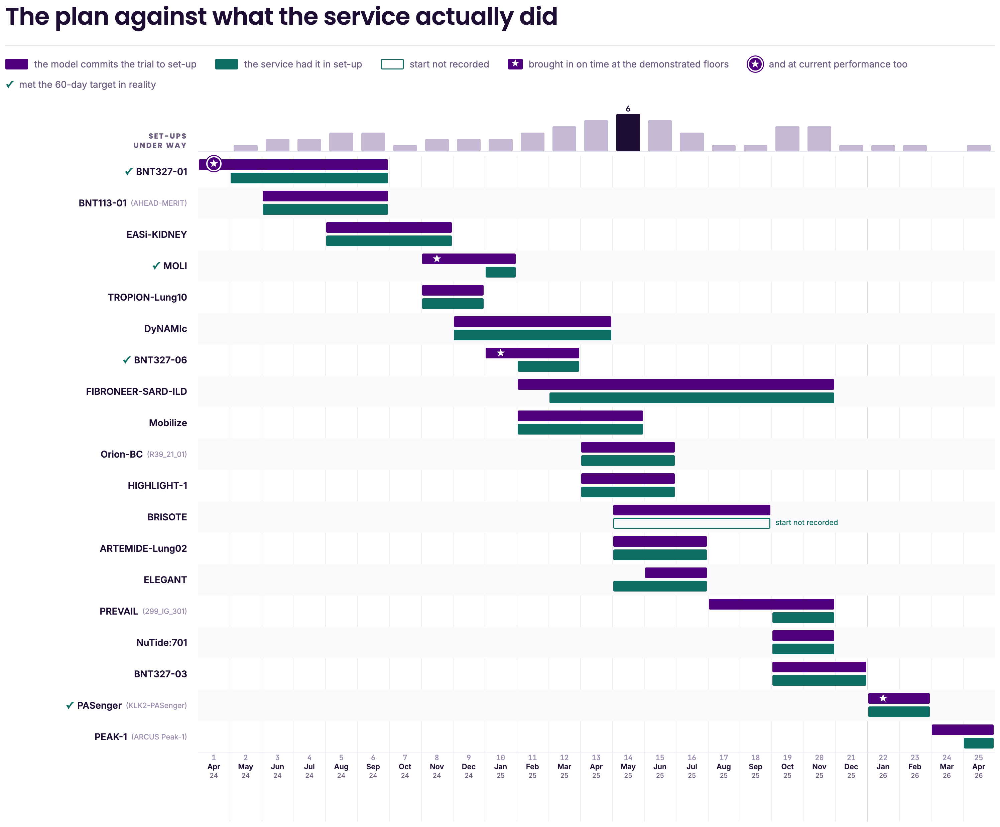
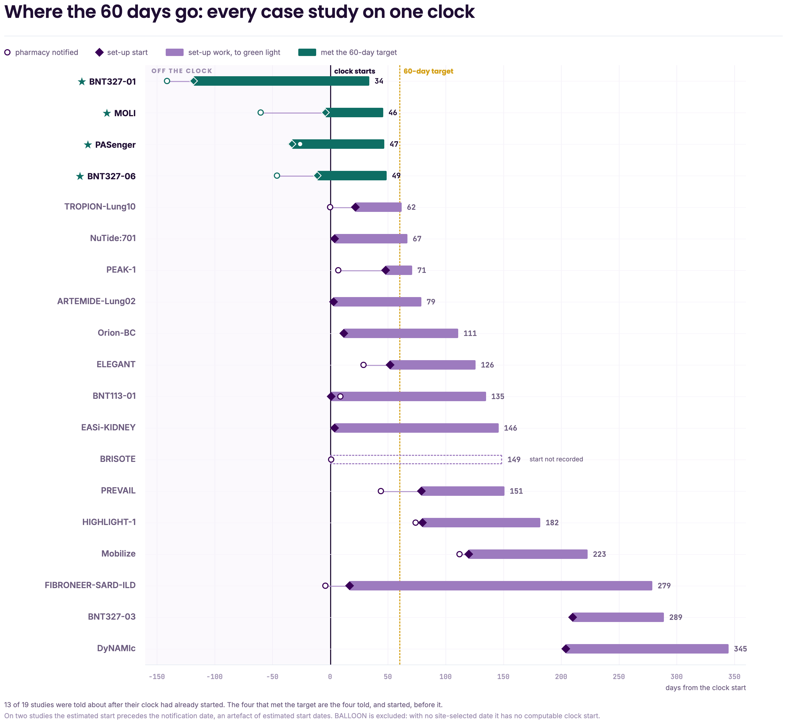
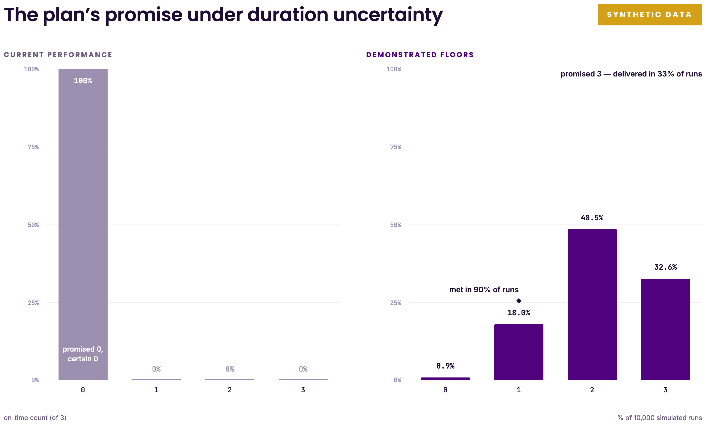
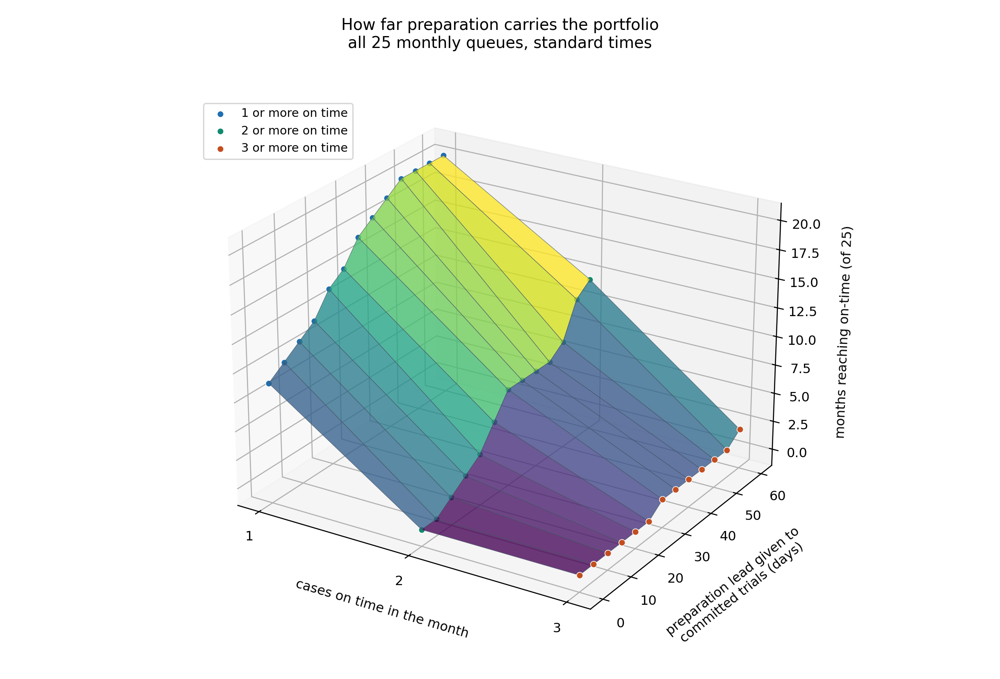
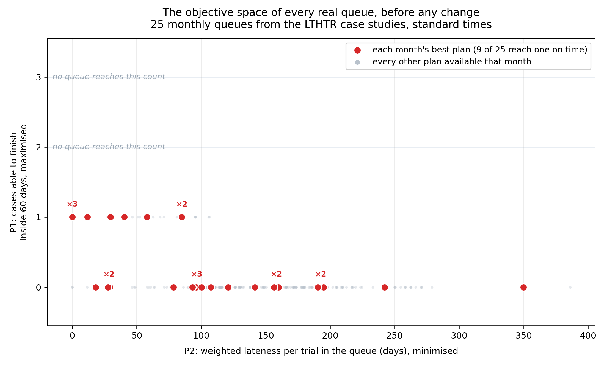
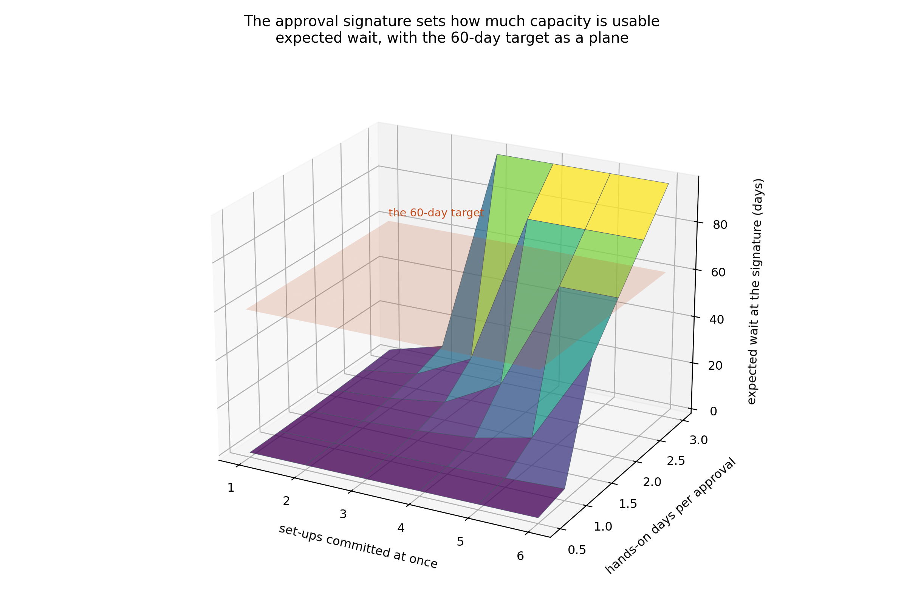

# 5. Results

`[edit]` This chapter reports what the planning model returns on the trust's own queues. It gives the capacity ceiling and which trials reach it, tests how reliably a plan delivers what it promises, and identifies what limits the number and what raising it costs. Table 4.3 maps each analysis to the sub-question it answers.

## 5.1 The model's decision on the real queues

The model was solved at each of the 25 decision points of §4.3. `[edit]` Figure 5.1 sets its plan against what the service actually did.

**Figure 5.1**

*The plan against what the service actually did, by month of commitment rather than by date*

Only four trials ever finish on time, and they are exactly the four that met the target in reality. The model identifies these trials in advance rather than in hindsight; it does not uncover any additional trial that the service could have brought in on time.

Against the stated “commit the longest waiter” rule, the model performs better when capacity is limited. It brings a trial in on time in 10 of the 25 months at both one and two set-ups per month, compared with 6 and 7 months respectively for the rule. From three set-ups per month onwards, both approaches commit the same trials and perform equally.

The 10 months cover only four trials. Because the plan is remade each month, a trial that still fits is re-committed and counted again. `[edit]` The comparator is a stated arrival-order rule, not an observed record of practice.

`[edit]` A sweep of 9,000 synthetic portfolios tests whether that pattern holds beyond the trust's own queues. At current performance the model never beats the arrival-order rule for on-time completions. At the demonstrated floors it wins in 36% of cases, each win costing 24.3 weighted days of lateness elsewhere, and it helps most when trials arrive early and the aseptic share is low. Appendix 5.A holds the design, the limitations and the full grid.
## 5.2 Why the model picks these and not others

The model starts the right trials sooner. Three of the four trials it brings in on time are among the six it starts earliest: MOLI by 34 days, BNT327-06 by 22 days, and BNT327-01 by 17 days. Appendix 5.D sets the model's start date against the service's own for all nineteen.

`[edit]` The service's own head start bought little: of the twelve trials it began before the model would, eleven missed the target anyway. Waiting is what consumes the window, and the trial that can still finish is usually the one that has just arrived; Appendix 5.D works through November 2024.

`[edit]` Figure 5.2 shows why so few can finish at all, placing the 19 studies with a computable clock start on one axis measured in days from that start.

**Figure 5.2**

*Where the 60 days go: every case study on one clock*

Four trials met the target, and all entered the pharmacy queue before the 60-day clock began.

**Table 5.1**

*The four trials that met the 60-day target*

| Trial | Days entered before clock start | Work interval (days) | Clock interval (days) |
| --- | --- | --- | --- |
| MOLI | 4 | 50 | 46 |
| BNT327-06 | 11 | 60 | 49 |
| PASenger | 33 | 80 | 47 |
| BNT327-01 | 118 | 152 | 34 |

Starting earlier did not shorten the work. Work intervals did not differ significantly between early and late starters ($p = 0.71$). Instead, earlier starts moved some work outside the 60-day window. Two of the four trials met the target despite requiring more than 60 days of work because their set-up began before the window opened. The window did not stretch; the work began earlier. No recorded trial characteristic predicted an early start (Appendix 4.I).

Where the plan falls short, it does so by relatively little. Four trials missed the target by 20 days or less in reality and, under the plan, fall 10 to 29 days short of their available windows. This shortfall reflects insufficient time in the window, not a failure to choose between trials. No selection rule can recover those days; Section 5.4 examines what would add them.

## 5.3 Plan delivery under duration uncertainty

`[edit]` A solved plan produces one on-time count from a single planned duration for each pathway, so the uncertainty run of §4.3 and Appendix 4.J.6.2 replays each committed plan 10,000 times to report how often that count is actually met. Appendix 5.F reports what the real February queue delivers, and Figure 5.3 the synthetic one.

`[edit]` In the real February queue, neither duration basis produced a plan promising an on-time completion. The simulation therefore describes outcome variability rather than delivery reliability for a positive promise; approval delay is held at its expected value throughout, so every reported figure understates total uncertainty. Appendix 5.F reports the distribution.

`[edit]` The synthetic standing queue of 16 trials described in Appendix 4.G, used in this section alone and labelled synthetic throughout, is the one that carries a promise. At current performance it promises zero and delivers zero in every one of the 10,000 runs. At the demonstrated floors it promises three, and Figure 5.3 shows what arrives: three in 32.6% of runs, but two in 48.5%. The promised three therefore lands in about a third of runs, two is the most likely single outcome, and one is the highest count reached in at least 90% of runs.

**Figure 5.3**

*The plan's promise under duration uncertainty (synthetic queue)*

`[edit]` The point is the deterministic verdict, not any single trial. Where a plan records a trial as one day late, that margin sits well inside the observed spread of set-up durations, so the label carries no information and a trivial change of input reverses it. Where the margin is smaller than the spread, the deterministic result is a tie-break rather than a finding; Appendix 5.F works through the case behind this.

## 5.4 What would have to change

Six settings could change the results. Table 5.3 reports what each one does, and the two columns disagree in a way that matters.

**Table 5.3**

*What each setting changes, across twenty-five decision points*

| Setting | Intervention tested / observed span | Months ≥1 on time (of 25) | Best count | Largest single-date lateness reduction |
| --- | --- | --- | --- | --- |
| Preparation lead, committed trials | 0, 7, 14, 21, 35, 60 days | 20 of 25 | 3 | 394 |
| Pharmacy queue, notification to start | Return 0, 25, 50, 75 or 100% of each trial's observed wait, which spans 0 to 23 days | 14 of 25 | 2 | 76 |
| Hand-over gap, clock to notification | Return 0, 25, 50, 75 or 100% of each trial's observed gap, which spans 0 to 112 days | 11 of 25 | 2 | 498 |
| Slots opened per month | 1, 2, 3, 4, 5, 6 | 9 of 25 | 1 | 154 |
| Hands-on days per approval | 0.5, 1.0, 2.0, 3.0 days | 9 of 25 | 1 | 20 |
| Target window | 55, 60, 65, 70 days | 11 of 25 | 2 | 77 |

Note. `[edit]` R&I controls the preparation lead and the hand-over gap, pharmacy the queue and the slots, the approver the hands-on days and governance the target window; every lever is measured except hands-on days, which is assumed, and the target window, which is policy. For the two delay levers the percentages apply to each trial's own observed delay, so the day spans are observed across trials rather than common tested values. The final column is the largest single-date reduction in weighted lateness against that lever's baseline, not a total. Appendix 4.J.7 gives the full design.

Nine of the twenty-five dates already admit one on-time trial at the demonstrated floors under the high-burden overlay and with no further change, which is the row every other row must be read against.

`[edit]` The levers affect the two outcomes differently. Removing the hand-over gap produces the largest reduction in weighted lateness but few additional on-time trials, because many affected cases are already beyond rescue. Reducing the pharmacy queue removes less lateness but creates more on-time completions by affecting trials near the threshold. Appendix 5.C gives the values.

Apart from preparation, no setting reaches three on-time trials in any month: the two delays and the target window reach two, and slots and approval time never pass one. Everything except preparation therefore moves more months onto the target without raising the ceiling. Appendix 5.C draws four of them as surfaces.

Preparation is the only setting that creates this opportunity, and Figure 5.4 shows its effect on the portfolio. `[edit]` Appendix 5.E tests the capacity assumption of §4.2.3 by reducing the concurrent capacity available to the plan.

**Figure 5.4**

*How far preparation carries the portfolio*

`[edit]` Approval time is the only assumption in the table without direct measurement, because the August 2026 questionnaire gave a range rather than a value. The commitment limit is a maximum, not a requirement: if opening six set-ups would create a long signature queue, the model commits fewer trials instead. Approval time therefore limits how much capacity is usable, not the on-time ceiling. Appendix 5.C reports the wait at each level and how many set-ups are worth opening.

## 5.5 Which studies preparation should reach

`[edit]` Table 5.3 makes preparation the strongest lever; pharmacy burden says which studies should receive it.

Burden does not make set-up take longer: the work-duration distributions for the three burden bands do not differ significantly (Kruskal-Wallis $p = 0.557$). Instead, burden raises the fastest observed duration in each band: 23 days for low burden, 40 for medium burden, and 60 for high burden (Table 4.H.3). This leaves 37 days of slack within the 60-day target for low-burden trials, 20 for medium-burden trials, and none for high-burden trials.

The median time between the target clock starting and pharmacy receiving the study is 14 days (Appendix 4.D); `[edit]` low- and medium-burden trials can absorb this delay. High-burden trials cannot absorb even one day; Figure 5.5 sets the three bands against the window. The exclusion is therefore structural. Of the six high-burden trials, the two that began before the clock started met the target, whereas all four that began afterwards missed it (Fisher’s exact test, $p = 0.067$). `[edit]`

**Figure 5.5**

*What each burden band has left inside the 60-day target*

Preparation is the only lever these studies have, and it is not aimed at them: burden rank does not predict which trials start early (Fisher $p = 1.000$, Appendix 4.I). All six high-burden trials are aseptic, and eleven trials in the set are, so the aseptic flag identifies every one of them at notification and five others besides.

`[edit]` Targeting preparation at the aseptic-flagged studies concentrates effort on identifiable high-burden risk for about half the earlier notification, but its achievable on-time count is lower than preparing every committed trial, because it leaves the rescuable non-flagged trials untreated (Appendix 5.B).

The lead must be sized against the variation in durations rather than against the shortfall it closes. `[edit]` Appendix 5.F shows the four-day fix for BNT327-06 delivering half the time. Reading a reliability as the proportion of runs in which a plan delivers the stated outcome, a high-burden study planned at the 63-day floor is 50 per cent reliable with no lead, 75 per cent with a 28-day lead, and 90 per cent only at a 63-day lead, a second window on top of the first. Preparation is what makes a high-burden study possible; a few days of it buy a plan that says yes rather than a delivery that can be relied on.

## 5.6 The trade-off the service faces

Preparation is the intervention considered here. This section reports the trade-offs it creates because the model ranks two objectives that do not always align.

`[edit]` The trade-off between on-time completion and weighted lateness appears only where preparation remains insufficient. On the largest queue, 1 May 2025, a 21-day lead makes each rescue cost additional lateness, whereas a 35-day lead brings two trials in on time at the lowest weighted lateness of any plan; on the 1 February 2025 queue the two objectives never conflict at any lead. Figure 5.6 sets the two leads side by side and Appendix 5.C reports the frontier values.

**The conflict between finishing on time and minimising lateness is itself a symptom of insufficient preparation.** A governance rule that ranks lateness first gives up nothing when preparation is adequate and two rescues when it is not, so it is the wrong rule to fix in advance.

**Figure 5.6**

*What a rescue costs at two preparation leads*

The second trade-off is between the on-time count and the preparation it requires, the cost the trust pays in days R&I must find. Figure 5.7 reports the least preparation that first reaches each count.

**Figure 5.7**

*What preparation buys, and where it stops being cheap*

Two things follow.

First, capacity never limits the on-time count. Each rescue requires one set-up slot, so a plan that rescues three trials uses only three of the six available slots.

`[edit]` Second, what a queue can reach is set by its own composition. A lead only repays a shortfall the queue already carried, so it buys a rescue cheaply while a trial is near its window and buys little once a trial is far past it. Across the whole range Figure 5.7 covers, the February queue never passes two. That ceiling belongs to the queue rather than to any lever, and it is the honest limit on what scheduling can promise.

`[edit]` Capacity does not stop working above the rescue count, however. Figure 5.8 holds the preparation lead at 35 days and varies the set-ups opened per month against the on-time count. Lateness falls with every slot opened at each on-time count, while the pharmacy burden a plan commits rises with both. Opening more set-ups is therefore a lever on how late the rest of the queue runs rather than on how many trials meet the target. Appendix 5.C gives the values and the derived burden scale.

**Figure 5.8**

*What capacity buys, in days and in burden*

## Appendix 5.A The robustness sweep

The sweep tests one narrow question: does the selection rule's advantage survive when arrival timing, pathway mix and set-up duration are varied? It does not test preparation or the hand-over correction, and it runs on generated portfolios rather than on the trust's own queues.

**Table 5.A.1**

*The scenario grid*

| Axis | Values | Grounding |
| --- | --- | --- |
| Arrival timing | early, typical, late | Days remaining at the planning date, spanning the tracker's observed spread |
| Aseptic share | 0.4, 0.6, 0.8 | Centred on the trust's own 60% figure |
| Prescription share | 0.2, 0.4 | No trust figure exists, so it is varied rather than assumed |
| Duration regime | calibrated at 0.8, 1.0 and 1.2 times the case-study medians; the Appendix 4.H floors; the pooled 62-day figure | Current performance, demonstrated performance, and the achievable pooled quantile |

90 cells, 100 portfolios each, 9,000 in total, one fixed seed per cell.

**Table 5.A.2**

*On-time wins against the arrival-order rule, by duration regime*

| Regime | Wins | Draws | Win rate |
| --- | --- | --- | --- |
| Calibrated, 0.8× | 0 | 1,800 | 0% |
| Calibrated | 0 | 1,800 | 0% |
| Calibrated, 1.2× | 0 | 1,800 | 0% |
| **Floors** | **640** | **1,800** | **36%** |
| Pooled 62 days | 0 | 1,800 | 0% |

The finding is that the rule has no advantage of its own. Four of the five duration regimes return exactly zero wins in 1,800 draws each: current performance, current performance 20% faster, current performance 20% slower, and the pooled 62-day figure. The rule gains something in one regime only, the durations pharmacy has already demonstrated, and there it wins 36% of the time. An advantage that appears in one of five regimes and vanishes in the other four is a property of the queue, not of the ordering.

The other two axes say which queues those are. The rule wins in 75% of draws when trials arrive early, 32% at the typical arrival time and never in any of the 600 draws where they arrive late, which is the same result §5.2 reads off the real queues: a trial that reaches pharmacy after most of its window has gone cannot be recovered by any ordering. Its wins also fall from 45% to 24% as the aseptic share rises from 0.4 to 0.8. The trust's own mix of roughly 60% aseptic sits between them, at 38%, and the direction of travel is towards the heavier end.

Three things follow. First, selection is the third lever rather than the first. A service that adopts this rule without changing durations gains nothing, and the four zero rows are what that looks like measured; §5.4 reaches the same ordering from the real queues by finding preparation and the two delays ahead of any scheduling change. Second, the rule is a rationing device rather than an improvement. §5.1 finds its advantage on the real queues at one and two set-ups a month and gone from three, so it earns its keep exactly where capacity is tightest and stops mattering once capacity is not, which is the opposite of how a scheduling tool is usually sold. Third, each win is bought. The 640 wins cost 24.3 weighted days of lateness elsewhere apiece, so the rule trades delay across the queue for a threshold rather than removing delay, which is the §5.5 trade-off appearing again on generated data.

**Three limits.** The model never loses, which is by construction rather than a finding: it attains the maximum achievable on-time count, so a loss is impossible. The 36% is therefore 36% better and 64% identical, not a rule that is worse the rest of the time. The generator draws studies already queued, so the sweep cannot exercise preparation and understates it throughout. And the comparator, committing the longest-waiting study first, is more mechanical than real practice, which already accelerates studies judged important; any advantage shown here is therefore an upper bound.

## Appendix 5.B Targeted against untargeted preparation

§5.5 reports that preparation aimed only at high-burden studies reaches almost as many dates for about half the earlier notification. This is the sweep behind that sentence.

The regime matches Table 5.3: the strict anchor rule, the demonstrated floors, the high-burden overlay at 63 days, six slots, and the same twenty-five decision points. Targeted preparation grants the lead only to committed trials in burden band 5 or 6. Spread preparation grants it across the queue.

**Table 5.B.1**

*What each lead reaches, targeted against spread*

| Lead | Targeted: dates with ≥1 | ≥2 | Best | R&I days | Spread: dates with ≥1 | ≥2 | Best | R&I days |
| --- | --- | --- | --- | --- | --- | --- | --- | --- |
| 0 days | 9 of 25 | 0 | 1 | 0 | 9 of 25 | 0 | 1 | 0 |
| 7 days | 10 of 25 | 0 | 1 | 147 | 11 of 25 | 0 | 1 | 469 |
| 14 days | 11 of 25 | 0 | 1 | 294 | 12 of 25 | 2 | 2 | 980 |
| 21 days | 12 of 25 | 0 | 1 | 441 | 14 of 25 | 4 | 2 | 1,407 |
| 35 days | 14 of 25 | 1 | 2 | 735 | 18 of 25 | 7 | 3 | 2,450 |
| 60 days | 16 of 25 | 2 | 2 | 1,260 | 20 of 25 | 12 | 3 | 4,020 |

Read the table across equal counts rather than equal leads. Twelve dates cost 441 trial-days of earlier notification when the lead is targeted and 980 when it is spread; fourteen dates cost 735 against 1,407. Roughly half the R&I effort reaches the same number of dates.

The ceiling is what targeting gives up. It never reaches three trials on time, and reaches two at only two dates, against three and twelve when the lead is spread. Not every rescuable trial is a heavy one, so a lead confined to bands 5 and 6 cannot reach the trials that the spread lead rescues.

`[edit]` **The case behind §5.5's structural exclusion.** NuTide:701 reached pharmacy four days after its clock started, took 63 days to complete, and missed the target by seven days. It is the clearest instance of the band-level finding: a high-burden study has no slack to absorb even a four-day hand-over, so the days it loses before pharmacy receives it decide the outcome before any set-up work begins.

Every figure comes from `Experiments/analyse_burden_and_preparation_2026-08-28.py`. Its untargeted arm reproduces the preparation row of Table 5.3 exactly, 20 of 25 dates at a 60-day lead, which is what makes the two arms comparable.

## Appendix 5.C The evidence behind Table 5.3

§5.4 reads Table 5.3 in prose and states each finding in a sentence. This appendix holds the four figures behind those sentences: the baseline every row is read against, the four settings drawn as surfaces, and the two settings whose surfaces explain why they leave the on-time count untouched.

**Figure 5.C.1**

*The objective space of every real queue before any change*

Figure 5.C.1 combines all queues, with lateness normalised by the number of waiting trials so that months with four and seven trials can be compared on the same scale. It is the baseline for §5.4's statement that nine of the twenty-five dates already admit one on-time trial with no further change. `[edit]` Those nine months are also the least late, none exceeding 85 days per trial, while months with no rescue reach up to 350.

**Figure 5.C.2**

*Four settings of Table 5.3, on the axes of the preparation surface*

Figure 5.C.2 shows four of the six settings on the same axes as the preparation surface, one panel per setting. The two delays are plotted as the delay itself, so each surface falls as the delay increases.

Removing the entire hand-over gap increases the on-time count from nine months to eleven. Removing the pharmacy queue increases it to fourteen months, over a span one-fifth as long. In contrast, slots and hands-on approval days remain flat at nine across their entire ranges. This is the evidence for §5.4's statement that the two delays move more months onto the target without raising the ceiling.

`[edit]` The two columns of Table 5.3 rank the interventions differently because on-time completion is a threshold measure, whereas lateness accumulates. Reducing the R&I hand-over gap produces the largest single-date reduction in weighted lateness, 498 days at one decision point, but increases the on-time count at only two additional decision points, because it mainly affects trials already beyond rescue. The pharmacy queue never exceeds 23 days and its best single-date reduction is around one-seventh as large, yet it improves the on-time count at five additional decision points, because those days affect trials close to the 60-day threshold. The target window, the only setting the trust does not control, reaches one on-time trial in 11 of the 25 months across the 55 to 70 day range tested, the same count as removing the entire hand-over gap.

`[edit]` Read against the preparation surface of Figure 5.4, a 10-day lead enables one on-time trial in 11 months, a 30-day lead in 17 months, and a 60-day lead in 20 of the 25 months. Two on-time trials are harder: no month reaches two below 10 days of lead, seven reach it at 30 days and twelve at 60. Three on-time trials occur in one month at 30 days and two at 60.

**Figure 5.C.3**

*The approval signature sets how much capacity is usable*

Figure 5.C.3 varies the hands-on approval assumption of §5.4 alongside the number of set-ups committed at once, with the expected wait at the signature stage as height. The 60-day target is included as a reference plane.

Below one hands-on day, the expected wait is under one day when three trials are committed at once, and about three days at six trials. At 1.5 days, the wait reaches 48.5 days with six concurrent commitments. At two days, the 60-day target is exceeded once five trials are committed at once. At three days, the expected wait reaches 97 days even with only three concurrent commitments.

When hands-on approval time is below 1.5 days, all six set-ups are worth opening. At two days, about four are worthwhile, and at three days, only two. This is the range behind §5.4's statement that performance is insensitive below the assumed one hands-on day and sharply sensitive above it.

**Figure 5.C.4**

*What capacity and preparation commit in pharmacy burden*

Figure 5.C.4 varies the set-ups committed against the preparation lead across the same twenty-five queues, with the burden the best plan commits as height. The surface is flat along the preparation axis: at every capacity the burden committed is the same at a 45-day lead as at none, and at 60 days it falls, from 5.2 units to 4.6 at five and six set-ups, because a long lead makes the lighter studies rescuable and the model stops reaching for the heavy ones. This is the evidence for §5.5's statement that burden is set by how many set-ups the service opens, not by how early it is told.

`[edit]` **The frontier values behind §5.6.** On the largest queue, 1 May 2025, a 21-day preparation lead produces three frontier plans: zero trials on time with 511 weighted late days, one trial on time with 523 days, and two trials on time with 684 days. The first on-time completion therefore costs 12 weighted late days, and the second a further 161. With a 35-day lead the plan that brings two trials on time also has the lowest weighted lateness, so those two are achieved with no lateness trade-off and only the third costs anything, 31 weighted days. On the 1 February 2025 queue the two objectives do not conflict at any preparation lead.

`[edit]` **What capacity buys, in days and in burden.** Figure 5.8 takes the median across the twenty-five queues with lateness per trial so that months of different sizes are comparable. Lateness falls with every slot opened at each on-time count, from 61 days per trial to 33 at one trial on time. Expressed in pharmacy burden rather than days, the same plans rise with both capacity and the on-time count, from 1.7 routine-trial equivalents for a single rescue at one set-up to 8.3 for three rescues at six, on the derived planning scale of Appendix 4.F.

## Appendix 5.D When the model would start each trial

§5.2 reports that three of the four trials the model brings in on time are among the six it starts earliest. This appendix sets its start date against the service's own for every trial, and states the caveat that reading requires.

**Figure 5.D.1**

*When the model would start each trial, against when the service did*

`[edit]` November 2024 shows what waiting costs. The service had TROPION-Lung10 and EASi-KIDNEY under way, neither able to finish within its window, and did not start MOLI, which could, until 5 December.

Overall the model starts only 6 of the 18 comparable trials sooner and 12 later. This is because it commits only on the first day of each month, so a trial arriving mid-month waits for the next planning cycle. Figure 5.D.1 therefore compares a monthly planning cycle with continuous decision-making rather than measuring which approach is faster, and the twelve later starts are a property of the planning cycle rather than a result about the rule.

## Appendix 5.E Preparation charged against capacity

*Not counted towards the word limit.*

The preparation lever of §5.4 adds days to the window of every trial a plan commits and never charges the relocated work against pharmacy capacity. This appendix sweeps the preparation lead against the number of concurrent set-ups, so that the omission becomes a bound rather than an unknown: if preparation consumes capacity, so that fewer set-ups run at once, does it still reach three trials on time?

**Table 5.E.1**

*Decision points reaching each on-time count, by preparation lead and concurrent set-ups*

| Lead | Count | 6 | 5 | 4 | 3 | 2 | 1 |
| --- | --- | --- | --- | --- | --- | --- | --- |
| 0 d | ≥1 | 9 | 9 | 9 | 9 | 9 | 9 |
| 10 d | ≥1 | 11 | 11 | 11 | 11 | 11 | 11 |
| 30 d | ≥1 | 17 | 17 | 17 | 17 | 17 | 17 |
| 60 d | ≥1 | 20 | 20 | 20 | 20 | 20 | 20 |
| 30 d | ≥2 | 7 | 7 | 7 | 7 | 7 | 0 |
| 60 d | ≥2 | 12 | 12 | 12 | 12 | 12 | 0 |
| 30 d | 3 | 1 | 1 | 1 | **1** | **0** | 0 |
| 60 d | 3 | 2 | 2 | 2 | **2** | **0** | 0 |

*Twenty-five decision points, April 2024 to April 2026, strict anchor rule, standard times, high-burden overlay, no synthetic data. The six-slot column reproduces §5.4 exactly, at 9, 11, 17 and 20 dates reaching at least one.*

Three readings. The count of dates reaching at least one on-time trial does not move with capacity at any lead, which is the same finding §5.4 reports from the other direction. The three-trial result is the one that depends on capacity, and it survives to three concurrent set-ups and fails at two. And against 3.51 set-ups observed in progress (Appendix 4.A) `[edit]`, the margin before that failure is roughly half a set-up.

## Appendix 5.F The plan-delivery simulation on the real queue

`[edit]` This appendix reports the plan-delivery simulation in full: what the real February 2025 queue delivers under each duration basis, and the one deterministic margin the simulation resolves. It assesses uncertainty around selected plans; it does not test whether the selection rule outperforms arrival order, which is the question Appendix 5.A answers across generated portfolios.

The two duration bases carry different spreads as well as different medians, a coefficient of variation of 0.467 at current performance and 0.575 at the demonstrated floors, so the two rows of Table 5.F.1 differ on both.

**Table 5.F.1**

*What the February 2025 queue delivers when durations vary*

| Duration basis      | Plan promises | 0 on time | 1     | 2    | 3    |
| ------------------- | ------------- | --------- | ----- | ---- | ---- |
| Current performance | 0             | 70.9%     | 29.0% | 0.1% | 0.0% |
| Demonstrated floors | 0             | 33.0%     | 49.3% | 17.7% | 0.0% |

*Approval wait times are held at their expected values, so every row understates total uncertainty.*

Both rows promise nothing, and both therefore keep their promise in every run: a plan that commits to no on-time completion cannot fall short of one, and so cannot test whether a promise survives. What the table does show is how far the outcome moves on duration alone. At current performance one trial finishes on time in 29% of runs; at the demonstrated floors that rises to 49%, and two trials finish on time in a further 18%. The model commits the same three trials in both rows, so this is the spread around one plan rather than a different decision. None of it can be planned for: an on-time completion that the plan does not promise is luck, and the service cannot schedule against it.

The same analysis resolves the uncertainty noted in §5.2. BNT327-06 carries burden rank 6, so the plan gives it the 63-day high-burden floor against a 62-day window and records it as one day late. In simulation it finishes on time in 48% of runs, which is the case behind §5.3's closing statement that a margin smaller than the spread is a tie-break rather than a finding.
## Source and provenance notes (not part of the submitted text)

**[edit] Two compressions, 2026-09-02.** §5.2's description of what Figure 5.2 plots was reading the figure back to the reader; the body keeps why so few trials can finish and what the axis measures. §5.5's opening was navigation between two sections. Twenty-eight words.

**[edit] Group 3, 2026-09-02. Chapter 5 from 2,499 to 2,427 counted words.**

**NuTide:701 moved to Appendix 5.B, not deleted.** On the user's instruction. It is the clearest single instance of §5.5's structural-exclusion finding, so the appendix now carries the case with a sentence saying what it instantiates, and the body keeps the band-level result and the Fisher test that carry the claim.

**§5.5's targeting paragraph** was three sentences making one comparison. It is now the single sentence drafted in review, which holds the comparison, the mechanism and the limitation together: targeting concentrates effort on identifiable risk for about half the notification, at a lower ceiling, because it leaves the rescuable non-flagged trials untreated.

**§5.1's figure-reading prose was cut rather than moved.** `dissertation_guidance.md:44` counts captions towards the limit, so moving the sentence into Figure 5.1's caption would have saved nothing. The body keeps the result and the caption gains eight words naming the unit of analysis, "by month of commitment rather than by date", which is what a reader needs to avoid misreading the bands.

**§5.3's two opening sentences** became one that states both the reason for the simulation and what it measures, how often the deterministic count is actually met.

**[edit] Relocation and de-duplication pass, 2026-09-02. Chapter 5 from 2,677 to 2,499 counted words.**

**§5.6, the first pass over this section.** The frontier arithmetic moved to Appendix 5.C: the three 1 May plans at 511, 523 and 684 weighted late days, the 12 and 161 marginal costs, the 35-day lead's 31 days, the fall from 61 days per trial to 33, and the burden range of 1.7 to 8.3 routine-trial equivalents. **All three figures stay in the body**, since figures do not count towards the limit; what moved is the prose reading them. Both substantive conclusions stay in full: that the conflict between finishing on time and minimising lateness is a symptom of insufficient preparation, and that capacity reduces lateness without raising the on-time ceiling. §5.6 is 541 words down to 420.

**Table 5.3 lost two columns.** Controlled by and Basis are now a sentence in the note, which carries the same six assignments in less space than a column pair does.

**Three de-duplications.** §5.2's "four of them by 20 days or less" appeared twice, four paragraphs apart, and the November 2024 vignette moved to Appendix 5.D, which is already about when each trial would start; the body keeps the finding it illustrated. §5.4's bridge sentence naming slots and approval time was deleted, the paragraph above it having just said the same. §5.3's synthetic-labelling sentence folded into the paragraph that uses the queue.

**One stale pointer fixed.** §5.5 cited §5.3 for the four-day fix on BNT327-06, a case that moved to Appendix 5.F in the pass before this one.

**[edit] Comparator caveat restored to §5.1, 2026-09-01.** User review. The earlier pass deleted it outright on the ground that Chapter 6 §6.3 explains it in full. That reasoning was half right: the explanation belongs in Chapter 6, but the qualification belongs beside the finding, or a reader passes through the most favourable model-versus-practice comparison in the dissertation before meeting its principal caveat. Twelve words are now carried at the point of the claim, "The comparator is a stated arrival-order rule, not an observed record of practice", and §6.3 keeps the consequence, that any advantage is an upper bound because practice already expedites some studies. §5.1's sweep summary and §5.4's approval sentence were re-read in the same review and needed no change: the first keeps the conditional form, that the rule never wins at current performance and wins in 36 per cent of runs at the demonstrated floors only, and the second still names approval time as the one unmeasured input and points to Appendix 5.C.

**[edit] Approval-wait caveat returned to §5.3, 2026-09-01.** User review of the relocation pass above. Table 5.2's note, "approval wait times are held at their expected values, so every row understates total uncertainty", moved to Appendix 5.F with the table, which left the 32.6 and 48.5 per cent figures in the body with no statement that they are optimistic. The caveat is now carried in the §5.3 bridge sentence itself, at the point where the simulation result is reported, rather than only beside the table it came from. Appendix 5.F's opening also now states plainly that it assesses uncertainty around selected plans and does not test the selection rule, which is Appendix 5.A's question. Net effect on the body: sixteen words.

**[edit] Relocation and length pass, 2026-09-01. Chapter 5 cut from 3,209 to 2,628 counted words.** Appendices do not count towards the limit (`dissertation_guidance.md:44`), so numerical detail moved rather than being deleted; every finding stayed in the body under the rule the user set.

**§5.3 to the new Appendix 5.F.** Table 5.2, the paragraph reading it, the BNT327-06 case and the coefficient-of-variation figures all moved. Appendix 5.F opens by stating what it answers and how that differs from Appendix 5.A, which tests the robustness of the rule across generated portfolios rather than the reliability of one committed plan. The body keeps the planning-result-not-forecast opening, the synthetic-queue result with its 32.6 and 48.5 per cent figures, and the closing statement that a margin smaller than the observed spread is a tie-break. Two sentences had to be rewritten rather than moved, because both referred to a table that is no longer in the chapter: "Both rows of Table 5.2 promise nothing" and "The point is the deterministic verdict, not this trial", whose antecedent had left with the BNT327-06 paragraph.

**§5.4 to Appendix 5.C.** Five paragraphs of table-reading moved, and the body gained one paragraph carrying the interpretation they were burying: that the hand-over gap removes the most lateness but rescues few trials, while the pharmacy queue removes less lateness and rescues more, because on-time completion is a threshold measure and lateness accumulates. The three approval-time paragraphs were compressed into one that keeps the SQ2 finding, that the commitment limit is a maximum and approval time bounds usable capacity rather than the on-time ceiling; Appendix 5.C Figure 5.C.3 already held every number removed.

**Three de-duplications.** The chapter-opening roadmap was compressed, Table 4.3 already mapping each analysis to its sub-question. The 9,000-portfolio summary in §5.1 keeps the 36 per cent and the early-arrival direction and drops the 7,200 draws and the 75 per cent, both in Appendix 5.A. The comparator caveat in §5.1 was deleted, Chapter 6 §6.3 carrying it with its consequence.

**§5.6 was not touched in this pass** and remains the largest remaining relocation candidate.

**[edit] Four de-duplication cuts, 2026-09-01.** Length pass agreed with the user. The preparation caveat about capacity was being stated three times in this chapter alone, on top of Chapter 4 §4.2.3 and Chapter 6 §6.3. (1) §5.3's synthetic-queue paragraph lost its methodological justification, which Chapter 4 §4.1 owns, and keeps the size, the Appendix 4.G pointer and the synthetic label. (2) §5.4's preparation paragraph lost both the "granted only to committed trials" mechanism, which is Chapter 4 §4.2.3 verbatim, and the capacity-charge sentence, keeping the Appendix 5.E pointer. (3) The closing paragraph of §5.5 was deleted as the third statement of the same caveat; §5.5 now ends on the reliability finding, which is what the section is about. (4) §5.7 was deleted with its heading: it was a hand-off to Chapter 6 that Chapter 6 performs itself through Table 6.1. Nothing cross-references §5.7. 163 counted words.

- Appendix 4.H figures (moved to Chapter 4 on 28 August): `Sources/Data/LTHTR20_analysis_set_2026-08-26.csv` (strict clock anchor, n = 19 for clock spans, n = 20 pharmacy-held). Work-fits list and floors: recompute report §9 to §12. Preparation tests: `Experiments/analyse_preparation_and_burden.py` (Fisher p = 0.0003; work p = 0.714; within-track clock p = 0.024, cited as p = 0.71 and p = 0.0003 in text). Documentation mechanism (Table 5.1): `Sources/Interviews/2026-06-30_CT-Aseptic-meeting_mapping.md` (verbal capacity gate deliberately not cited, supervisor instruction 26 Aug; manual-contradiction row from the OVACT thaw-time note in the same record). Table 5.2 work-interval row: n = 19, median 79, range 23 to 262, five within 60, from the analysis set; clock range 34 to 345.
- §5.2 figures: `Experiments/optimiser/replay_results_2026-08-26.csv` (standards regime rows; pathway floors without the high-burden overlay, which §5.3 applies). F1 window/duration numbers extracted 26 Aug (62/43/−61/−127/−216 vs 79/142/79/142/102). Cap-1 pick and +7.2 weighted days: REPLAY.md. Flattening at 5 to 6 slots: per-date frontier CSVs.
- Figure ids: Figures 5.1 to 5.4 come from the Claude Design canvas (5.1 = F5 plan against actual, 5.2 = F6 choosing against waiting, 5.3 = F1 all-cases timeline, 5.4 = F4 plan uncertainty). F2 and F3, the work intervals and the floor audit, left for Appendix 4.H with the derivation they belong to, rendered by `Experiments/render_ch5_figures.py`. Figures 5.5 and 5.7 to 5.10 are matplotlib output of `make_ch5_real_figures_2026-08-28.py`, and Figure 5.5 of `make_ch5_lever_grid_2026-08-28.py`, added 28 Aug because four of the six settings in Table 5.3 otherwise appeared as numbers alone; it imports the sensitivity module, so those surfaces and the table cannot drift apart. The F5 and F6 artboards are orphaned: the approval cliff and the burden cap both left the chapter, the cliff because Table 5.3 and the §5.4 text now carry it. The former F1, the 1 February queue, is retired: it covered one date, used the permissive anchor rule that admits BALLOON without a site-selected date, and labelled `days_available` as days to deadline.
- High burden defined as Q4b 5 to 6 throughout (decision 26 Aug); the 60 to 63 floor band and the 63-day planning figure trace to `optimiser/config.py::HB_FLOOR_TOP`.
- Burden material at the end of §5.4: `Experiments/analyse_burden_and_preparation_2026-08-28.py` and its report `Experiments/eda_output/real_run/BURDEN_PREPARATION_2026-08-28.md`. Band floors and the 37/20/0-day slacks are Table 4.H.3 subtracted from the 60-day target; the median hand-over of 14 days is Appendix 4.D. High-burden early-versus-met Fisher p = 0.067 on six cases, so it is quoted as the case count first and the test second. The targeted-preparation arm reuses the sensitivity module's own `build()` and plan enumeration, and its untargeted arm reproduces the Table 5.3 preparation row exactly (20 of 25 dates at a 60-day lead), which is what makes the two arms comparable. Reliability leads are the quantiles of the delivery simulation's own lognormal draw at CV 0.575, cross-checked by Monte Carlo against the 48% figure (48.9%). The block sat in §5.2 and §5.3 in the 28 August draft and moved here on 28 August: §5.2 is about why the model selects as it does, and the targeted sweep is real-queue material that did not belong in the chapter's one synthetic section. All six high-burden trials are aseptic and 6 of the 11 aseptic trials are high-burden, which is what makes the aseptic flag usable as a day-one screen. Figure 5.1 brings a trial in on time in ten of the twenty-five months against the nine of Table 5.3's baseline row: the single date between them is lost because §5.4 plans high-burden studies at the 63-day overlay floor rather than at their pathway floor.
- Figure 5.8 is the `Burden Band Slack Chart` board, drawn in Claude Design against the Manchester Analytics design system and rendered by `Experiments/render_standalone_boards.py`, which reuses the token inlining, headless capture and crop of `render_ch5_figures.py`. The board is a standalone `.dc.html` rather than a card on the Chapter 5 canvas, which is why it has its own renderer; Figure 5.11 is the other board it renders. Its three `DCLogic` booleans, `showSlackLabels`, `showBreachFlag` and `showLegend`, all default true and are exported true. The figures it draws are Table 4.H.3's band floors of 23, 40 and 60 days, the slack the 60-day target leaves, and the median hand-over of 14 days from Appendix 4.D, on a 95-day axis. A matplotlib version and its token-parsing palette module were built first on 28 August, superseded by the board, and deleted on the same day. Figures 5.5 to 5.8, 5.10 and 5.13 are still on their own ad hoc colours rather than the design system. The board's palette differs from the six Chapter 5 cards: it uses the undarkened `#50017D` for bars and `#9D4EDD` for the hand-over, where README_Chapter5.md records `#3A0058` and `#9D7BBF` applied across every other card for print contrast.
- Figure 5.12 is the `Preparation Lead Step Chart` board, imported 28 August in the handoff bundle `Manchester system conversion-handoff.zip` and rendered by `Experiments/render_standalone_boards.py`. It replaced Table 5.4, which carried the same two queues over only three rescues. Least lead that first reaches each count, re-derived at `cap=6`: 7, 21, 29, 64, 82 and 105 days on 1 May; 2 and 8 days on 1 February, where a third needs 122 days and a fourth 248. Table 5.4 and the §5.5 text both said three was unreachable at any preparation; a sweep to 400 days on 28 August showed otherwise, and the readings paragraph was corrected. The mechanism is that queue's own shortfalls, 1, 7, 121 and 246 days below the window on the day it formed, so a lead long enough to rescue a third trial is only repaying a debt incurred before pharmacy was involved. The board's axis stops at 112 days and its label reads "no lead reaches 3", which is true only within that range and should be reworded at the next board edit. Set-ups committed equal the on-time count at every step on both queues, which is why the table's set-ups column became a footnote. The burden column was verified before the table went (1.00, 3.61, 4.61 and 2.61, 3.61) and then extended: 6.35 at four rescues, 7.35 at five, 8.35 at six. Four is where committed burden first passes the 5.2 units of Figure 5.10, and it is the same step where the lead jumps 35 days, so the cliff is confirmed on two independent measures. That is new to the chapter and is why the readings paragraph gained a sentence.
- Figure 5.11 is the `Preparation Lead Lateness Chart` board, imported 28 August with the Burden Band Slack board in the same export and rendered by `Experiments/render_standalone_boards.py`. Two panels on a shared axis, the 1 May 2025 queue at a 21-day and a 35-day preparation lead, each plotting the least weighted lateness at every on-time count. Values from `run_sensitivity_real_2026-08-28.py`, `_std()` then `enumerate_plans()` at `cap=6`: 511, 523, 684 at 21 days and 537, 481, 433, 464 at 35 days. Three earlier drafts and the reasons the first two were rejected are in `Model/Design_Brief_Chapter5_Fig511_frontier_rotation_2026-08-28.md`. One finding from the rejected marginal-cost draft is not in the figure and could be added to the text: the third rescue never becomes free, rising from 31 weighted days at a 35-day lead to 54 by 56 days.
- Figure 5.13 was two figures until 28 August, the lateness and burden trade-off surfaces. They were merged into one 1x2 row because the text's claim is that the two objectives move in opposite directions over the same axes, which a reader cannot see across a page break. `tradeoff_surface()` became `_tradeoff_cells()`, `_draw_tradeoff()` and `tradeoff_pair()` in `make_ch5_real_figures_2026-08-28.py`, so the two panels share one cell computation rather than repeating it, and the row carries a single legend because the colour coding is identical on both. Output `tradeoff_pair.{png,pdf}`; the old `tradeoff_lateness` and `tradeoff_burden` files are deleted.
- Figure 5.10 is `burden_preparation_surface()` in `make_ch5_real_figures_2026-08-28.py`, added 28 August: set-ups committed against preparation lead, median committed burden across the 25 queues as height. Figures 5.9 and 5.10 of that draft became 5.10 and 5.11 to admit it, and 5.11 and 5.12 when the burden-slack figure joined them on 28 August.
- **Table 5.3's sixth row restored, 29 August.** §5.4 has always opened "Six settings could change the results" while the table carried five. `Experiments/run_sensitivity_real_2026-08-28.py` sweeps six levers and `optimiser/sensitivity_real_2026-08-28.md` reports six; the target window, the only governance lever, had been dropped from the chapter table. It is back with the report's own figures: Governance, policy, 55 to 70 days, 11 of 25 dates, best count 2, 77 weighted days. The other five rows were checked against the same report and match. The paragraph that read "Only the two delays achieve two on-time trials in any month, and none reaches three" was rewritten at the same time: it had been scoped by the four panels of the figure that is now Figure 5.C.2, and once that figure left the body the sentence read as a claim about all six settings, contradicting Table 5.3's own preparation row of 3.

- **Chapter 5 cut to results only, 29 August.** Four groups left the chapter, taking it from 3,288 words to 2,851 against a 2,500 target. First, §5.4 opened by restating §5.1's opening almost word for word, 19 of 20 cases and 25 months planned separately; the duplicate went. Second, the run configuration and its assumptions moved to Chapter 4's planning-run description in §4.3, where the other experimental settings live; §5.3's restatement of the uncertainty method was cut back to the two coefficients of variation, which are the part a reader needs in order to compare the rows of Table 5.2; and the synthetic queue's design justification was cut back to a pointer at Appendix 4.G, keeping the synthetic labelling. Third, three recommendations moved to `plan/Chapter6_inputs_from_Chapter5_2026-08-29.md` for Chapter 6 to carry: record hands-on approval time, flag aseptic studies at notification, and plan for one on-time completion rather than three. The finding behind each one stays in Chapter 5. Fourth, §5.6 was a summary of §5.1 to §5.5 and is now the two-line handover to Chapter 6 that its last paragraph already was; its five claims are recorded in the same plan file.

- **Figures 5.5 and 5.6 moved into Appendix 5.C, 29 August, and the chapter figures renumbered a second time.** The appendix is now "The evidence behind Table 5.3" and carries four figures: the baseline objective space (was 5.5, now 5.C.1), the four lever surfaces (was 5.6, now 5.C.2), the approval surface (now 5.C.3) and the burden-against-preparation surface (now 5.C.4). §5.4 keeps every finding: that the nine rescuable months are also the least late, that removing either delay moves more months onto the target without raising the ceiling, and that slots and approval time leave the count untouched. What moved is the figure-reading prose and the numbers Table 5.3 already carries. The body figures renumbered 5.7 to 5.5, 5.8 to 5.6, 5.9 to 5.7, 5.10 to 5.8 and 5.11 to 5.9, so the body now runs 5.1 to 5.9 with no gap.

- **Chapter figures renumbered after the first move, 29 August.** Closing the gaps left when the approval and burden-preparation surfaces went to the appendix: 5.9 became 5.8, 5.11 became 5.9, 5.12 became 5.10 and 5.13 became 5.11. That numbering was superseded the same day by the note above. **Image filenames never changed through either renumber**, so a filename no longer indicates a figure number: `fig5_7_preparation_surface.png` is Figure 5.4, `fig5_9_burden_slack.png` is Figure 5.5, `fig5_11_frontier_rotation.png` is Figure 5.6, `fig5_12_preparation_steps.png` is Figure 5.7 and `fig5_13_tradeoff_pair.png` is Figure 5.9. The provenance entries below this point were written before both renumbers and use the original numbers throughout.

- **Figures 5.8 and 5.10 moved to a new Appendix 5.C, 29 August.** Both are three-dimensional surfaces supporting statements §5.4 makes in a sentence, and the chapter is over its word budget. What stays in §5.4 is every claim the two figures support: that approval time is the only unmeasured input in Table 5.3, that the commitment limit is a maximum so extra capacity cannot reduce performance, that performance is sharply sensitive above the assumed value and hands-on approval time is therefore the most valuable measure to begin recording, and that burden is set by how many set-ups are opened rather than by how early pharmacy is told. What moved is the numbers behind those claims and the surfaces themselves. Each retained claim carries a pointer to Appendix 5.C, so a reader who wants the surface is told where it is at the point the claim is made. Neither figure file changed; they are now Figure 5.C.1 and Figure 5.C.2.

- **The robustness sweep paragraph moved from §5.3 to the end of §5.1, 29 August.** It answers whether the selection rule beats arrival order, which is §5.1's question and SQ3's, not the delivery-reliability question §5.3's heading sets. The chapter's opening paragraph already paired §5.1 with Appendix 5.A for SQ3, so the move makes the text match the map. Its first sentence was rewritten: "shows the result is not specific to one queue" pointed at the uncertainty results it used to follow, and §5.1 covers twenty-five queues rather than one, so it now reads "tests whether that pattern holds beyond the trust's own queues". No number changed. §5.3 now closes on the deterministic-verdict paragraph, and §5.1 carries the only synthetic material outside §5.3; it is labelled synthetic in its first four words.

- **§5.3 trimmed, 29 August.** The synthetic distribution was recited in full in the text while Figure 5.3 already carried it; the 18.0% and 0.9% cells supported no claim and were cut, leaving the promised count and the mode. A second statement of why the section needs a synthetic queue was cut from the paragraph after Table 5.2, the preceding paragraph having already given the reason.

- **§5.3 rerun under the strict anchor rule, 29 August.** The 26 August runner passed every case study to `enrich()`, which anchors on the HRA date alone, so BALLOON entered the February queue despite §5.1 stating that it does not enter the analysis and despite §5.4 and §5.5 having been rebuilt on the strict rule on 28 August. §5.3 was the only section still reading the permissive run. `Experiments/run_plan_sim_real_2026-08-29.py` applies the same filter as `run_sensitivity_real_2026-08-28.py::load_strict`; output `optimiser/plan_sim_results_2026-08-29.md`. The committed set changes from DyNAMIc, BNT327-06, BALLOON to DyNAMIc, BNT327-06, FIBRONEER-SARD-ILD. Table 5.2's current-performance row barely moves, 71.2/28.8/0.0/0.0 to 70.9/29.0/0.1/0.0, so the 29% in the text is unchanged. The floors row moves materially, 51.6/48.4/0.0/0.0 to 33.0/49.3/17.7/0.0, and two on time at 17.7% is new. The synthetic queue is unaffected, so Figure 5.3 did not need redrawing. BNT327-06's own on-time probability is 48.4% under both rules, checked against `PlanOutcome.per_trial` rather than against the P(exactly one) cell, which happened to carry the same value under the permissive run and does not under the strict one.

- §5.3 figures: superseded by the 29 August rerun above for every real-queue number; this bullet is kept for the settings it records, which the rerun did not change (10,000 replications per cell, seed 20260818; CV paired per regime, 0.467 medians / 0.575 floors). The BNT327-06 figure was originally taken from the real-queue floors *cell* (48.4%) rather than from that trial's own probability; the two coincided under the permissive run and the rerun confirms 48.4% as the trial's own value, so the chapter's 48% stands on the right quantity now. Robustness paragraph: see the Appendix 5.A bullet below, which supersedes the 26 August run this bullet originally cited (270 cells × 100 draws from `robustness_results_2026-08-26.csv`, 19% and 23.3 weighted days). Two corrections were made on 29 August in order. The cost per win first read 7.0, which is a different statistic: ROBUSTNESS.md:105 reports −7.0 as the mean per-draw saving across the cells that contain at least one win, and the chapter had compressed it into a per-win figure. It was recomputed as a true per-win figure, and then recomputed again on the rerun without the score axis. Table 5.2 carries the two real-queue cells only; the synthetic pair (0: 100.0% at current performance; 0.9 / 18.0 / 48.5 / 32.6% at the floors) is Figure 5.3, so the table and the figure do not overlap. At conversion the table's count columns take a spanning header that Markdown cannot express: `& & \multicolumn{4}{c}{\textbf{Trials on time}} \\` with `\cmidrule(l){3-6}` above the `0 1 2 3` row, in the `tabularx` and `booktabs` style of Chapter 4.
- Figures 5.5 to 5.10 pool all 25 monthly queues, on the supervisor's point that pinning to one date discards 24 of them. Lateness is divided by the queue size so months of different sizes are comparable, and where a count is reported it is a count of months. Figure 5.7 is the exception and is analytic: the queueing term of equation (4.4) depends `[edit]` on the commitment count and the hands-on time alone, not on which trials are waiting.

- Appendix 5.A rerun without the value-score axis, 29 August. Code `Experiments/optimiser/robustness.py` with `SCORES`, `Scenario.scores` and `SynthTrial.value` removed, run by `Experiments/run_robustness_real_2026-08-29.py` to `optimiser/robustness_results_2026-08-29.csv`; 68 tests pass. Same seed (42), comparator and duration regimes as the 26 August run, so the two CSVs differ only by the dropped axis. Grid 3 timings × 3 aseptic shares × 2 prescription shares × 5 regimes = 90 cells. Floors regime 640 wins of 1,800 (35.6%, quoted as 36%); every other regime 0 of 1,800, 7,200 draws in total. Cost per win 24.3 weighted days, the summed P2 saving over the floors regime's 18 cells (−15,580 weighted days, each cell's `mean_p2_saving_weighted_days` × 100 draws) divided by its 640 wins. Losses are 0 across all 9,000 draws, as before and for the same by-construction reason. The superseded 26 August figures were 27,000 draws, 1,024 wins of 5,400 (19%) and 23.3 weighted days; filtering that CSV to its `allhigh-floor20` cells alone, the condition in which the gate excludes nobody, gives 664 of 1,800 (36.9%), which is why the rerun moves the headline from 19% to 36% rather than changing the finding.

- §5.4 and §5.5: every number from `Experiments/run_sensitivity_real_2026-08-28.py` and its report `optimiser/sensitivity_real_2026-08-28.md`; figures from `Experiments/make_ch5_real_figures_2026-08-28.py`, which imports that module so a figure and its table cannot drift apart. Both sections were rebuilt on 28 August on the real case studies only; the synthetic queue left the chapter with them.

- Three corrections made during that rebuild, all recorded in `plan/Ch5_sensitivity_and_tradeoff_2026-08-28.md`. First, the analysis rolls over all 25 decision points rather than three chosen dates: the three gave zero on time and generalising them into a universal null was wrong, since nine of the 25 admit an on-time trial with no change. Second, the strict anchor rule is enforced at queue construction, because `optimiser.data.enrich()` anchors on the HRA date alone, which is right for live planning and would otherwise have admitted BALLOON to the February queue and added 210 weighted days to its lateness. Third, "slots above the rescue count buy nothing" holds only for the least-preparation question; at a fixed lead, slots keep cutting lateness well past that point.

- Superseded, kept as a record of the 27 August draft: the canvas then supplied five figures rather than four, and Figures 5.6 to 5.8 were matplotlib output of `make_capacity_frontier_2026-08.py` (figB_objective_space, figC_capacity_frontier, figD_policy_grid). The 28 August rebuild replaced that set and the figure-ids note above governs; these ids do not. One decision from that draft still stands: the policy grid moved from Appendix 5.A into the body on the supervisor's point that it carries the trade-off itself, and the appendix was retired with the remaining two relettered. Superseded images are in `Archive/figures_superseded_2026-08-27/`.
